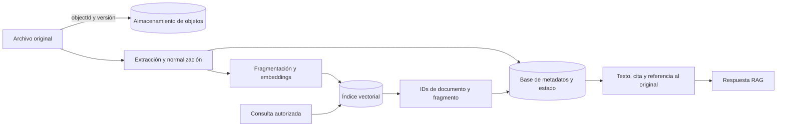

# Capítulo 11. Almacenamiento de documentos

## ¿Por qué importa?

Un sistema RAG conserva varias representaciones de una misma fuente: el archivo original, el texto extraído, los fragmentos usados para la búsqueda, los vectores, los metadatos y, a veces, respuestas en caché o registros de procesamiento. Si el equipo no define dónde vive cada cosa y cuál es la fuente de verdad, una actualización puede dejar resultados viejos, un borrado puede ser incompleto y una cita puede apuntar a un archivo que ya no corresponde.

Pensalo como una biblioteca con depósitos separados. El archivo original es el ejemplar completo; el texto normalizado es una transcripción de trabajo; los fragmentos son fichas del catálogo; los vectores son índices que permiten encontrar fichas por significado. No siempre conviene guardar todo en el mismo sistema. La separación puede reducir costos y facilitar escalado, pero exige un modo de mantener referencias y versiones alineadas.

El problema se vuelve más importante al manejar documentos privados, versiones vigentes e históricas, solicitudes de eliminación o varios clientes. El almacenamiento deja de ser «dónde pongo el vector» y se convierte en un contrato sobre identidad, acceso, integridad, recuperación ante fallos y ciclo de vida. El [capítulo 3](book-es-cap3.md) ya presentó el recorrido de ingesta; aquí se profundiza en qué datos persisten y cómo elegir los almacenes.

## ¿Cómo funciona?

### Las capas de persistencia

Una arquitectura común usa tres capas lógicas. La primera guarda el original y sus versiones, por ejemplo en un almacenamiento de objetos. La segunda conserva registros de negocio, permisos, estado de ingesta y referencias en una base relacional o documental. La tercera mantiene los fragmentos, vectores y campos necesarios para recuperación en un motor vectorial. Estas capas pueden ser productos separados o capacidades del mismo producto.

La separación es lógica, no una obligación de desplegar tres servidores. Un prototipo podría guardar texto y vectores juntos en Qdrant, mientras una aplicación con procesos documentales complejos conserva el archivo original en un almacén de objetos y el estado en PostgreSQL. Las decisiones dependen de consultas, escalabilidad, seguridad, experiencia del equipo y requisitos de retención.



El diagrama muestra una posibilidad: recuperar candidatos, resolver identidad y formar citas con metadatos autorizados. Si el texto del fragmento se guarda directamente en el índice, la segunda consulta puede no ser necesaria. En cualquier diseño, la ruta debe conservar una relación inequívoca entre resultado, versión de fuente y documento mostrado.

### Qué guardar y por qué

El original sirve para auditoría, reextracción, representación descargable o reconstrucción del índice. El texto extraído evita repetir un proceso costoso y permite inspeccionar qué vio el sistema. Los fragmentos permiten búsqueda y citas. Los vectores aceleran búsqueda semántica. Los metadatos conectan esos resultados con propietario, versión, sección, vigencia y permisos.

| Dato | Uso habitual | Riesgo si falta | Consideración de almacenamiento |
|---|---|---|---|
| Archivo original | Auditoría, descarga, reingesta | No poder verificar o reconstruir extracción | Tamaño, cifrado, control de acceso y retención |
| Texto extraído | Inspección y reindexación rápida | No poder explicar la transformación | Puede contener datos sensibles equivalentes al original |
| Fragmento | Contexto del modelo y cita | Tener vector sin contenido recuperable | Duplicación frente a recuperación por referencia |
| Vector | Búsqueda semántica | No poder recuperar por similitud | Modelo, dimensión, métrica y versión deben ser compatibles |
| Metadatos | Filtros, orden, permisos y trazabilidad | Resultado sin contexto ni dueño claro | Validación de esquema y actualización coherente |
| Estado de trabajo | Reintentos y soporte | No saber si está listo o falló | Debe ser durable y transicionar de forma controlada |

No toda aplicación necesita conservar el texto extraído para siempre. Puede recalcularse desde el original, si el parser sigue disponible y el tiempo y costo son aceptables. Tampoco todo payload necesita copiar el documento completo. La decisión debe considerar confidencialidad, volumen, frecuencia de lectura, reconstrucción y exigencias de borrado.

### Identidad, versiones e idempotencia

Conviene distinguir cuatro identificadores. El ID lógico del documento representa «la política de reintegros de la organización A». La versión representa una revisión concreta. La huella o hash identifica bytes o contenido normalizado. El ID del fragmento identifica una pieza indexable de esa versión. Confundirlos hace difícil actualizar documentos iguales con propietarios diferentes o borrar una sola versión histórica.

Un hash puede detectar si el archivo cambió, pero no debería ser la única identidad. Dos organizaciones pueden cargar el mismo PDF y tener permisos distintos; un mismo contenido puede aparecer en dos ubicaciones con políticas de retención diferentes. Una clave compuesta como tenant + documentId + versionId delimita la identidad del negocio, mientras un hash ayuda a detectar duplicados o verificar integridad.

La idempotencia permite repetir una operación sin multiplicar efectos. En una red distribuida, puede ocurrir que el índice confirme una escritura y la API pierda la respuesta. Si el cliente vuelve a intentar con IDs aleatorios, se crean duplicados. Si los IDs dependen de documento, versión y posición del fragmento, la repetición puede reemplazar los mismos puntos. El diseño también debe limpiar fragmentos sobrantes cuando una versión nueva tiene menos unidades que la anterior.

Una estrategia segura de actualización puede mantener la versión nueva inactiva hasta que la extracción, indexación y comprobación terminen. Después cambia un puntero de versión activa. Si algo falla, la versión previa continúa disponible; si se publica un error, el equipo puede volver atrás. La estrategia aumenta temporalmente el espacio ocupado, pero reduce el riesgo de dejar lectores ante una mezcla de fragmentos nuevos y viejos.

### Coherencia entre almacenes

Cuando el original está en un servicio, los metadatos en otro y los vectores en un tercero, no existe necesariamente una transacción única que abarque todo. El objeto puede cargarse y fallar el registro de base; la base puede marcar `ready` antes de persistir el último lote vectorial; el borrado puede retirar vectores y fallar antes de eliminar el archivo. El sistema debe asumir fallos parciales.

Un patrón sencillo es mantener un estado durable, por ejemplo `received`, `processing`, `ready`, `failed` y `deleting`. Cada transición se realiza sólo después de confirmar la etapa que representa. Se registran intentos y errores sin almacenar contenido sensible en logs. Un reconciliador periódico puede buscar registros incoherentes: documentos `ready` sin puntos, puntos sin versión conocida, o trabajos atascados en `processing`.

La consistencia eventual puede ser aceptable en ingesta asíncrona: el documento aparece como «procesando» hasta publicarse. No es aceptable devolver silenciosamente una mezcla parcial como si fuera la versión completa. La interfaz y la API deben distinguir «aceptado», «procesando», «listo» y «fallido».

### Borrado y retención

Eliminar un documento puede implicar el archivo, texto extraído, fragmentos, vectores, cachés, resultados guardados, logs y respaldos. El alcance exacto depende de las políticas legales y contractuales aplicables; el diseño técnico debe convertir esas reglas en ubicaciones y acciones concretas. No se debe prometer «borrado total» si existen respaldos inmutables con retención vigente o copias de seguridad que se purgan por ciclo.

Una eliminación puede ser lógica primero —deja de estar disponible para consulta y queda registrada— y física después, según política. Para una solicitud que requiera retiro inmediato del corpus, el filtro de consulta debe excluir la versión desde el inicio, aunque la limpieza física ocurra más tarde. Así se separa la revocación de acceso de la tarea de purgar datos. La confirmación de borrado debe reflejar qué etapas concluyeron y cuáles siguen sujetas a retención.

También hay que invalidar cachés. Una respuesta cacheada puede contener información que ya no es válida aunque el índice se haya actualizado. El [capítulo 9](book-es-cap9.md) explica claves y frescura de caché; el almacenamiento de documentos debe emitir o permitir identificar cambios de versión para invalidación.

### Seguridad: acceso en todas las capas

El control de acceso debe aplicarse al recibir el documento, al guardarlo, al indexarlo y al recuperarlo. La búsqueda semántica no es una barrera de permisos. Si todos los clientes consultan la misma colección, la solicitud debe incluir un filtro fiable asociado a la identidad autenticada; el usuario no debe poder elegir arbitrariamente un `tenantId` en el cuerpo de la petición. La autorización se deriva de credenciales verificadas por el servidor.

Si el índice almacena el texto completo en su payload, un error de filtro expone ese texto directamente. Si sólo guarda IDs, una consulta posterior al almacén de documentos todavía debe filtrar por propietario antes de entregar el contenido. El enfoque de referencia debe proteger todas las rutas: no alcanza con ocultar documentos en la interfaz de React.

Otros controles incluyen cifrado en tránsito y en reposo, credenciales con privilegios mínimos, rotación de secretos, separación de entornos, límite de tamaño y tipo, análisis de archivos, registro de acceso y eliminación de temporales. Un archivo puede contener macros o contenido hostil; el parser debe ejecutarse con límites de recursos y no asumir que la extensión refleja el formato real.

## Opciones de arquitectura

### Relacional con extensión vectorial

PostgreSQL puede almacenar entidades, permisos, versiones y vectores en un mismo sistema usando una extensión como pgvector. Este enfoque reduce el número de servicios y permite relacionar resultados de búsqueda con tablas de negocio mediante consultas conocidas. Es atractivo cuando ya existe experiencia con PostgreSQL y el volumen/latencia medidos encajan en su configuración.

La cercanía de datos no elimina la operación: hay que dimensionar índices, memoria, disco, réplicas, backups y mantenimiento. El rendimiento y las capacidades dependen de versiones, tipo de índice, métrica y patrones de carga. Antes de decidir, se debe probar en el conjunto real y revisar la documentación oficial de la versión. Un motor relacional generalista puede ser preferible por simplicidad; una base vectorial especializada puede encajar mejor cuando la búsqueda domina y escala de manera independiente.

### Base documental más motor vectorial

Una base documental puede representar metadatos flexibles y estados de proceso; Qdrant u otro motor puede indexar vectores y payloads de recuperación. La flexibilidad resulta útil cuando las fuentes tienen esquemas heterogéneos. El costo es operar dos sistemas, sincronizar IDs, manejar fallos parciales y definir cuál contiene la verdad para cada atributo.

Esta arquitectura debe decidir si la base vectorial almacena el texto o sólo una referencia. Texto en el payload reduce viajes durante la búsqueda, pero duplica contenido y amplía el riesgo de exposición. Sólo referencias disminuyen duplicación, pero añaden una lectura y requieren manejar que el registro haya sido borrado o no esté disponible.

### Almacenamiento de objetos más índice administrado

Un servicio de objetos, como S3, es adecuado para conservar archivos grandes y separarlos de los datos de consulta. El índice vectorial administrado puede escalar como servicio independiente. Esta combinación puede simplificar la administración de infraestructura, pero agrega dependencias, tráfico entre servicios, cargos distintos y contratos de consistencia. También hay que elegir una base de metadatos para identidad, estado y permisos; S3 más un índice vectorial no constituye por sí solo un catálogo de documentos.

El acceso al objeto debería usar identificadores internos y políticas controladas por el servidor, no URL pública permanente. Si se emiten enlaces temporales, deben limitarse a los permisos, vencimiento y acción necesarios. No registres enlaces firmados completos en logs accesibles sin necesidad.

### Comparativa resumida

| Diseño | Ventaja | Desventaja | Buen criterio de elección |
|---|---|---|---|
| PostgreSQL + pgvector | Datos relacionales y vectoriales cercanos; menos sistemas | Hay que validar capacidad de búsqueda y escalar la base completa | El equipo ya opera PostgreSQL y las pruebas cumplen objetivos |
| MongoDB + Qdrant | Esquema flexible y motor vectorial separado | Doble operación y coherencia entre servicios | Los metadatos son variables y se justifica la búsqueda especializada |
| S3 + Pinecone + base de metadatos | Objetos e índice escalan por separado; servicios administrados | Más proveedores, red, costos y puntos de fallo | Se prioriza servicio administrado y hay capacidad operativa para integrar |
| Qdrant con payload para demo | Flujo directo y pocas piezas | No es catálogo completo ni gestor de ciclo de vida | Laboratorio de bajo riesgo y corpus pequeño |

Los nombres son ejemplos de patrones, no recomendaciones comerciales universales. Consultá documentación, licencias, región disponible, contratos y costos actuales antes de elegir. El [capítulo 8](book-es-cap8.md) compara motores vectoriales en más detalle; la decisión de este capítulo abarca además el documento y su ciclo de vida.

## ¿Cómo se implementa?

### Inspeccionar el modelo del prototipo

El backend de acompañamiento recibe texto pegado, lo divide en ventanas por caracteres, calcula embeddings y guarda puntos con `name`, `text`, `position` y `documentId` en el payload de Qdrant. La identidad del documento se calcula con SHA-256 sobre nombre y texto; los IDs de puntos son deterministas a partir de ese digest y posición. Es una forma compacta de demostrar persistencia vectorial.

Ese diseño no guarda un archivo original ni metadatos de tenant, autor, tipo MIME, vigencia o estado durable de ingesta. No hay parser de PDF/DOCX, control de acceso, base de documentos, proceso de borrado ni sincronización de un objeto externo. `name` no constituye una identidad suficiente ni una autorización. El repositorio confirma expresamente que el demo acepta texto pegado y no implementa carga de archivos ni aislamiento multi-tenant en [VALIDATION.md](../VALIDATION.md).

La diferencia entre ejemplo y producto debe permanecer visible. Extenderlo requiere decidir modelo de identidad, almacenamiento, permisos y estados antes de agregar una ruta de carga. La siguiente tabla traduce el objetivo a decisiones de diseño:

| Necesidad | Decisión que debe quedar documentada |
|---|---|
| Citar una página o sección | Metadatos de ubicación preservados por el extractor |
| Reemplazar una política vigente | Identidad lógica y versión activa independiente |
| Reconstruir índice | Original o texto extraído durable y proceso reproducible |
| Borrar a un cliente | Alcance de purga por almacén, índice, caché y backups |
| Reintentar sin duplicar | IDs deterministas e idempotencia de etapas |
| Aislar organizaciones | Tenant autenticado y filtro obligatorio en cada lectura |

### Flujo conceptual de versionado

El ejemplo siguiente expresa el orden de un flujo, no llama a un proveedor ni representa una función existente. Se omiten detalles específicos de SDK y transacciones distribuidas; debe adaptarse a los almacenes seleccionados.

```js
// Pseudocódigo conceptual para publicar una versión sólo cuando está completa.
async function publicarDocumento({ archivo, tenantId, repositorio, extraer, indexar }) {
  const versionId = await repositorio.registrarVersion({ tenantId, estado: "processing" });
  try {
    const original = await repositorio.guardarOriginal({ tenantId, versionId, archivo });
    const texto = await extraer(archivo);
    await repositorio.guardarTexto({ tenantId, versionId, texto, original });
    await indexar({ tenantId, versionId, texto });
    await repositorio.marcarLista({ tenantId, versionId });
    await repositorio.activarVersion({ tenantId, versionId });
    return { versionId, estado: "ready" };
  } catch (error) {
    await repositorio.marcarFallida({ tenantId, versionId, motivo: "processing_error" });
    throw error;
  }
}
```

**Qué hace:** registra el trabajo antes de procesar, conserva el original y texto, indexa y sólo al final activa la versión. **Por qué se utiliza:** reduce ventanas donde un lector observa una mezcla o una versión parcial. **Cómo funciona:** cada operación confirma una etapa y los errores producen un estado recuperable. **Cuándo conviene:** en documentos cuyo reemplazo no debe interrumpir consultas o cuya vigencia debe ser auditable. **Resultado esperado:** una nueva versión activa sólo después de completar el proceso. **Pendiente:** `repositorio` y `indexar` son contratos abstractos; el ejemplo no implementa transacción, rollback, idempotencia, seguridad ni limpieza de una versión fallida.

### Un esquema relacional ilustrativo

Para una aplicación relacional, un modelo inicial podría distinguir documento lógico, versión y trabajo. Este SQL es **conceptual**: no se probó y no incluye extensiones vectoriales ni tipos específicos de proveedor. Sirve para pensar claves y restricciones, no para copiar a producción sin revisión.

```sql
-- Esquema conceptual: IDs y estados deben adaptarse al motor elegido.
CREATE TABLE documents (
  tenant_id TEXT NOT NULL,
  document_id TEXT NOT NULL,
  active_version_id TEXT,
  created_at TIMESTAMP NOT NULL,
  PRIMARY KEY (tenant_id, document_id)
);

CREATE TABLE document_versions (
  tenant_id TEXT NOT NULL,
  document_id TEXT NOT NULL,
  version_id TEXT NOT NULL,
  source_hash TEXT NOT NULL,
  object_key TEXT,
  status TEXT NOT NULL CHECK (status IN ('processing', 'ready', 'failed', 'deleting')),
  created_at TIMESTAMP NOT NULL,
  PRIMARY KEY (tenant_id, document_id, version_id),
  FOREIGN KEY (tenant_id, document_id) REFERENCES documents (tenant_id, document_id)
);
```

**Qué hace:** separa la identidad lógica de las versiones y vincula cada revisión al documento dentro de un tenant. **Por qué se utiliza:** permite preservar historial sin usar el hash como identidad y facilita estados consultables. **Cómo funciona:** la clave primaria compuesta distingue propietarios; una clave foránea impide versiones huérfanas. **Cuándo conviene:** cuando la aplicación necesita relaciones, consultas de negocio y restricciones consistentes. **Resultado esperado:** modelo básico capaz de representar varias versiones por documento. **Pendiente:** sintaxis exacta, estrategia de migraciones, índice vectorial, protección a nivel de fila, borrado, timestamps y transacciones deben validarse para el motor real.

### Lectura con filtro de tenant

Una solicitud nunca debería aceptar el identificador de cliente como autoridad sin verificarlo. El servidor deriva el tenant de una sesión o token validado y aplica ese valor en la búsqueda, además de cualquier filtro de estado o versión activa. El siguiente pseudocódigo muestra esa frontera; no corresponde a la API incluida y no implementa autenticación.

```js
// Conceptual: tenantId proviene de middleware autenticado, no del cuerpo libre.
async function buscarDocumentos({ identidad, pregunta, indice }) {
  const tenantId = identidad.tenantId;
  if (!tenantId) throw new Error("Identidad sin tenant autorizado");
  return indice.search({
    query: pregunta,
    filter: { tenantId, status: "ready", active: true },
    limit: 8
  });
}
```

**Qué hace:** exige una identidad ya validada y construye los filtros de búsqueda desde el servidor. **Por qué se utiliza:** evita confiar en un campo enviado por el navegador. **Cómo funciona:** todos los resultados se limitan a tenant y versiones listas. **Cuándo conviene:** en cualquier sistema con clientes u organizaciones aisladas. **Resultado esperado:** la búsqueda no incluye documentos fuera del alcance verificado. El fragmento no demuestra aislamiento: el middleware, autorización, filtro de backend y pruebas negativas deben diseñarse y probarse por separado. Nunca envíes datos no autorizados al LLM para descartarlos después.

### Borrado coordinado

Una función de borrado debería primero impedir nuevas lecturas de la versión y marcar la operación, luego solicitar limpieza a cada sistema y registrar resultado. La API no debería contestar «eliminado» antes de conocer qué significa ese estado en la política del producto. Ante un fallo parcial, debe poder reintentar con seguridad.

```text
Conceptual: retirar versión
1. Verificar identidad y permiso de borrado.
2. Marcar versión como deleting y excluirla de consultas nuevas.
3. Invalidar cachés vinculadas a documentId y versionId.
4. Eliminar puntos vectoriales y texto derivado.
5. Eliminar objeto original cuando la política lo permita.
6. Registrar confirmaciones, retenciones de backup y fallos para reintento.
```

**Qué hace:** describe una secuencia que se puede convertir en un trabajo idempotente. **Por qué se utiliza:** evita que un borrado de una sola capa deje contenido servible por otra. **Cómo funciona:** la revocación de lectura precede a la purga física y cada etapa tiene confirmación. **Cuándo conviene:** cuando usuarios pueden retirar fuentes o existen obligaciones de retención. **Resultado esperado:** la versión deja de aparecer en consultas inmediatamente y cada copia tiene un estado de purga verificable. **Pendiente:** esta secuencia es una guía conceptual, no una implementación ejecutable; backups, snapshots y logs requieren políticas propias.

## Errores frecuentes y buenas prácticas

- **Guardar sólo vectores.** Sin texto, metadatos o referencia durable, no se pueden formar citas útiles ni reconstruir el índice.
- **Guardar sólo el original.** La reextracción puede ser lenta, costosa o cambiar al actualizar el parser; conservar el texto procesado puede ser conveniente.
- **Usar nombre de archivo como identidad.** Los nombres se repiten y cambian; definí IDs lógicos y versiones.
- **Usar el hash como identidad universal.** El contenido igual no implica propietario, permisos o retención iguales.
- **Actualizar los puntos en sitio sin publicar estado.** Lectores pueden recibir una combinación de versiones; usá estado y activación explícitos.
- **Olvidar fragmentos sobrantes.** Al reducir un documento, retirá posiciones que pertenecían a la revisión anterior.
- **Borrar sólo el índice.** Revisá archivos, texto, caches, logs y ciclo de vida de respaldos.
- **Aplicar permisos después de recuperar.** La información ya pudo llegar al modelo; filtra antes de construir contexto.
- **Confiar en consistencia eventual sin explicarla.** Mostrá estados y no marques como lista una versión incompleta.
- **Multiplicar almacenes sin una necesidad medida.** Cada servicio suma operación, costo, credenciales y fallos parciales.
- **Poner texto sensible en logs.** Registra IDs y métricas suficientes para depurar, con redacción y retención definidas.

La regla práctica es asignar a cada dato una fuente de verdad, un propietario, una política de acceso y una fecha de retención. Luego diseñar la ingesta y el borrado alrededor de ese mapa. El motor vectorial es una parte importante del almacenamiento, pero no es el sistema completo de documentos.

## Ejercicios prácticos

1. Dibujá dónde guardarías el original, el texto extraído, los fragmentos, vectores y estado. Marcá cuál es la fuente de verdad para cada campo.
2. Diseñá IDs para dos organizaciones que cargan el mismo archivo con nombres distintos. Explicá qué identifica el hash y qué identifica el documento.
3. Simulá una actualización que falla luego de guardar el 60 % de los vectores. Definí qué ve la consulta y cómo se reintenta.
4. Prepará un inventario de todas las copias que deben considerarse durante el borrado, incluyendo caché y backups.
5. Compará PostgreSQL + pgvector con una base relacional/documental más un motor vectorial usando volumen, filtros, capacidad del equipo y objetivos de latencia propios.
6. Escribí una prueba negativa que intente consultar un documento de otro tenant modificando el cuerpo HTTP. Indicá dónde debe rechazarse.

## Referencias y continuidad

- [Capítulo 3: arquitectura de ingesta y consulta](book-es-cap3.md), para contratos, estados e idempotencia.
- [Capítulo 8: bases de datos vectoriales](book-es-cap8.md), para búsqueda, índices y compatibilidad de vectores.
- [Capítulo 9: estrategias de caché](book-es-cap9.md), para frescura e invalidación.
- PostgreSQL, [documentación oficial de pgvector](https://github.com/pgvector/pgvector), para tipos vectoriales, índices y consultas; revisar versión y capacidades al implementar.
- Qdrant, [documentación oficial](https://qdrant.tech/documentation/), para colecciones, puntos, payloads y filtros.
- Amazon Web Services, [documentación de Amazon S3](https://docs.aws.amazon.com/AmazonS3/latest/userguide/Welcome.html), para conceptos y operación del almacenamiento de objetos; región, retención y controles dependen de configuración.
- Pinecone, [precios](https://www.pinecone.io/pricing/); tarifas, disponibilidad y producto deben verificarse en el momento de la decisión.
- [Código de referencia](../backend/src/core.js) y [validación del repositorio](../VALIDATION.md): el ejemplo guarda texto y puntos en Qdrant; no implementa almacenamiento de archivos, carga de PDF/DOCX ni aislamiento multi-tenant.
- Seguí con [del MVP a producción](book-es-cap12.md), donde se organizan controles y procesos operativos.

**Estado de los ejemplos:** los fragmentos JavaScript y SQL son conceptuales y no fueron ejecutados. Se inspeccionó el almacenamiento de puntos del backend; el repositorio documenta que no existe parser de archivos ni almacén de originales. No se validaron integraciones con PostgreSQL, pgvector, S3, Pinecone o MongoDB como parte de esta tarea.
