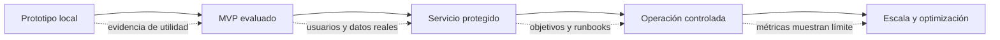

# Capítulo 12. Del MVP a producción

## ¿Por qué importa?

Un MVP demuestra que un recorrido es posible: alguien aporta texto, el sistema lo indexa y una pregunta produce una respuesta con fuentes. Producción significa que ese recorrido sigue siendo correcto, seguro y recuperable cuando hay usuarios reales, datos privados, cambios, fallos y carga. Son objetivos distintos. Un prototipo puede ser valioso sin ser seguro para uso público; llamarlo «producción» antes de resolver sus riesgos convierte a los usuarios en parte de una prueba que no aceptaron.

La transición no se logra añadiendo Kubernetes o cambiando una base por un servicio administrado. Se logra identificando riesgos concretos y construyendo controles verificables: quién puede leer cada documento, cómo se actualiza una fuente, cómo se detecta una respuesta sin evidencia, qué ocurre si el proveedor falla, cómo se restauran los datos y quién recibe una alerta. La arquitectura elegida debe responder a esos requisitos y al tamaño del producto.

Pensá en un MVP como un prototipo de puente sobre una mesa: alcanza para comprobar que las piezas encajan. Un puente real necesita soportar cargas, viento, corrosión, inspección y mantenimiento. En software, los «factores ambientales» son picos de demanda, incidentes, ataques, rotación de credenciales, documentos defectuosos y cambios de modelos. La forma de probarlos y las decisiones deben quedar registradas.

Este capítulo ofrece una ruta incremental, no una receta que obligue a toda aplicación a usar la misma infraestructura. La elección entre modelo local y remoto se trató en el [capítulo 10](book-es-cap10.md); identidad y persistencia documental, en el [capítulo 11](book-es-cap11.md). El [capítulo 13](book-es-cap13.md) continúa con arquitecturas según escala y el [capítulo 14](book-es-cap14.md) con opciones de despliegue cloud.

## ¿Cómo funciona?

### La producción es un conjunto de propiedades

Una aplicación está lista para su contexto cuando satisface propiedades acordadas con evidencia suficiente. «Alta disponibilidad» sin objetivo medible no permite elegir diseño. «Seguro» sin modelo de amenazas no identifica controles. «Rápido» sin una latencia objetivo no indica si una decisión mejoró el producto. Antes de invertir en infraestructura, definí qué servicio se entrega y cómo se reconocerá un incumplimiento.

| Propiedad | Pregunta concreta | Evidencia de avance |
|---|---|---|
| Calidad | ¿Las respuestas están apoyadas por fuentes y se abstienen cuando corresponde? | Evaluación etiquetada y pruebas de regresión |
| Seguridad | ¿Cada usuario sólo puede recuperar datos autorizados? | Pruebas negativas y revisión de permisos |
| Rendimiento | ¿La ruta completa cumple objetivos bajo carga? | p50/p95 y pruebas representativas |
| Disponibilidad | ¿Qué degradación se acepta cuando falla un proveedor? | SLO y ejercicios de fallo |
| Integridad | ¿Las actualizaciones no dejan documentos parcialmente publicados? | Estados, reconciliación e idempotencia |
| Recuperabilidad | ¿Se puede restaurar lo necesario dentro de objetivos? | Prueba de restauración documentada |
| Operabilidad | ¿El equipo detecta y resuelve incidentes? | Alertas, runbooks y responsables |
| Economía | ¿El costo por uso aceptable cabe en el modelo de producto? | Presupuesto y medición periódica |

Los objetivos de nivel de servicio (SLO) describen metas internas para una propiedad, como proporción de consultas exitosas o latencia dentro de un umbral. Un acuerdo contractual (SLA) es un compromiso distinto, sujeto al proveedor y al contrato. No se debe presentar una meta interna como garantía contractual. Las métricas se desarrollan en el [capítulo 18](book-es-cap18.md).

### Evolucionar por etapas

Una ruta útil divide la madurez en etapas con salidas demostrables. No todas las aplicaciones necesitan alcanzar todos los niveles, pero cada salto debe justificarse por uso real o riesgo, no por moda.



**Prototipo local:** comprueba que se puede recorrer el flujo con un corpus pequeño y controlado. **MVP evaluado:** define consultas representativas, fuentes correctas y fallos aceptables. **Servicio protegido:** añade autenticación, autorización, límites, gestión de secretos y protección del dato. **Operación controlada:** incorpora observabilidad, backups probados, respuesta a incidentes y cambio de modelos. **Escala y optimización:** separa componentes, colas o capacidad cuando mediciones muestran un cuello de botella.

Este orden no es rígido. Una aplicación que maneja información sensible desde el inicio requiere seguridad antes de permitir usuarios externos. Una herramienta interna de corpus público podría necesitar menos controles de privacidad, aunque aún necesita fiabilidad y límites de abuso. La etapa se define por el riesgo y el público, no por el nombre de la versión.

### El límite entre MVP y plataforma

El demo de este repositorio tiene frontend, API Express, Ollama, Qdrant y Docker Compose. La API acepta texto pegado, consulta e indexa; el README describe comandos reproducibles. Sin embargo, el propio `VALIDATION.md` identifica funciones ausentes: autenticación, autorización documental, aislamiento multi-tenant, carga de archivos, cola de ingesta, límites de tasa aplicados, integración end-to-end de Docker y despliegue cloud completo. El ejemplo Kind despliega sólo la API, no Qdrant ni Ollama.

Por esa razón, que el endpoint `/health` devuelva `ok` sólo confirma una parte del proceso; no demuestra que el almacenamiento esté listo, que la búsqueda recupere evidencia, ni que usuarios estén aislados. Que una respuesta parezca correcta tampoco demuestra que las fuentes no autorizadas estén protegidas. Las afirmaciones de madurez deben basarse en pruebas de rutas reales y límites documentados.

### Confiabilidad: controlar fallos y reintentos

Una petición atraviesa frontend, API, proveedor de embeddings, índice y modelo generativo. Cada dependencia puede fallar por causas temporales o permanentes. Una conexión interrumpida, un timeout, una cuota agotada y una configuración inválida no deben tratarse igual. Los timeouts acotan la espera; el número de reintentos debe tener límite; la espera incremental ayuda a evitar que todos los clientes vuelvan a intentar al mismo tiempo.

Los reintentos pueden generar duplicados si el servidor completó la operación pero la respuesta se perdió. La ingesta requiere claves idempotentes; las consultas pueden volver a ejecutarse, aunque pueden consumir costo adicional. El equipo debe definir qué errores se reintentan, cuántas veces, con qué espera y cómo se presenta el fallo. Una política ilimitada puede atascar colas y multiplicar consumo; ninguna política puede convertir un error permanente en éxito.

El *circuit breaker* es un patrón que deja de invocar temporalmente una dependencia cuando observa fallos repetidos, da tiempo a su recuperación y luego prueba de nuevo. Es útil si llamadas reiteradas empeoran un incidente, pero agrega estado y configuración. Para un servicio de baja carga, un timeout más un manejo claro de error puede ser suficiente. Elegí patrones operativos según datos observados.

### Ingesta desacoplada y estados observables

Una solicitud HTTP síncrona puede funcionar para texto breve. Cuando la extracción, el embedding o el índice demoran, el navegador puede desconectarse antes de que finalice el trabajo. Una cola permite aceptar el documento, responder con un identificador y procesarlo en segundo plano. El usuario consulta el estado de ese trabajo y puede corregir errores sin mantener una conexión larga abierta.

La cola no elimina fallos: los vuelve administrables. El mensaje puede procesarse más de una vez, así que el worker debe ser idempotente. Se necesita política de reintento, plazo máximo, manejo de mensajes que fallan repetidamente y supervisión del backlog. La cola también introduce consistencia eventual: el documento no está disponible para consulta hasta que se publica como listo. Para el recorrido de ingesta y estados, consultá el [capítulo 3](book-es-cap3.md).

### Seguridad y separación de clientes

La identidad del usuario debe verificarse antes de aceptar ingestiones o búsquedas. La autorización define a qué documentos puede acceder y debe aplicarse en el backend, en cada consulta al índice o al almacén. El navegador puede solicitar un documento; no decide qué tenant tiene. Un campo `tenantId` que llega en JSON no es una credencial.

Un test de aislamiento tiene que intentar acceder a datos de otro cliente, no sólo comprobar el camino feliz del usuario correcto. También se prueba el borrado, los filtros, las rutas administrativas, las cachés y las exportaciones. Si el mismo prompt incluye evidencia de varios tenants, el error ya ocurrió antes de que el modelo redactara. El RAG no crea una frontera de seguridad por sí mismo.

Los documentos también pueden ser hostiles o contener datos que parecen instrucciones. Tratá fuentes como entrada no confiable y limitá qué puede hacer el modelo. No conectes herramientas que ejecuten acciones sin autorización y validación del servidor. Los secretos pertenecen al backend o al sistema de despliegue, nunca a React. Los registros deben evitar cuerpos de solicitudes sensibles salvo necesidad documentada, acceso restringido y retención apropiada.

### Backups y recuperación real

Tener un snapshot programado no demuestra que sea posible restaurar el servicio. Una copia puede estar incompleta, contener datos incompatibles con una nueva versión o no incluir configuraciones esenciales. La prueba significativa crea un entorno aislado, restaura los datos, valida integridad y mide cuánto tarda. También verifica que la aplicación pueda reconstruir vectores desde originales si el índice se pierde.

Definí RPO (punto objetivo de recuperación: cuánto dato se puede perder) y RTO (tiempo objetivo de recuperación: cuánto puede tardar volver a operar). Son objetivos del negocio y deben ser realistas según arquitectura y costo. Si el índice se reconstruye a partir de originales, su RPO puede ser distinto al del catálogo de permisos. Las copias deben protegerse con controles de acceso y políticas de retención propias.

### Cambios de modelos e índices

Cambiar un modelo generativo puede alterar estilo, latencia, formato y calidad. Cambiar el modelo de embeddings altera el espacio vectorial y requiere reindexar; los dos cambios no tienen el mismo impacto. Antes de publicar una nueva versión, fijá configuración, ejecutá evaluación de regresión, compará latencia y costo, y definí cómo revertir.

Una migración de índice puede construirse en paralelo: indexar la colección nueva, verificar dimensiones y resultados, dirigir una fracción controlada de consultas o ejecutar comparaciones sin exponer ambas respuestas, y cambiar el destino cuando la evidencia alcance el criterio de aprobación. Mantener temporalmente la versión anterior facilita rollback, pero usa espacio. Esta estrategia se relaciona con las versiones y colecciones del [capítulo 8](book-es-cap8.md).

## ¿Cómo se implementa?

### Crear una lista de preparación revisable

Un checklist sirve cuando cada casilla tiene evidencia y responsable. «Configurar seguridad» no es una evidencia; «el usuario A recibe cero resultados al consultar el ID del documento de B, y la prueba falla si se quita el filtro obligatorio» sí describe algo comprobable. El checklist inicial puede ser:

| Área | Pregunta de salida | Ejemplo de artefacto |
|---|---|---|
| Producto | ¿Qué tareas responde y cuándo debe abstenerse? | Conjunto de evaluación y comportamiento esperado |
| Datos | ¿Quién es dueño, qué se conserva y qué se elimina? | Inventario, política y diagrama de datos |
| Identidad | ¿Cómo autentica y autoriza cada ruta? | Reglas y pruebas negativas |
| Calidad | ¿Qué mide una respuesta fundamentada? | Evaluación versionada y umbral acordado |
| Disponibilidad | ¿Cómo se comporta cada dependencia caída? | Matriz de fallos y respuesta de API |
| Operación | ¿Cómo detecta y atiende el equipo un incidente? | Dashboard, alerta y runbook |
| Recuperación | ¿Cuándo se probó una restauración completa? | Evidencia, RPO/RTO observados |
| Costos | ¿Cuál es el gasto esperado y qué activa una revisión? | Estimación y límites de consumo |

No se necesita un formulario enorme para un proyecto pequeño. Sí se necesita que las preguntas de mayor riesgo tengan respuesta antes de abrir el servicio al público. Una restricción puede documentarse como decisión pendiente y bloquear el uso de datos reales.

### Cliente HTTP con timeout y error controlado

El backend de muestra tiene un timeout de red en la función que llama a servicios upstream, pero la aplicación no incluye una estrategia completa de reintentos ni cola. El fragmento siguiente es **conceptual** y sólo muestra cómo acotar una llamada desde un handler y devolver un error estable sin revelar detalles internos.

```js
// Conceptual: el servicio llamado debe propagar AbortSignal al cliente HTTP.
async function llamarServicioConLimite(operacion, timeoutMs = 8000) {
  const controller = new AbortController();
  const timer = setTimeout(() => controller.abort(), timeoutMs);
  try {
    return await operacion({ signal: controller.signal });
  } finally {
    clearTimeout(timer);
  }
}

app.post("/api/query", async (req, res) => {
  try {
    const result = await llamarServicioConLimite(({ signal }) =>
      ragQuery(req.body.question, { signal })
    );
    res.json(result);
  } catch {
    res.status(503).json({ error: "Servicio temporalmente no disponible" });
  }
});
```

**Qué hace:** acota una operación y devuelve un error público genérico si falla. **Por qué se usa:** impide que una solicitud quede esperando indefinidamente y evita mostrar internals al cliente. **Cómo funciona:** `AbortController` cancela si el adaptador propaga la señal; `finally` limpia el temporizador. **Cuándo conviene:** al llamar dependencias de red con objetivos de latencia definidos. **Resultado esperado:** el handler responde con resultado o error controlado dentro del límite previsto. **Pendiente:** `ragQuery` debe aceptar y propagar `signal`; decidir código de error, reintentos, logging, métricas y límites requiere implementación y pruebas. Un timeout en la capa externa no cancela trabajo si el cliente subyacente ignora la señal.

### Aceptar ingesta y entregar trabajo

Un patrón con cola evita procesar archivos grandes dentro de la petición HTTP. El siguiente ejemplo es **conceptual**: `jobQueue` representa un sistema que el repositorio no incluye y `documentStore` un almacenamiento durable.

```js
// Conceptual: el documento se registra antes de confirmar que el trabajo fue aceptado.
app.post("/api/ingest-jobs", requireUser, async (req, res, next) => {
  try {
    const { name, text } = req.body ?? {};
    if (typeof name !== "string" || typeof text !== "string" || !text.trim()) {
      return res.status(400).json({ error: "Documento inválido" });
    }
    const job = await documentStore.createJob({
      tenantId: req.user.tenantId,
      name,
      text,
      status: "queued"
    });
    await jobQueue.enqueue({ jobId: job.id, tenantId: req.user.tenantId });
    return res.status(202).json({ jobId: job.id, status: "queued" });
  } catch (error) {
    return next(error);
  }
});
```

**Qué hace:** valida una entrada, la registra asociada a la identidad autenticada y encola trabajo, respondiendo HTTP 202. **Por qué se usa:** el cliente recibe una confirmación rápida mientras el procesamiento puede demorar. **Cómo funciona:** un worker consulta el ID, procesa y actualiza el estado. **Cuándo conviene:** cuando hay picos, archivos grandes o etapas externas lentas. **Resultado esperado:** un `jobId` consultable en vez de una espera hasta que el vector se escriba. **Pendiente:** transacción entre registro y cola, límite de tamaño, idempotencia, autorización, almacenamiento del documento y comportamiento ante fallo de `enqueue` requieren diseño. Sin un patrón de outbox u otra coordinación, puede guardarse el trabajo y perderse el mensaje.

### Worker idempotente y estado

Un worker podría ser interrumpido después de escribir vectores pero antes de marcar el trabajo como listo. Al retomarlo, debe poder detectar que repite la misma versión y sobrescribir los mismos puntos. También debe evitar que dos trabajos concurrentes publiquen revisiones en orden incorrecto. La clave idempotente, el estado y la operación de activación deben diseñarse juntos.

Un estado básico podría progresar `queued → processing → ready` o `queued → processing → failed`. Un reintento temporal puede volver a `queued` con un contador; un documento inválido no debería reintentarse indefinidamente. Una cola de mensajes fallidos separa trabajos que requieren análisis. Las métricas deben mostrar antigüedad y tamaño del backlog, no sólo cantidad de procesos activos.

El procesamiento también necesita límites de memoria y tamaño por etapa. Extraer un archivo enorme o generar millones de fragmentos puede afectar a otros trabajos. Limitar páginas, bytes, duración, concurrencia y lotes convierte recursos compartidos en presupuestos explícitos. Los valores se calibran con muestras reales y se revisan según el hardware y servicio seleccionado.

### Despliegue reproducible y secretos

El artefacto de aplicación debe construirse de forma reproducible y promoverse entre ambientes con configuración separada. No compiles una imagen distinta para cada ambiente si lo que cambia es sólo la configuración; fijá versiones razonables, escaneá dependencias según el proceso del equipo y registrá el identificador de imagen. Los secretos se inyectan al ejecutar, no se copian a Git ni a una imagen.

Docker Compose es útil para desarrollo local; Kubernetes o una plataforma administrada pueden ser apropiados cuando se necesitan funciones de orquestación concretas. Ninguno corrige un diseño de permisos ni crea automáticamente backups. Antes de desplegar, enumerá servicios externos, almacenamiento persistente, red, secretos, health checks, escalado y rollback. El ejemplo Kind del repositorio sólo despliega API; no debe tomarse como clúster RAG completo. El [capítulo 14](book-es-cap14.md) expande esta parte.

### Observabilidad por etapas

Una consulta tiene pasos distinguibles: validar usuario y entrada, crear embedding, buscar, filtrar, generar y devolver. Registrar duración y resultado por etapa permite separar «el modelo está lento» de «la búsqueda agotó tiempo». Un identificador de solicitud conecta registros sin depender de guardar la pregunta o el documento. Para diagnóstico, se puede registrar número de candidatos, tamaño aproximado del contexto, modelo elegido, código de error y latencia.

Las métricas útiles incluyen tasa de error por dependencia, latencia total y por etapa, tokens o consumo reportado, consultas sin evidencia, errores de formato, documentos listos/atascados, backlog y costo agregado. Las métricas de calidad normalmente requieren muestrear o evaluar contenido con controles de privacidad. Evitá etiquetas de alta cardinalidad como texto completo o IDs de usuario si disparan costos o revelan datos.

Una alerta debe implicar una acción. Si el p95 se eleva, el runbook indica qué panel revisar, qué límites verificar y cuándo escalar. Si el backlog crece, el equipo mira tasa de llegada frente a capacidad de workers. Alertar por cada error transitorio produce fatiga; acordá umbrales, ventanas y severidad.

### Lanzamiento gradual y rollback

Un despliegue progresivo libera una versión primero a un conjunto acotado, o enruta una fracción del tráfico, y observa errores, latencia y calidad. La proporción gradual reduce el alcance de un defecto, pero exige poder identificar qué versión atendió cada solicitud y volver a la anterior. En sistemas pequeños, una ventana de lanzamiento con revisión manual puede ser suficiente.

El rollback también necesita pensar en datos. Revertir el contenedor no revierte necesariamente una migración de esquema o un índice nuevo. Los cambios deben ser compatibles hacia atrás durante la transición, o tener una ruta de restauración. Una estrategia de expansión y contracción agrega primero campos compatibles, migra datos y retira lo anterior sólo después. Para índices RAG, conservar la colección previa hasta validar la nueva puede funcionar como punto de retorno.

## Decisiones de escalado

### Escalar por medición, no por volumen abstracto

«Tenemos muchos documentos» no revela qué componente limita el sistema. El problema puede ser extracción serial, proveedor de embeddings, índice, generación, red o consulta de permisos. Medí tasas y latencias para identificar capacidad. El costo de una cola puede no justificarse en unas pocas ingestiones diarias; un proveedor remoto puede no ser conveniente si se requiere operación sin red.

Las métricas del capítulo 18 ayudan a encontrar cuellos de botella; el [capítulo 13](book-es-cap13.md) estudia patrones según escala y el [capítulo 19](book-es-cap19.md) optimización avanzada. La secuencia sana es reproducir un problema, medir una línea base, cambiar una variable, volver a medir y verificar que calidad no empeoró.

### Monolito modular o servicios separados

Un monolito modular puede tener rutas de API, lógica de dominio y adaptadores separados en un proceso desplegable. Reduce coordinación y fallos de red entre componentes. Separar workers permite escalar ingesta sin escalar la consulta. Separar microservicios permite desplegar o escalar etapas de forma independiente, pero añade red, observabilidad distribuida, contratos, autenticación entre servicios y gestión de versiones.

No separe servicios sólo porque el diagrama tenga cajas distintas. Separalos cuando haya necesidades distintas de escalado, disponibilidad, equipo o seguridad que justifiquen la frontera. Mantener interfaces internas limpias facilita esa evolución posterior. Una aplicación bien modularizada puede comenzar con pocas unidades y separarse sin reescribir el dominio.

### Matriz de riesgos antes de abrir usuarios

| Riesgo | Impacto potencial | Control inicial | Prueba que aporta evidencia |
|---|---|---|---|
| Recuperación entre tenants | Divulgación de documentos | Identidad validada y filtro de permisos en servidor | Intento cruzado con dos usuarios y corpus centinela |
| Respuesta sin sustento | Decisión incorrecta | Umbral y abstención, citas trazables | Preguntas sin respuesta y revisión de citas |
| Ingesta duplicada | Resultados repetidos o costo | Claves idempotentes | Repetir misma solicitud y comparar IDs |
| Proveedor caído | Consultas bloqueadas | Timeout, límite y error degradado | Desconectar dependencia en entorno de prueba |
| Borrado parcial | Datos que siguen apareciendo | Estado de eliminación y reconciliación | Borrar y buscar en cada capa |
| Pérdida del índice | Interrupción o reingesta lenta | Backup o reconstrucción desde originales | Restauración cronometrada |
| Consumo abusivo | Degradación y gasto | Autenticación, límites y cuotas | Prueba de ráfaga y revisión de límites |

La tabla no sustituye un análisis de amenazas; ayuda a hacer visible la relación entre riesgo, control y evidencia. El riesgo aceptado debe tener dueño y fecha de revisión. Para una aplicación sensible, conviene contar con revisión de seguridad, privacidad y legales acorde a la organización.

## Errores frecuentes y recomendaciones

- **Confundir «funciona en mi máquina» con disponibilidad.** Probá dependencias, permisos, fallos y carga bajo un entorno definido.
- **Publicar una demo sin autenticación.** Una URL accesible hace que un flujo educativo pueda convertirse en una exposición pública.
- **Confiar en health check superficial.** Separá liveness (proceso vivo) de readiness (puede recibir tráfico con dependencias necesarias).
- **Adoptar Kubernetes antes de tener una necesidad.** Orquestación añade operación; no reemplaza arquitectura, seguridad ni runbooks.
- **Escalar sólo el backend.** Modelos y bases pueden ser el cuello de botella; mide toda la ruta.
- **Reintentar todo.** Diferenciá cuota temporal, indisponibilidad, autenticación y entrada inválida.
- **Aceptar éxito parcial como completo.** Estados `processing` y `ready` deben tener significado claro.
- **No probar restauración.** Un backup no restaurado es una hipótesis, no evidencia.
- **Cambiar el modelo y el prompt a la vez.** Aísla variables y conserva una línea base de calidad.
- **Registrar prompts completos por comodidad.** Minimiza contenido y protege los registros como datos sensibles.
- **Mantener dependencias sin responsable.** Asigná propiedad y revisiones de versiones, licencias y seguridad.
- **Confundir disponibilidad del proveedor con la del producto.** El sistema depende de red, aplicación, índice, datos y contratos propios.

## Ejercicios prácticos

1. Definí un SLO de latencia y uno de éxito para una aplicación interna. Especificá cómo medirlos y cuál es su ventana.
2. Armá una matriz de errores para embedding, búsqueda y generación: timeout, 429, autenticación inválida, respuesta mal formada. Decidí qué se reintenta.
3. Diseñá una prueba negativa de aislamiento con dos tenants, dos documentos y una consulta deliberadamente cruzada.
4. Escribí el procedimiento para restaurar un documento y reconstruir su índice; estimá qué falta para conocer RPO y RTO.
5. Simulá una ingesta que falla luego de indexar un lote. Explicá cómo reintentar sin duplicar y cómo queda visible el estado.
6. Compará desplegar API y worker juntos con desplegarlos por separado. Usá una carga estimada y un límite operativo para justificar.
7. Revisá `VALIDATION.md` y clasificá cada limitación como requisito para tu producto, riesgo aceptado o fuera de alcance. Agregá evidencia que necesitarías para cerrar las primeras.

## Referencias y continuidad

- [README del repositorio](../README.md), para el inicio local, contratos HTTP y límites de seguridad del demo.
- [VALIDATION.md](../VALIDATION.md), para distinguir lo verificado de las integraciones pendientes.
- [Capítulo 3](book-es-cap3.md), para flujos, idempotencia y límites entre etapas.
- [Capítulo 10](book-es-cap10.md), para selección de modelo local/remoto y costos.
- [Capítulo 11](book-es-cap11.md), para versiones, almacenamiento, permisos y borrado.
- [Capítulo 13](book-es-cap13.md), para patrones de arquitectura según carga.
- [Capítulo 14](book-es-cap14.md), para despliegue cloud; [capítulo 18](book-es-cap18.md), para métricas y alertas.
- Google Cloud, [guía sobre SRE y objetivos de nivel de servicio](https://sre.google/sre-book/service-level-objectives/), para distinguir objetivos medibles de impresiones generales.
- Kubernetes, [configuración de probes de liveness, readiness y startup](https://kubernetes.io/docs/concepts/configuration/liveness-readiness-startup-probes/), para verificar semántica de salud en un despliegue Kubernetes.
- AWS, [documentación de Amazon EKS](https://docs.aws.amazon.com/eks/latest/userguide/), como referencia del servicio citado en el repositorio; el ejemplo de Kind no aprovisiona EKS.

**Estado de los ejemplos:** los fragmentos de API y cola son conceptuales y no fueron ejecutados; el repositorio no incluye cola ni autenticación. Se inspeccionaron el backend Express, Compose y manifiestos de Kind, pero el README y `VALIDATION.md` advierten que la integración end-to-end y el despliegue cloud completo están pendientes. Este capítulo describe capacidades necesarias y criterios de implementación, no certifica que el demo sea apto para producción.
