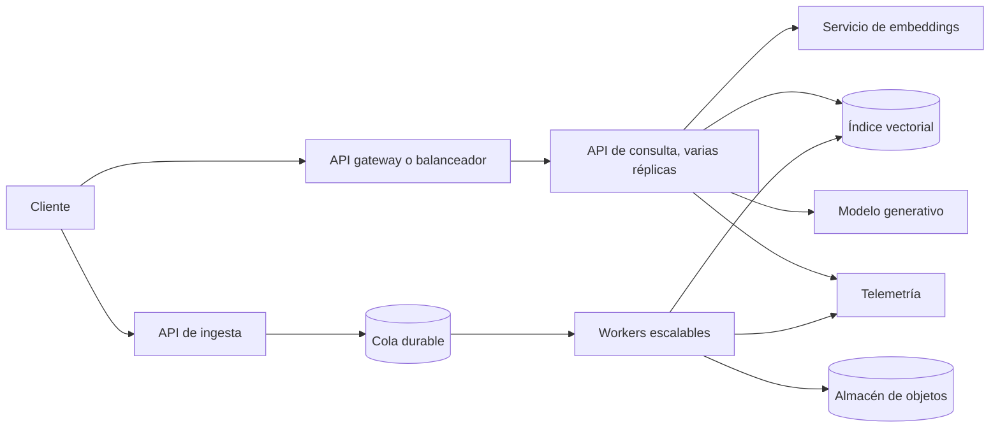

# Capítulo 13. Arquitecturas según la escala

## ¿Por qué importa?

Una arquitectura RAG no se elige contando usuarios registrados. Se elige entendiendo cuánto trabajo produce cada usuario, qué parte de ese trabajo ocurre al mismo tiempo y qué compromisos de latencia, disponibilidad, privacidad y costo acepta el producto. Diez mil usuarios que hacen una pregunta semanal pueden generar menos carga que cien analistas que lanzan búsquedas simultáneas sobre documentos extensos. La cifra de usuarios es contexto; las tasas de llegada, el tamaño de los documentos y el patrón de uso son los datos que dimensionan el sistema.

La escala importa porque cada componente tiene límites distintos. El servidor HTTP puede atender consultas mientras la base vectorial se satura; el modelo puede imponer cuotas aunque sobren CPU y memoria; la ingesta puede consumir ancho de banda y competir con las consultas; y una base de datos puede mantener un buen promedio mientras la cola de solicitudes empuja la latencia p95 a valores inaceptables. Añadir instancias a ciegas no corrige el cuello de botella: incluso puede amplificarlo, por ejemplo, si cada réplica abre demasiadas conexiones al mismo servicio.

En el capítulo 12 se describieron las capacidades que convierten un MVP en un servicio operable: autenticación, persistencia, límites, respaldo y recuperación. Este capítulo responde una pregunta distinta: cómo distribuir esas capacidades cuando cambian el volumen y el patrón de carga. La meta no es adoptar la arquitectura más compleja, sino identificar la siguiente restricción real y pagar por resolverla.

Una analogía útil es una biblioteca. Al principio, una persona recibe al visitante, busca el libro y lo entrega. Cuando llegan más personas, separar recepción de búsqueda evita que una tarea lenta bloquee todas las demás. Si crece el catálogo, hacen falta estanterías organizadas y reglas de acceso. Si la biblioteca tiene varias sedes, se necesita coordinar catálogos y circulación. No se construyen sucursales distribuidas antes de saber que la sala única quedó chica.

## ¿Cómo funciona?

### De la pregunta a una carga medible

Una consulta RAG típica pasa por validación, autenticación, generación del embedding de consulta, recuperación de candidatos, quizá reranking, armado del contexto y generación de respuesta. La ingesta recorre otro camino: recepción, extracción, fragmentación, embeddings por fragmento, escritura en almacenamiento y publicación del estado del documento. Son cargas diferentes y conviene medirlas por separado.

La tasa de consultas por segundo (QPS) es la cantidad de consultas que llegan en un segundo. El promedio oculta ráfagas, por eso también interesan el pico sostenido y el pico breve. La latencia p50 indica el tiempo que iguala o supera la mitad de las solicitudes; p95, el que iguala o supera el 95 %. Si el p50 es 1 segundo y el p95 es 12, una fracción importante de personas experimenta esperas largas aunque el promedio parezca razonable. En RAG, conviene medir cada etapa y la duración total.

El throughput de ingesta puede expresarse como documentos o fragmentos por minuto, pero los documentos no son equivalentes: una página corta y un manual de cientos de páginas producen distinto número de fragmentos y llamadas al modelo. Para estimar, se separa el volumen de documentos, su distribución de tamaños, la estrategia de fragmentación y la capacidad del proveedor. La ingesta por lotes permite absorber picos; no elimina el trabajo ni garantiza que los documentos ya estén disponibles para buscar.

La concurrencia es el número de operaciones que permanecen activas a la vez. Una solicitud que espera al modelo externo mantiene recursos y ocupa una plaza lógica aunque use poca CPU. Una regla aproximada para dimensionar conexiones concurrentes es la ley de Little: trabajo simultáneo ≈ tasa de llegada × tiempo de permanencia. Si llegan 20 consultas por segundo y cada una tarda 2 segundos, en promedio hay unas 40 solicitudes activas. Esta cuenta orienta; no reemplaza una prueba con distribución de tráfico real, límites de proveedor y colas.

| Señal | Qué muestra | Riesgo si se ignora | Decisión que puede orientar |
|---|---|---|---|
| QPS pico y ráfagas | Ritmo y forma de llegada | Colas y expiraciones | Réplicas, límites y suavizado |
| p50/p95 por etapa | Dónde se consume el tiempo | Optimizar la etapa equivocada | Caché, proveedor, índice o timeout |
| Errores 429/5xx | Cuotas y fallos externos | Reintentos que agravan la carga | Backoff, cuota o alternativa |
| Fragmentos por consulta | Tamaño del contexto recuperado | Tokens, costo y ruido | Top-k y filtros |
| Tiempo de indexación | Ritmo de disponibilidad | Retraso entre carga y búsqueda | Más workers o lotes menores |
| Costo por tarea | Economía unitaria | Crecimiento sin presupuesto | Modelo, caché y límites |

### Una arquitectura que evoluciona por etapas

En una etapa inicial, una API y una base vectorial pueden ser suficientes. El backend recibe peticiones, llama a embeddings, consulta el índice y genera una respuesta. Con una aplicación pequeña, el menor número de piezas facilita comprender fallos y cambiar el producto. Docker Compose, tal como se presenta en los capítulos prácticos, brinda un entorno reproducible; no proporciona por sí mismo alta disponibilidad ni aislamiento de clientes.

Cuando las tareas de ingesta empiezan a tardar o a competir con las consultas, se introduce una cola y uno o varios workers. La API valida el documento, guarda un registro de trabajo y devuelve un identificador; el worker extrae, divide e indexa. La cola desacopla la recepción del procesamiento y permite controlar concurrencia y reintentos. La consecuencia es que el resultado deja de ser inmediato: se necesita un estado explícito (recibido, procesando, disponible, fallido) y una política para trabajos repetidos.

Cuando una sola API no alcanza, puede ejecutarse en varias réplicas detrás de un balanceador. Para que escalar horizontalmente sea seguro, la sesión no debe depender de memoria local de una réplica, y el estado durable debe residir en almacenamiento externo. También hay que ajustar los pools de conexiones: cuatro réplicas con cien conexiones configuradas cada una pueden abrir cuatrocientas conexiones al vector store. El escalado de cómputo y la capacidad de las dependencias deben diseñarse juntos.

En cargas mayores conviene separar el camino de consulta del camino de ingesta y, en algunos casos, separar servicios por responsabilidad. Esto permite asignar recursos distintos y desplegar cambios con menor impacto, pero añade interfaces, observabilidad y operación. Los microservicios no hacen que el sistema sea automáticamente más rápido ni más confiable; son una herramienta para aislar límites de carga y propiedad de equipos cuando el costo de coordinación está justificado.



El diagrama muestra una separación conceptual, no un manifiesto listo para desplegar. En un sistema real, autenticación y autorización deben preceder a la recuperación; el almacenamiento de objetos y el índice necesitan políticas de acceso, respaldo y ciclo de vida. Una cola necesita visibilidad de trabajos fallidos y una estrategia de reintento que no duplique documentos.

### Escala vertical, horizontal y por partición

Escalar verticalmente significa dar más CPU, memoria o aceleración a una instancia. Es sencillo mientras exista una máquina mayor disponible, y puede ser la respuesta correcta cuando una carga tiene un límite claro y la operación necesita seguir siendo simple. Tiene un techo, puede encarecerse de manera no lineal y no protege por sí solo contra la caída de esa instancia.

Escalar horizontalmente significa ejecutar más instancias. Aumenta capacidad y puede mejorar resiliencia, pero requiere estado externo, balanceo, límites de conexión y despliegues compatibles. En servicios RAG, hay al menos tres escaladores diferentes: API/consulta, workers de ingesta y, si se administra en el propio entorno, inferencia. Escalar una API que espera a un proveedor ya limitado puede aumentar el número de llamadas fallidas sin elevar el throughput útil.

Particionar o distribuir el índice puede ayudar cuando el corpus supera la capacidad de una instancia o requiere aislamiento físico. La partición puede organizarse por cliente, dominio, región o rango de datos. Elegirla implica considerar tanto la recuperación como las operaciones de mantenimiento: una consulta global quizá deba buscar en múltiples particiones; migrar un cliente entre particiones exige preservar consistencia; demasiadas particiones pequeñas multiplican coordinación y costos. Antes de fragmentar un índice, medí si filtros, índices adecuados o una instancia mayor resuelven la necesidad.

La replicación crea copias para lectura o disponibilidad, pero no equivale a un backup. Una eliminación o corrupción lógica puede propagarse a las réplicas. Las copias deben tener una política separada y ensayos de restauración. En un índice RAG, también es posible reconstruir desde documentos fuente y metadatos, pero esa operación consume tiempo y capacidad de embeddings; no debe confundirse reconstruibilidad con recuperación rápida.

### Capacidad y presupuesto como restricciones de diseño

Cada consulta utiliza un presupuesto de latencia. Si el objetivo total fuera, a modo de ejemplo, 4 segundos p95, el equipo debe asignar una parte a autenticación, recuperación, reranking y generación. El presupuesto no obliga a que todas las partes sean iguales. Si la generación consume casi todo, optimizar unos milisegundos del gateway no cambiará la experiencia. Los objetivos concretos deben salir del producto y de mediciones; el ejemplo es conceptual, no un SLA recomendado.

El presupuesto financiero también se calcula por operación: embeddings de consultas, tokens de entrada y salida, almacenamiento, transferencia, cómputo, logging y soporte. Un costo medio por pregunta permite proyectar escenarios, pero hay que considerar solicitudes fallidas, reintentos, uso de herramientas, consultas largas e ingestas iniciales. Establecé límites por usuario o cliente, alertas de gasto y presupuestos de prueba. Una cuota de API es un límite de seguridad económica además de una regla de equidad.

El capítulo 9 presenta caché como optimización. A escala, la caché requiere una definición de clave, vencimiento e invalidación. Cachear la respuesta final puede ser peligroso si la respuesta depende de permisos, versión del documento, fecha o identidad. Como mínimo, la clave debe incluir el ámbito autorizado y la versión del corpus pertinente. Cachear embeddings de consultas suele ser más simple, aunque su utilidad depende de repetición y normalización.

## ¿Cómo se implementa?

### Ruta progresiva de decisión

Antes de agregar infraestructura, construí una línea base con preguntas representativas. Medí p50/p95, errores, costo y calidad de recuperación. Luego aumentá carga de manera controlada y registrá cuándo se incumple el objetivo. El resultado guía la acción: si la ingesta bloquea el servicio, aislá workers; si el modelo devuelve 429, limita o distribuye llamadas según las condiciones del proveedor; si la búsqueda es lenta, revisá filtros e índice; si el contexto es irrelevante, corregí recuperación antes de comprar más CPU.

| Etapa | Patrón habitual | Señal para avanzar | Cambio razonable |
|---|---|---|---|
| Prototipo | Una API, servicios simples | Se necesita persistencia y operación | Separar configuración y estado durable |
| Primer uso real | API replicable, límites y monitoreo | Ingesta interfiere con consulta | Cola y workers independientes |
| Crecimiento | Escalado por componente | Una dependencia limita el throughput | Capacidad dedicada, cuotas y backpressure |
| Plataforma | Equipos, regiones o tenants múltiples | Requisitos de aislamiento y recuperación | Particiones, despliegue regional, gobierno |

No existe un número universal de usuarios que marque estas transiciones. Una aplicación puede continuar con un monolito modular durante años si sus límites se conocen. Otra puede requerir workers desde el primer día por documentos voluminosos o por un proceso de extracción lento.

### Ejemplo conceptual: escalado independiente en Kubernetes

El siguiente fragmento ilustra el principio de escalar una API por CPU. Es conceptual: no reemplaza los manifiestos del repositorio ni garantiza que CPU refleje la saturación de un servicio RAG. El Horizontal Pod Autoscaler necesita métricas disponibles y `resources.requests` definidos. En una aplicación con generación remota, una métrica de concurrencia o cola puede representar mejor la demanda que CPU.

```yaml
apiVersion: autoscaling/v2
kind: HorizontalPodAutoscaler
metadata:
  name: rag-api
spec:
  scaleTargetRef:
    apiVersion: apps/v1
    kind: Deployment
    name: rag-api
  minReplicas: 2
  maxReplicas: 12
  metrics:
    - type: Resource
      resource:
        name: cpu
        target:
          type: Utilization
          averageUtilization: 65
```

**Qué hace:** define un rango de réplicas y una señal de CPU para orientar el autoscalado. **Por qué se usa:** evita fijar manualmente una única cantidad para toda la jornada. **Cómo funciona:** el controlador compara la métrica observada con el objetivo y ajusta el número deseado de Pods. **Cuándo conviene:** cuando la API es replicable, el clúster tiene capacidad y existe una métrica estable. **Resultado esperado:** aumento o reducción de réplicas ante cambios de carga, no garantía de latencia. Deben añadirse límites de recursos, readiness/liveness probes, estrategia de despliegue, presupuesto de interrupciones y pruebas. No validar este YAML como producción sin probar la versión de Kubernetes, métricas y comportamiento de la aplicación.

### Controlar la presión en lugar de acumular trabajo

Una cola absorbe ráfagas, pero si la tasa de entrada supera la tasa de procesamiento durante un período prolongado, la cola crece sin límite. El sistema debe comunicar cuándo acepta trabajo, cuándo está demorado y cuándo rechaza temporalmente nuevas cargas. Backpressure significa transmitir esa presión hacia quien produce trabajo, usando límites, respuestas temporales o cuotas. El cliente puede reintentar con espera exponencial y variación aleatoria; reintentar inmediatamente en todos los clientes genera una nueva ráfaga sincronizada.

Los trabajos deben ser idempotentes: repetir el mismo identificador de operación no debe crear varias copias activas del documento. Un patrón frecuente combina clave de idempotencia, estado persistido y escritura atómica o deduplicación. Los mensajes que fallan reiteradamente deben terminar en una cola de revisión, no circular eternamente. Se debe distinguir un error transitorio (timeout de proveedor) de uno permanente (formato no aceptado).

En consultas, los límites incluyen longitud de pregunta, número máximo de fragmentos, tokens de contexto, duración y concurrencia por identidad. Un timeout del cliente no necesariamente cancela la operación aguas abajo. La cancelación debe propagarse donde el cliente de modelo lo permita; de lo contrario, la solicitud puede seguir consumiendo cuota aunque nadie espere la respuesta.

#### Caso aplicado: biblioteca documental que duplica su uso

Supongamos que una organización pasa de 50 a 500 personas usuarias. Antes de modificar la plataforma, el equipo clasifica la carga: preguntas cortas a políticas, consultas largas a manuales y cargas documentales concentradas al comienzo de cada mes. Las mediciones revelan que la API conserva poco estado, la búsqueda se mantiene rápida y los picos de latencia coinciden con la extracción e indexación de lotes grandes. Comprar una máquina más grande para la API probablemente no atienda la causa.

La respuesta razonable es limitar el tamaño de lote, sacar la ingesta del proceso de consulta y procesar trabajos con concurrencia controlada. Se prueba primero con una muestra representativa: se mide cuánto tarda cada documento, cuántas llamadas de embedding genera, qué sucede si el proveedor limita solicitudes y cuánto tarda la cola en volver a cero tras el pico. Después se fija un límite de aceptación y una señal de atraso. Si los datos cambian, la arquitectura puede ajustarse sin convertir una suposición de capacidad en un contrato rígido.

El ejemplo ilustra un principio: elegir el cambio más pequeño que reduzca la restricción observada. La decisión también considera el costo humano. Una cola administrada puede costar más por unidad que una solución propia, pero ahorrar guardias y mantenimiento. La comparación económica incluye infraestructura, ingeniería, soporte e incidentes, no solo CPU mensual.

### Prácticas de ingeniería para crecer con control

Versioná el pipeline de indexación, el modelo de embeddings y sus dimensiones. Un índice creado con un espacio vectorial no debe mezclarse accidentalmente con vectores incompatibles. Para cambiar de modelo, una migración gradual puede crear un índice paralelo, reingerir una muestra, comparar calidad y latencia y luego cambiar el tráfico. Mantené una forma de volver al índice anterior durante la ventana acordada.

Definí objetivos de servicio con el equipo de producto. Disponibilidad, latencia, frescura de documentos y exactitud de recuperación pueden entrar en tensión. Una actualización de documentos que tarda diez minutos puede ser aceptable para una biblioteca de políticas internas y no para un catálogo de inventario. Una respuesta rápida sin evidencia suficiente tampoco es éxito.

Prepará fallas parciales. Si el reranker no responde, ¿se usa el orden inicial o se falla la consulta? Si el modelo generativo está indisponible, ¿se muestran pasajes recuperados con una explicación? Si un cliente excede su cuota, ¿se limita solo su tráfico? Estas decisiones deben ser deliberadas y observables. Los detalles de métricas, trazas y alertas se desarrollan en el capítulo 18.

## Errores frecuentes

- Usar usuarios registrados como único factor de dimensionamiento.
- Escalar la API aunque la cuota del modelo o la capacidad del vector store sea el cuello de botella.
- Añadir cola sin estados visibles, idempotencia, límite de crecimiento ni proceso para fallos permanentes.
- Confundir réplicas de lectura con copias de respaldo.
- Compartir una tabla o índice entre clientes sin aplicar autorización antes de recuperar candidatos.
- Asumir que una métrica de CPU mide la saturación de una aplicación que espera principalmente respuestas de red.
- Particionar demasiado pronto y crear una carga operativa difícil de revertir.
- Reintentar sin límites, sin espera y sin distinguir fallos transitorios de permanentes.
- Medir solo el promedio y pasar por alto p95, errores o costo por consulta.

## Buenas prácticas

Empezá con un diagrama simple, una hipótesis de carga y un presupuesto de latencia. Conservá una arquitectura modular que permita separar responsabilidades sin obligar a desplegarlas como servicios independientes. Medí consulta e ingesta por separado, identificá dependencias externas y revisá cuotas antes de comprar capacidad. Aumentá una variable por vez en las pruebas de carga.

Automatizá el despliegue y mantené entornos reproducibles. Configurá límites de gasto y alertas antes de abrir acceso a usuarios. Para datos durables, definí respaldo, retención, restauración y borrado. Para cada control de acceso, probá tanto el permiso permitido como el intento denegado. Para cada cambio de embedding, planificá reindexación y reversión.

## Ejercicios

1. Para una aplicación interna con 200 usuarios, estimá escenarios de 2, 10 y 30 consultas simultáneas. Escribí qué dato necesitás medir antes de dimensionar infraestructura.
2. Dibujá por separado el flujo de consulta y el de ingesta. Marcá qué componentes son stateless y cuáles guardan estado durable.
3. Supongamos que el p50 es 2 segundos y el p95 es 14. Diseñá una tabla de métricas por etapa que permita localizar la cola larga.
4. Describí una estrategia de idempotencia y de tratamiento de trabajos fallidos para una cola de ingesta.
5. Elegí una condición concreta que justificaría pasar de una API única a workers independientes. Incluí el costo operativo que aceptarías.
6. Diseñá una migración de embeddings en paralelo con criterios de comparación de calidad, latencia y rollback.

## Referencias y continuidad

- [Capítulo 12: Del MVP a producción](book-es-cap12.md), para capacidades de producción y persistencia.
- [Capítulo 9: Estrategias de caché](book-es-cap9.md), para reutilización e invalidación.
- [Capítulo 18: Observabilidad y monitoreo](book-es-cap18.md), para métricas y trazas por etapa.
- [Capítulo 19: Optimización avanzada](book-es-cap19.md), para recuperación híbrida y reranking.
- [Horizontal Pod Autoscaling, Kubernetes](https://kubernetes.io/docs/tasks/run-application/horizontal-pod-autoscale/).
- [Amazon EKS architecture](https://docs.aws.amazon.com/eks/latest/userguide/eks-architecture.html), referencia del plano de control y las opciones de cómputo administrado.
- [Amazon EKS managed node groups](https://docs.aws.amazon.com/eks/latest/userguide/managed-node-groups.html), ciclo de vida de nodos administrados.
- [Referencias verificadas del repositorio](../REFERENCIAS_VERIFICADAS.md), con fecha de revisión y límites de validación.

**Siguiente:** [Capítulo 14: Despliegue cloud](book-es-cap14.md).
