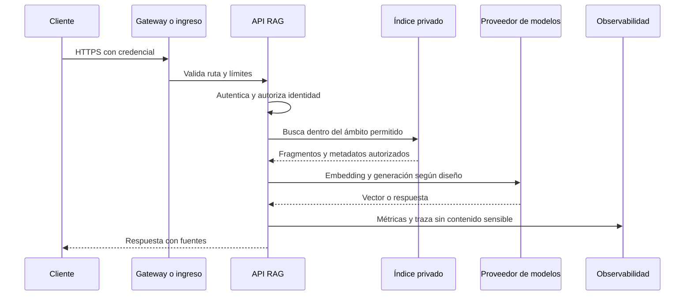

# Capítulo 14. Despliegue cloud

## ¿Por qué importa?

Desplegar un servicio RAG en la nube significa mucho más que subir una imagen de Docker. Hay que decidir dónde se ejecuta cada componente, cómo se conectan, dónde persisten los datos, quién puede acceder, cómo se actualiza la aplicación y qué ocurre cuando falla una dependencia. Una API puede responder correctamente en una laptop y aun así perder documentos al reiniciarse, exponer una base vectorial a Internet o agotar presupuesto al recibir tráfico inesperado.

La nube ofrece servicios con distintos niveles de administración. En un extremo, una plataforma de contenedores ejecuta una aplicación y gestiona buena parte de su capacidad. En otro, un clúster Kubernetes administrado deja al equipo decidir cómo se organizan nodos, redes, controladores y despliegues, aunque el proveedor mantenga parte del plano de control. Más administración puede ofrecer flexibilidad, pero cada opción implica trabajo operativo y una factura formada por componentes distintos.

El objetivo de este capítulo es ayudar a seleccionar un modelo de despliegue, no recomendar una marca universal. El capítulo 13 explica cómo la carga determina la arquitectura; aquí seguimos esa arquitectura hasta una plataforma cloud. El capítulo 12 cubre requisitos de producción y el capítulo 15 abordará gobierno y seguridad empresarial. Los ejemplos de infraestructura son conceptuales y no constituyen una receta de producción validada.

Pensá en alquilar un espacio para un negocio. Una oficina compartida resuelve rápido el acceso a salas, limpieza y recepción, pero limita algunas modificaciones. Un edificio propio da control y también obliga a mantener ascensores, seguridad y servicios. Una plataforma administrada se parece más al espacio compartido; Kubernetes administrado se parece a un edificio del que el proveedor mantiene ciertas instalaciones, mientras el equipo todavía organiza muchos servicios.

## ¿Cómo funciona?

### Las capas del despliegue

Un despliegue RAG suele involucrar una imagen de aplicación, un registro de imágenes, una plataforma de cómputo, una red privada, identidad de servicio, configuración y secretos, almacenamiento de documentos, base vectorial, proveedores de embedding/generación, logs y alertas. Según la arquitectura, algunos elementos son servicios administrados y otros contenedores propios. Conviene dibujar las dependencias antes de elegir la plataforma: mover solo la API no desplaza automáticamente el índice, los modelos ni los documentos.

La imagen contiene código y dependencias de ejecución. El registro conserva versiones que el despliegue puede identificar por etiqueta o, con mayor precisión, por digest inmutable. El pipeline de entrega compila, analiza y publica la imagen; un despliegue actualiza la revisión o conjunto de réplicas. Un rollback requiere que la imagen anterior y una configuración compatible sigan disponibles.

La red define entrada y salida. El ingreso público puede pasar por un balanceador, gateway o servicio de entrada administrado. La API suele necesitar salida hacia la base vectorial, almacenamiento, identidad y modelos. La base vectorial y el almacén documental normalmente no necesitan aceptar tráfico público abierto. Las reglas de red y las identidades de máquina deben permitir únicamente las comunicaciones necesarias.

La persistencia es una decisión central. Los contenedores pueden reemplazarse en cualquier momento; por eso, los documentos y los índices no deben depender del sistema de archivos efímero de la instancia. Un índice vectorial como servicio administrado, una base relacional con extensión vectorial o un clúster propio pueden ser opciones, con perfiles distintos de operación, consultas, extensiones, aislamiento y costo. El capítulo 8 desarrolla los criterios de base vectorial.

### Tres modelos operativos

**Contenedores gestionados por solicitud o aplicación.** Plataformas como Cloud Run o Azure Container Apps permiten desplegar contenedores sin administrar directamente cada nodo. Son atractivas para APIs HTTP y workers que pueden escalar según solicitudes, eventos u otras señales. El equipo debe revisar límites de concurrencia, arranque en frío, tiempo máximo de petición, recursos, red privada, almacenamiento y comportamiento durante escalado a cero. El nombre “serverless” no significa ausencia de servidores ni costo cero.

**Plataforma de aplicaciones gestionada.** Servicios como DigitalOcean App Platform priorizan una experiencia de despliegue y operación más sencilla para aplicaciones habituales. La conveniencia depende de los requisitos de red, regiones, escalado, identidades, integración de datos y límites ofrecidos en el plan actual. Antes de comprometerse, verificá que la plataforma pueda acceder de forma privada al vector store y a los datos, y que el modelo operativo admita los trabajos largos de ingesta.

**Kubernetes administrado.** Amazon EKS, Google Kubernetes Engine y Azure Kubernetes Service ejecutan Kubernetes y dejan que el equipo gestione objetos, políticas y parte del cómputo. La capa administrada reduce ciertas tareas del plano de control, pero no elimina la responsabilidad de configurar redes, permisos, capacidad, actualizaciones, políticas, monitoreo, almacenamiento y recuperación. En EKS, por ejemplo, hay diferencias entre nodos administrados, autogestionados y modos que automatizan más partes del cómputo. El beneficio de portabilidad tiene sentido cuando se puede sostener el conocimiento operativo que exige.

| Modelo | Ventaja típica | Costo operativo | Riesgo o límite | Adecuado cuando… |
|---|---|---|---|---|
| Contenedor gestionado | Menos tareas de clúster | Menor, con restricciones propias | Arranque, concurrencia o duración | API stateless y workers compatibles |
| Plataforma de aplicaciones | Flujo de entrega simple | Bajo a medio | Menos control fino o variación por plan | Equipo pequeño y requisitos estándar |
| Kubernetes administrado | Control y ecosistema amplio | Medio a alto | Complejidad de red y operación | Hay varios servicios, cargas diversas y capacidad del equipo |
| Máquina virtual propia | Control directo | Alto en mantenimiento | Parches, disponibilidad y escalado manual | Requisito específico que las plataformas no cubren |

La comparación no sustituye una prueba. Las capacidades y precios cambian por región y producto. Evitá elegir por una etiqueta general: compará los límites concretos requeridos por la aplicación y registrá la fecha de consulta.

### El recorrido de una solicitud en producción



El diagrama representa el orden lógico y no implica que todos los sistemas envíen credenciales del mismo modo. La aplicación debe evitar que el gateway sea el único control: la autorización de documentos se valida cerca de la operación que los recupera. La telemetría debe correlacionar etapas sin registrar secretos ni texto confidencial por defecto.

### Disponibilidad, zonas y recuperación

Una región cloud reúne infraestructura en una ubicación geográfica; las zonas de disponibilidad son dominios de fallo separados dentro de una región, según el proveedor. Distribuir réplicas entre zonas puede evitar que una interrupción localizada deje sin servicio a toda la aplicación, pero solo si las dependencias críticas también toleran esa falla. Una API redundante conectada a un índice de una sola zona sigue dependiendo de ese índice.

La estrategia de recuperación ante desastres define cómo restablecer servicio tras una pérdida amplia. RPO (objetivo de punto de recuperación) expresa cuánto dato se acepta perder; RTO (objetivo de tiempo de recuperación) expresa cuánto puede tardar volver a operar. Son metas del negocio, no propiedades automáticas de la nube. Para RAG, el plan puede incluir documentos fuente, metadatos, índices, configuración, secretos recuperables y el proceso de reindexación.

Un backup no se considera válido hasta que se restaura en un entorno controlado y se comprueba integridad y capacidad de consulta. La replicación geográfica puede mejorar recuperación, pero también introduce costo, latencia, residencia de datos y consistencia. Guardar documentos e índice en regiones distintas puede crear problemas de cumplimiento o recuperación. El plan debe determinar qué se replica, qué se reconstruye y quién autoriza la restauración.

### Seguridad de configuración y suministro de software

La configuración no sensible puede inyectarse como variables o archivos controlados por el despliegue. Las llaves, tokens y contraseñas se guardan en un gestor de secretos y se entregan a una identidad de servicio con permisos limitados. No deben incluirse en el código, la imagen, el historial Git, archivos de frontend ni logs. La rotación requiere una secuencia que actualice el secreto y reinicie o actualice las instancias que lo consumen.

La imagen debe construirse desde un contexto mínimo, ejecutar con privilegios reducidos, fijar dependencias y escanearse de acuerdo con la política de la organización. Una etiqueta como `latest` no es una referencia reproducible. El pipeline debe promover la misma imagen probada entre ambientes, aplicar revisiones de configuración y permitir volver a una versión anterior. Estos controles se complementan con revisión de cambios, políticas de acceso y auditoría.

Las sondas de salud también requieren semántica. Un chequeo de vida pregunta si el proceso está trabado y conviene reiniciarlo; uno de disponibilidad pregunta si la instancia puede recibir tráfico. Si una sonda de vida consulta al proveedor de modelos, una caída externa puede provocar reinicios en cadena de instancias sanas. Separá salud local de disponibilidad de dependencias y usá timeouts razonables.

## ¿Cómo se implementa?

### Preparar el despliegue antes de crear recursos

Primero inventariá componentes y estado: API, frontend, workers, vector store, documentos, cachés, proveedores y tareas programadas. Para cada uno anotá si puede ser reemplazado, qué datos conserva, qué identidad necesita, si requiere acceso público y cómo se respalda. Después definí regiones por latencia, residencia y disponibilidad del servicio, no por intuición.

Acordá objetivos verificables: latencia, disponibilidad, frescura, capacidad máxima, RPO/RTO, presupuesto y retención. Documentá qué se degrada cuando una dependencia falla. Definí el proceso de despliegue y rollback antes de permitir tráfico real. Validá con datos sintéticos en un entorno aislado y revisá el comportamiento de los límites de cuota.

### Ejemplo conceptual: manifiesto de Deployment

Este ejemplo ilustra una API stateless en Kubernetes. No configura ingress, secretos, persistencia, políticas de red ni autoscaling; tampoco sustituye el manifiesto del repositorio. Debe adaptarse a la plataforma y validarse allí antes de producción.

```yaml
apiVersion: apps/v1
kind: Deployment
metadata:
  name: rag-api
spec:
  replicas: 2
  selector:
    matchLabels:
      app: rag-api
  template:
    metadata:
      labels:
        app: rag-api
    spec:
      containers:
        - name: api
          image: registry.example.invalid/rag-api:1.0.0
          ports:
            - name: http
              containerPort: 3001
          env:
            - name: PORT
              value: "3001"
          resources:
            requests:
              cpu: 250m
              memory: 256Mi
            limits:
              cpu: "1"
              memory: 1Gi
          readinessProbe:
            httpGet:
              path: /health
              port: http
            initialDelaySeconds: 5
            periodSeconds: 10
```

**Qué hace:** declara dos instancias deseadas y recursos de referencia para un contenedor HTTP. **Por qué se usa:** Kubernetes puede reponer Pods y distribuir carga mediante un Service configurado aparte. **Cómo funciona:** el controlador compara estado real y deseado; readiness evita enviar tráfico a una instancia que todavía no declaró disponibilidad. **Cuándo conviene:** cuando Kubernetes ya forma parte de la plataforma operada y la API es replicable. **Resultado esperado:** un Deployment que intenta mantener dos Pods disponibles. La imagen de ejemplo es ficticia. El endpoint `/health` debe existir y tener el significado correcto; los valores de recursos se deben medir. Para producción hay que agregar seguridad, probes adicionales, políticas de despliegue, identidad, límites, autoscaling y monitoreo.

### Ejemplo de contenedor gestionado

Una API Express desplegada en una plataforma gestionada necesita escuchar en el puerto que la plataforma indique, atender solicitudes concurrentes de forma segura y no guardar estado esencial en disco local. La configuración llega por variables o bindings seguros. El código debe cerrar limpiamente ante señales de terminación y limitar duración y tamaño de solicitudes. El proveedor puede iniciar o detener instancias, de modo que no debe asumirse que un proceso vive entre peticiones.

En Cloud Run, el ajuste de concurrencia y de instancias mínimas puede influir en el uso de instancias y en la latencia de arranque; las instancias mínimas pueden reducir arranques fríos con un costo de capacidad ociosa. En Azure Container Apps, las reglas de escalado producen revisiones y los cambios de secretos pueden requerir que las revisiones se reinicien para consumir valores actualizados. Son comportamientos específicos que hay que comprobar en la documentación vigente y en el entorno elegido, no extrapolar a cualquier plataforma.

### Entrega continua con promoción controlada

Un pipeline típico corre validaciones, construye una imagen, la publica con una referencia inmutable, despliega en un entorno de prueba y ejecuta comprobaciones funcionales y de seguridad. Luego promueve esa misma imagen, con configuración propia del entorno, a producción. Esto reduce el riesgo de que el artefacto de producción difiera del probado.

Un despliegue gradual (rolling, canary o blue/green) reduce el tamaño del cambio simultáneo. Un canary deriva una parte del tráfico hacia la versión nueva y compara errores, latencia y calidad con una referencia. Para RAG también interesa inspeccionar respuestas y citas en una muestra evaluada. Un rollback de aplicación no necesariamente revierte una migración de esquema ni cambios de índice; diseñá compatibilidad hacia atrás y una ventana de coexistencia.

### Lista de comprobación para una primera salida

1. Separar configuración de desarrollo y producción; validar cada variable obligatoria al iniciar.
2. Usar identidades de servicio con permisos mínimos y acceso privado a datos.
3. Fijar la imagen y dependencias; no incluir credenciales en capas ni en registros.
4. Confirmar almacenamiento durable, respaldos y restauración de prueba.
5. Establecer cuotas, límites de concurrencia, tamaño de entrada y timeout por dependencia.
6. Probar carga de consulta e ingesta por separado y observar p95 y errores.
7. Ensayar despliegue, health checks, actualización de secretos y rollback.
8. Confirmar políticas de retención, residencia, borrado y acceso a logs.
9. Definir alertas para saturación, fallas de proveedor, costo y atraso de cola.
10. Documentar responsables y pasos operativos que no estén automatizados.

### Caso de decisión: API pequeña y procesamiento pesado

Imaginemos un asistente que responde preguntas sobre documentación interna y recibe algunos cientos de consultas diarias. Las consultas son breves y el proveedor de modelos procesa la generación; la ingesta de manuales, en cambio, puede durar varios minutos. Un contenedor gestionado para la API y un worker activado por cola podrían simplificar la operación. Se mantiene la base vectorial como servicio administrado accesible por red privada, si el servicio elegido lo permite y cumple los requisitos de residencia. En este escenario, operar un clúster Kubernetes completo puede añadir más tareas que valor.

Ahora supongamos que la organización ejecuta decenas de servicios, posee una plataforma Kubernetes con guardias, políticas y pipeline estandarizados, y necesita desplegar workers especializados en GPU junto con APIs. Kubernetes puede encajar porque la empresa ya paga el costo de conocimiento y operación, y aprovecha reglas comunes. Sin esa plataforma existente, el mismo despliegue podría requerir contratar capacidades, mantener add-ons, resolver actualizaciones y responder incidentes del clúster.

La decisión no se toma por el volumen aislado. Se comparan al menos cuatro dimensiones: complejidad de la aplicación, habilidades disponibles, restricciones de integración y costo total de operación. Una prueba de concepto debe cubrir el camino completo (API, índice, documentos, identidad, telemetría y rollback), no solo publicar un endpoint “hello world”. También se valida el caso de capacidad máxima y la falla de una dependencia.

Antes de elegir proveedor, armá una tabla de capacidades con evidencia y fecha: regiones habilitadas, conectividad privada, límites de tiempo/concurrencia, escalado, almacenamiento, identidad de servicio, gestión de secretos, métricas y exportación de logs. Marcá cada requisito como imprescindible o deseable. Si un requisito no está confirmado en documentación oficial o en una prueba de cuenta, se trata como pendiente, no como capacidad garantizada.

## Errores frecuentes y buenas prácticas

No publiques la base vectorial con una clave compartida para todos los clientes si la aplicación puede filtrar permisos antes de recuperar. No guardes archivos subidos en el filesystem efímero del contenedor. No des por hecho que la región elegida incluye todos los servicios requeridos ni que sus cuotas están habilitadas. No confundas “managed” con “sin operación”: alguien sigue siendo responsable de configuración, datos, accesos y continuidad.

Separá entornos y cuentas/proyectos cuando corresponda; aplicá permisos mínimos; cifrá tráfico y almacenamiento con las opciones y gestión de claves que requiera la organización. Conservá logs de auditoría con acceso restringido y plazo definido. Limitá los registros de texto, porque preguntas y documentos pueden contener información personal o comercial.

Probá fallos, no solo despliegues exitosos: caída del modelo, pérdida de acceso al índice, respuesta lenta, cuota excedida, reinicio de worker y saturación de almacenamiento. Asegurate de que el fallo tenga una respuesta visible para el usuario y un identificador de correlación para operaciones. El detalle de telemetría pertenece al capítulo 18.

## Ejercicios

1. Dibujá qué servicios necesitaría el ejemplo local para ejecutarse en cloud. Marcá cada uno como gestionado o propio y señalá quién conserva los datos.
2. Elegí un modelo de despliegue para un equipo de dos personas y otro para una organización con operación Kubernetes existente. Explicá el costo operativo, no solo el costo de cómputo.
3. Definí un RPO y un RTO para un asistente de documentación no crítico. Escribí cómo restaurarías documentos e índice y cómo comprobarías el resultado.
4. Diseñá un pipeline con una fase de prueba, promoción y rollback. Indicá qué pasa si el nuevo código es compatible con el índice pero no con una migración de datos.
5. Identificá tres datos que no registrarías en logs y tres metadatos útiles para investigar una solicitud.

## Referencias y continuidad

- [Capítulo 12: Del MVP a producción](book-es-cap12.md), para controles de operación.
- [Capítulo 13: Arquitecturas según la escala](book-es-cap13.md), para distribución de consulta e ingesta.
- [Capítulo 15: RAG en empresas](book-es-cap15.md), para aislamiento, permisos y gobierno.
- [Cloud Run: concurrencia](https://cloud.google.com/run/docs/about-concurrency) y [configuración de instancias mínimas](https://cloud.google.com/run/docs/configuring/min-instances).
- [Azure Container Apps: secretos](https://learn.microsoft.com/azure/container-apps/manage-secrets), [escalado](https://learn.microsoft.com/azure/container-apps/scale-app) y [revisiones](https://learn.microsoft.com/azure/container-apps/revisions).
- [Amazon EKS: arquitectura](https://docs.aws.amazon.com/eks/latest/userguide/eks-architecture.html) y [grupos de nodos administrados](https://docs.aws.amazon.com/eks/latest/userguide/managed-node-groups.html).
- [Kubernetes: Deployments](https://kubernetes.io/docs/concepts/workloads/controllers/deployment/) y [sondas](https://kubernetes.io/docs/concepts/configuration/liveness-readiness-startup-probes/).
- [Referencias verificadas del repositorio](../REFERENCIAS_VERIFICADAS.md). Revisá vigencia, región y plan antes de tomar decisiones comerciales.

**Siguiente:** [Capítulo 15: RAG en empresas](book-es-cap15.md).
