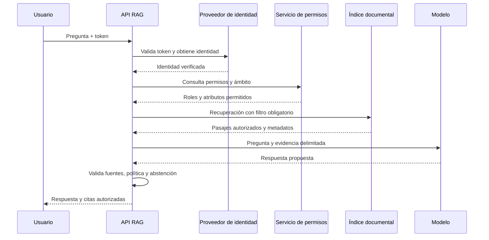

# Capítulo 15. RAG en empresas

## ¿Por qué importa?

En una empresa, responder con información plausible no alcanza. Una respuesta debe provenir de documentos que la persona tenga permiso para consultar, corresponder a una versión vigente y dejar evidencia suficiente para corregir errores. Si un asistente recupera un contrato de otro cliente, una política retirada o una nota confidencial, la calidad lingüística de la respuesta no reduce el impacto. En RAG empresarial, identidad, autorización y ciclo de vida documental son parte del algoritmo de recuperación.

Un buscador tradicional puede mostrar títulos y fragmentos; un sistema generativo los combina en una respuesta que parece una explicación única. Esa síntesis puede ocultar contradicciones, fechas o condiciones que estaban separadas en los documentos. Por eso, la empresa necesita controles en cada etapa: quién cargó un archivo, de dónde proviene, quién puede verlo, cuál versión está activa, qué pasajes se usaron y cómo se corrige o elimina una respuesta defectuosa.

El capítulo 12 presentó los requisitos generales para producción; el 14 trató infraestructura cloud; y el 16 enfocará SaaS multi-cliente. Aquí estudiamos el gobierno de un conocimiento organizacional sujeto a roles, procesos y obligaciones. No se propone sustituir el juicio profesional: en seguros, legal, salud, finanzas o recursos humanos, una aplicación debe delimitar claramente el uso previsto y derivar los casos de riesgo a las personas responsables.

Una analogía sencilla: un archivador corporativo no entrega todas las carpetas a cualquiera que pregunte bien. Primero se verifica la identidad, luego el permiso para una sección, después se busca el expediente vigente y, finalmente, quien lo consulta puede comprobar la referencia. El modelo generativo es como un asistente que redacta el resumen; no debe convertirse en el guardia que decide quién puede entrar al archivo.

## ¿Cómo funciona?

### Identidad no es autorización

La autenticación responde “¿quién es esta persona o servicio?”. La autorización responde “¿qué puede hacer con qué recurso y bajo qué condiciones?”. Un token válido no demuestra que el usuario pueda leer una póliza, expediente o carpeta. Las decisiones de acceso deben comprobarse en el backend y vincularse con una identidad confiable, no con un `userId` que el navegador envía sin verificar.

Los roles agrupan permisos, por ejemplo, lector, editor o administrador. El control basado en atributos (ABAC) evalúa propiedades como departamento, región, sensibilidad, cliente y fecha. En la práctica se pueden combinar: un rol permite buscar en un dominio, mientras atributos limitan la búsqueda a documentos de una unidad o caso. La elección depende de la complejidad de la matriz de acceso y de quién mantiene sus reglas.

La autorización debe aplicarse antes de recuperar contenido. Filtrar en la interfaz o eliminar fragmentos de la respuesta final es demasiado tarde: el contenido ya pudo ingresar al prompt, a una traza o a un log. El filtro puede implementarse como condición de consulta del motor vectorial o mediante una capa de búsqueda que consulta solamente el conjunto autorizado. Debe probarse la ausencia de fugas entre usuarios, roles, regiones y clientes.

| Enfoque | Ventaja | Límite | Uso razonable |
|---|---|---|---|
| Índice compartido con filtro por metadatos | Operación compacta y búsqueda conjunta | Un filtro mal aplicado puede exponer datos | Dominios con políticas claras y motor que filtra antes de devolver resultados |
| Colecciones o namespaces separados | Separación lógica explícita | Más administración y riesgo de configuración inconsistente | Grupos con límites de acceso diferenciados |
| Índices o cuentas aislados | Mayor aislamiento operativo | Costos y mantenimiento superiores | Requisitos fuertes de residencia o separación contractual |
| Almacén documental con ACL y búsqueda delegada | Reutiliza políticas existentes | Integración y latencia pueden ser complejas | Ecosistema corporativo con permisos mantenidos en origen |

Ningún método brinda autorización automática. La separación física puede reducir el radio de impacto, pero una identidad con permiso excesivo sigue pudiendo consultar datos ajenos. La seguridad depende también de cuentas de servicio, políticas de red, secretos, auditoría y pruebas.

### Del archivo fuente al pasaje recuperable

Un documento empresarial necesita más que texto y vector. El registro debería conservar identificador estable, origen, propietario funcional, clasificación, versión, fecha de vigencia, idioma, estado, permisos y relación con el documento padre. El pasaje indexado hereda esos atributos o mantiene una referencia que permite verificar y actualizar los permisos.

El pipeline valida tipo y tamaño, analiza contenido, extrae texto, identifica metadatos, divide en fragmentos y los indexa. El estado del documento avanza de forma explícita: recibido, validado, procesando, publicado, rechazado o retirado. Los errores deben ser visibles para el responsable del contenido. Una carga aceptada no equivale a un documento ya disponible para consulta.

La procedencia (lineage) describe de dónde vino el contenido y qué transformaciones recibió. Para cada respuesta se debería poder conocer la versión del pipeline, el documento y pasajes empleados, el modelo o configuración relevante y el identificador de solicitud. No siempre es necesario almacenar el prompt completo ni la salida textual por tiempo indefinido; los datos de auditoría deben diseñarse con minimización, propósito y retención.

La vigencia requiere reglas de negocio. Si dos políticas se contradicen, el sistema no debe resolver la disputa solo porque una tenga mayor similitud semántica. Puede filtrar por estado vigente, mostrar fecha y origen, o abstenerse y escalar. La lógica de documentos reemplazados, adendas y excepciones pertenece a los dueños del conocimiento y debe expresarse como metadatos o reglas comprobables.

### El límite de confianza de los documentos

Los documentos recuperados son datos, no instrucciones confiables. Una página maliciosa podría incluir texto que intente convencer al modelo para ignorar reglas, revelar información o ejecutar acciones. También puede haber instrucciones accidentales dentro de correos o ejemplos. La inyección de prompts puede entrar por la pregunta del usuario o por el material recuperado; el hecho de que el texto provenga del repositorio corporativo no lo convierte en seguro.

El diseño debe mantener instrucciones de sistema separadas del contenido citado, limitar herramientas y acciones disponibles, validar entradas/salidas y no otorgar al modelo acceso directo a operaciones privilegiadas. Los controles del prompt ayudan, pero no reemplazan autorización determinista ni pruebas adversariales. Cuando el asistente puede actuar, cada herramienta necesita su propia verificación de permisos y confirmación adecuada al impacto.

### Respuesta con evidencia y posibilidad de abstenerse

Una cita no garantiza que la respuesta esté respaldada. La cita debe enlazar a una fuente accesible para esa persona, señalar una sección o pasaje suficiente y preservar versión o fecha cuando importe. Si la respuesta combina fuentes, cada afirmación material debería poder rastrearse. Las fuentes mostradas deben pasar la misma autorización que la consulta.

La abstención es una salida válida. Si no hay fragmentos relevantes, hay conflicto entre fuentes, la vigencia no puede determinarse o la pregunta exige una decisión fuera del propósito del sistema, la respuesta debe comunicar el límite y ofrecer la ruta de escalamiento. Esto es distinto de un error de proveedor: ausencia de evidencia es resultado de negocio; indisponibilidad es una falla técnica.

### Gobierno: responsables, políticas y auditoría

Un programa empresarial necesita responsables distintos. El dueño del dominio define qué documentos son autoridad; seguridad determina controles y clasificación; privacidad/compliance define obligaciones y retención; ingeniería opera el pipeline; y usuarios referentes evalúan utilidad. En equipos pequeños una persona puede cubrir más de un rol, pero las decisiones deben quedar asignadas.

El inventario de datos registra fuentes autorizadas, tipos de contenido, sensibilidad, residencia, base de uso y retención. El catálogo de conocimiento agrega estado y propietario. Las reglas para exportar, compartir, borrar o conservar deben aplicarse tanto a documentos fuente como a derivados: texto extraído, fragmentos, vectores, cachés, respaldos y logs. Eliminar una fila del índice no necesariamente elimina todas las copias.

La auditoría debe permitir responder preguntas operativas: quién publicó o retiró un documento, quién cambió permisos, qué versión de política se usó, qué identidad consultó y qué fuentes fueron entregadas. Los registros pueden contener datos sensibles, de modo que también requieren control de acceso y borrado. Registrar todo para siempre suele crear un segundo repositorio de alto riesgo.

## ¿Cómo se implementa?

### Un flujo de consulta con autorización explícita

La secuencia segura comienza con la identidad verificada por el servidor. El backend obtiene permisos desde una fuente confiable, deriva filtros de acceso y ejecuta la recuperación restringida. Después verifica que cada resultado siga permitido, arma el contexto con fuentes etiquetadas como datos y genera una respuesta. Antes de devolverla, comprueba que los enlaces de fuente respeten los permisos y aplica políticas de salida. El cliente nunca decide el alcance de la búsqueda.



Si el servicio de permisos no responde, una regla de “fallar cerrado” impide consultar datos que no se pudieron autorizar. Para ciertos datos públicos podría existir un camino independiente, definido y probado. No se debe convertir una falla de autorización en acceso general para mantener disponibilidad.

### Ejemplo conceptual en Express

El siguiente middleware es pseudocódigo pedagógico: las funciones de identidad, permisos y base vectorial son adaptadores que deben implementarse con los contratos reales. No debe copiarse como seguridad lista para producción. Su propósito es mostrar dónde se calcula el filtro y que el cliente no puede enviarlo libremente.

```js
app.post("/api/query", requireIdentity, async (req, res, next) => {
  try {
    const question = validateQuestion(req.body.question);
    const scope = await authorizationService.scopeFor(req.user);

    if (!scope.canSearch) {
      return res.status(403).json({ error: "forbidden" });
    }

    const passages = await vectorStore.search({
      question,
      filter: scope.documentFilter,
      limit: 8,
    });

    const answer = await answerService.generate({ question, passages });
    res.json({ answer, sources: passages.map(toAuthorizedSource) });
  } catch (error) {
    next(error);
  }
});
```

**Qué hace:** valida la identidad, calcula el alcance en el servidor y pasa ese filtro a la recuperación. **Por qué se usa:** impide que el cliente elija un tenant o conjunto de documentos arbitrario. **Cómo funciona:** el middleware anterior establece `req.user`; el servicio de autorización devuelve permisos confiables; el adaptador del vector store aplica el filtro antes de entregar pasajes. **Cuándo conviene:** como patrón de backend para consultas protegidas, adaptado a políticas reales. **Resultado esperado:** una consulta autorizada produce respuesta y fuentes; una identidad sin permiso recibe denegación. El ejemplo no define JWT, reglas ABAC, validación, límites, auditoría, cancelación ni contratos de la base. Debe agregarse pruebas negativas para modificar el tenant, manipular atributos y solicitar fuentes ajenas. El código es conceptual y requiere validación.

Un peligro frecuente es construir el filtro desde `req.body.tenantId`. Si ese valor no se contrasta con permisos confiables, una persona puede cambiarlo manualmente. Un campo enviado por el cliente puede indicar una selección de interfaz; nunca constituye por sí solo una prueba de pertenencia. Otra precaución: comparar permisos después de recuperar no garantiza confidencialidad si el proceso ya registró esos pasajes en una traza.

### Ingesta, actualización y borrado

La ingesta debe autenticar al cargador y comprobar que puede publicar en el dominio correspondiente. El archivo se analiza en un entorno restringido, se valida tamaño y formato, se extraen metadatos y se conserva el origen. Los workers reciben referencias al objeto, no necesariamente el contenido sensible en mensajes de cola. Los accesos temporales deben expirar y cada etapa debe registrar resultado sin exponer el texto completo.

Para actualizar una política, una estrategia segura conserva versión y estado: la versión nueva se procesa en paralelo, se valida y luego se marca vigente; la anterior se retira para nuevas consultas sin borrar inmediatamente la evidencia histórica si existe obligación de conservación. Evitá que una carga parcial deje una versión previa presentada como actual si falló la indexación. El catálogo debe indicar claramente qué está disponible.

El borrado debe propagarse a índice, cachés, vistas derivadas y réplicas según la política. Los respaldos plantean una dificultad: puede ser necesario conservarlos durante un plazo, pero impedir que un objeto borrado reaparezca al restaurar. Una solución operacional es mantener tombstones o un registro de eliminaciones que se reaplica después de la restauración. La política exacta depende de las obligaciones legales y del diseño de backup.

### Evaluación y control humano

Antes de habilitar un caso empresarial, armá un conjunto de preguntas representativas con fuentes correctas, preguntas sin respuesta, documentos contradictorios y límites de acceso. Medí recuperación y respuesta por separado: si la evidencia correcta no aparece, cambiar el prompt puede enmascarar la causa. Evaluá además citas válidas, abstención, filtraciones cruzadas, comportamiento con prompt injection y tratamiento de errores.

La revisión humana depende del impacto. Para una búsqueda interna de manuales, quizá baste con mostrar fuentes y permitir feedback. Para recomendar acciones que afectan cobertura, elegibilidad, salud o derechos, puede ser necesario requerir aprobación de una persona calificada y mantener prohibida la decisión automática. La interfaz debe explicar qué está automatizado, cómo se impugna y quién responde.

La observabilidad del capítulo 18 debe incorporar identificadores de usuario seudonimizados o controlados, decisión de autorización, versión de índice, etapa, latencia y resultado técnico. El acceso a contenido completo debe estar excepcionalmente justificado, autorizado y auditado. Separá telemetría técnica de auditoría de negocio y define sus períodos de retención.

### Caso aplicado: conocimiento de pólizas y procedimientos

Una aseguradora quiere ayudar a sus equipos de atención a localizar condiciones de pólizas. El corpus contiene contratos de distintas líneas, endosos, versiones anteriores y guías internas. Un piloto ingenuo podría indexar todo el texto y pedir al modelo “responder usando los documentos”. El problema no se resuelve con una instrucción mejor: una condición depende de vigencia, producto, jurisdicción y, en ciertos casos, de una excepción aprobada.

El dominio define primero las fuentes autorizadas y los metadatos mínimos: identificador de producto, región, versión, vigencia desde/hasta, estado de aprobación y dueño del contenido. Seguridad determina qué grupos acceden a cada línea; ingeniería implementa esos límites en la consulta. El asistente presenta las cláusulas junto con la respuesta y permite abrir la referencia si la identidad tiene permiso. Si hay documentos incompatibles o falta el contexto del caso, explica que no puede concluir y deriva a un especialista.

La evaluación incluye preguntas sobre coberturas incluidas, exclusiones explícitas, vigencia y solicitudes sin evidencia. Se agregan ejemplos de usuarios con permisos distintos y una fuente retirada que aún existe en el índice histórico. Los responsables califican si la evidencia es adecuada y si la respuesta preserva matices. El equipo registra fallos como categorías corregibles: metadato ausente, versión incorrecta, recuperación insuficiente, síntesis excesiva o fuente no autorizada. Esta clasificación decide si se corrige contenido, filtros, recuperación, interfaz o política.

El resultado deseado del piloto no es automatizar decisiones de cobertura. Es reducir el tiempo de localización y mejorar consistencia documental sin ocultar incertidumbre. Antes de ampliar el alcance, el dueño del producto define qué tareas siguen siendo exclusivamente humanas, qué respuesta se ofrece ante indisponibilidad y cómo se revisan casos reportados. Esto transforma una demostración llamativa en un proceso controlado y medible.

### Riesgo de abuso y pruebas de frontera

Además de probar preguntas normales, probá entradas largas, instrucciones hostiles en documentos, contenido que simula ser una política del sistema, enlaces externos y solicitudes para revelar información ajena. Revisá tanto la respuesta como lo que ocurrió antes de generarla: si se recuperó un documento prohibido, el control de acceso ya falló aunque el modelo se haya negado a citarlo.

Para casos de alto impacto, conservá un procedimiento de incidente: cómo bloquear una fuente, invalidar cachés, revocar una credencial, identificar consultas afectadas, notificar a responsables y verificar que la corrección se propagó. La respuesta operativa debe distinguir una vulnerabilidad confirmada de una alerta aún no investigada, preservar evidencia necesaria y limitar el acceso a esa evidencia.

## Errores frecuentes

- Autorizar en React o confiar en el identificador de cliente enviado por el navegador.
- Recuperar documentos de todos los usuarios y filtrar después de invocar al modelo.
- Creer que las citas prueban que la respuesta es correcta o que el usuario puede abrir la fuente.
- Indexar permisos en metadatos y no actualizarlos cuando cambia el sistema fuente.
- Tratar texto recuperado como instrucciones confiables para el modelo.
- Usar una respuesta generativa para decidir derechos, cobertura o tratamiento sin controles apropiados.
- Registrar prompts y documentos completos por defecto y retenerlos indefinidamente.
- Considerar terminado un borrado al eliminar el vector, olvidando cachés, derivados y copias.
- Aceptar trabajos de ingesta sin distinguir entre recibido, indexado y disponible.
- Mantener una sola colección por cliente sin evaluar costos, operación y riesgo de configuración.

## Buenas prácticas y criterios de elección

Definí el modelo de autorización junto con responsables de datos, seguridad y producto. Preferí políticas centralizadas y comprobables, aplicadas antes de la búsqueda; mantén el ámbito en el servidor y registra el resultado de la decisión. Si los permisos cambian con frecuencia, necesitás una estrategia de actualización que no deje copias obsoletas autorizables. Probá permisos negativos y fallas del servicio de identidad, no solo el camino exitoso.

Elegí aislamiento lógico compartido cuando el motor soporta filtros confiables y la clasificación permite ese riesgo operacional. Elegí separación de colecciones o infraestructura cuando exista una razón de seguridad, residencia, rendimiento o contrato que justifique la complejidad. Documentá quién opera cada frontera y cómo se recupera. No uses aislamiento físico como sustituto de control de identidad.

Definí propósito, población usuaria, tipos de contenido, límites de uso, escalamiento y retención. Etiquetá documentos con fuente y vigencia. Evaluá calidad en un conjunto mantenido por el dominio. Revisá incidentes y feedback para actualizar fuentes o filtros, no solo instrucciones al modelo. Dejá claro cuándo el sistema no tiene evidencia suficiente.

## Ejercicios

1. Diseñá una matriz de permisos para una compañía con equipos de ventas, legal y soporte. Incluí documentos compartidos, sensibles y restringidos por cliente.
2. Escribí cinco pruebas negativas para demostrar que cambiar un campo del request no permite leer otro ámbito.
3. Definí metadatos mínimos para políticas con versiones, fechas de vigencia, propietario y clasificación.
4. Diseñá el comportamiento para una pregunta sin evidencia, una pregunta con fuentes contradictorias y una caída del servicio de permisos.
5. Trazá el recorrido de borrado desde el documento original hasta índices, cachés, logs y backups. Identificá qué debe verificarse después de una restauración.
6. Prepará un conjunto pequeño de evaluación que incluya un intento de inyección de instrucciones dentro de un documento y describí cómo medirías el resultado.

## Referencias y continuidad

- [Capítulo 12: Del MVP a producción](book-es-cap12.md), requisitos base para producción.
- [Capítulo 14: Despliegue cloud](book-es-cap14.md), redes, secretos y continuidad.
- [Capítulo 16: RAG para startups SaaS](book-es-cap16.md), aislamiento de clientes externos.
- [Capítulo 18: Observabilidad y monitoreo](book-es-cap18.md), trazas y métricas con cuidado de privacidad.
- [OWASP Top 10 for LLM Applications](https://owasp.org/www-project-top-10-for-large-language-model-applications/), riesgos como prompt injection y manejo inseguro de salidas; usar como guía de amenazas, no como certificación.
- [NIST AI Risk Management Framework](https://www.nist.gov/itl/ai-risk-management-framework), marco voluntario para gestionar riesgos de sistemas de IA.
- [NIST Privacy Framework](https://www.nist.gov/privacy-framework), guía para gestionar riesgo de privacidad.
- [Referencias verificadas del repositorio](../REFERENCIAS_VERIFICADAS.md), con fecha de revisión declarada.

**Siguiente:** [Capítulo 16: RAG para startups SaaS](book-es-cap16.md).
