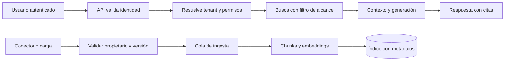

# Capítulo 16. RAG para startups SaaS

## ¿Por qué importa?

Una startup SaaS vende una capacidad repetible a organizaciones distintas. Cuando agrega búsqueda conversacional sobre manuales, tickets o políticas, el producto deja de ser una demo de modelo y pasa a ser un sistema que decide qué información puede ver cada cliente. Una respuesta correcta para la organización A puede ser una filtración grave si aparece en la sesión de B. Por eso, el límite entre clientes debe diseñarse antes que el prompt.

Pensá en un edificio con muchas oficinas. El ascensor puede llevar a todos al mismo piso, pero cada puerta tiene una cerradura distinta. El vector store es el edificio; el `tenantId` es parte de la cerradura, no una etiqueta decorativa. Si recuperamos primero desde todo el corpus y filtramos después, el fragmento ajeno ya pudo entrar en logs, caché, contexto del modelo o memoria del proceso.

El segundo motivo es económico. En SaaS, el uso varía mucho entre clientes: uno indexa diez documentos y otro millones de páginas; uno pregunta ocasionalmente y otro automatiza cada operación. Una tarifa plana sin límites puede convertir el éxito comercial en una factura imprevisible. La arquitectura debe permitir medir consumo, fijar cuotas y dar una experiencia razonable cuando se alcanza un límite.

El tercer motivo es la confianza. El usuario necesita saber qué versión de una guía fundamenta una respuesta, cuándo fue indexada y qué hacer si no hay evidencia. Un chatbot que habla con seguridad sobre una versión obsoleta aumenta el costo de soporte y erosiona la confianza. La promesa adecuada no es «la IA siempre sabe», sino «buscamos en el material autorizado y mostramos evidencia suficiente para que puedas verificarla».

Este capítulo aplica a asistentes de soporte, búsqueda en bases de conocimiento, copilotos internos ofrecidos como producto y automatización documental para clientes. No vuelve a explicar embeddings o chunking; para eso están los [capítulos 2](book-es-cap2.md) y [7](book-es-cap7.md). La arquitectura general de ingesta y consulta está en el [capítulo 3](book-es-cap3.md), y los principios de empresa y datos sensibles en el [capítulo 15](book-es-cap15.md).

## ¿Cómo funciona?

### Identidad, organización y autorización

Una identidad autenticada suele representar a una persona o una cuenta de servicio. Esa identidad pertenece a una o más organizaciones, y cada organización posee documentos, colecciones y políticas. La API valida una credencial —por ejemplo, una sesión o un token firmado— y resuelve sus permisos en el servidor. El navegador puede indicar qué espacio de trabajo desea usar, pero ese identificador se compara con las membresías autorizadas; nunca se toma como prueba de permiso.

Conviene diferenciar tres decisiones: autenticación responde «¿quién es el solicitante?»; autorización responde «¿puede leer este documento?»; aislamiento responde «¿puede una operación de un cliente influir o revelar datos de otro?». Aislar una búsqueda por `tenant_id` no reemplaza la autorización por documento si dentro de la organización existen roles, carpetas privadas o permisos de usuario.

### Formas de aislar los datos

| Estrategia | Ventajas | Costos y riesgos | Conviene cuando |
|---|---|---|---|
| Colección compartida con filtro obligatorio | Menos recursos y administración sencilla | Un filtro omitido puede mezclar clientes; particiones desiguales compiten | Muchos tenants pequeños con políticas uniformes y pruebas estrictas |
| Colección o esquema por tenant | Separación clara, límites y restauraciones por cliente | Más objetos, migraciones y tareas operativas | Pocos tenants medianos/grandes o requisitos de borrado independiente |
| Instancia o cuenta separada | Frontera fuerte y opciones dedicadas | Costo y complejidad altos; operación repetida | Contratos regulados, residencia o aislamiento contractual específico |

No existe una modalidad universalmente más segura sin considerar implementación, permisos del operador, copias, backups y canales laterales. Una colección separada ayuda, pero no impide que una ruta con credenciales incorrectas lea otra colección. En todos los modelos, el backend debe derivar el alcance a partir de identidad verificada y utilizar permisos mínimos.

### Ruta de consulta y ruta de ingesta

La consulta normalmente valida entrada, autentica, determina el ámbito autorizado, aplica límites, calcula el embedding, busca candidatos dentro del ámbito, arma un contexto limitado, genera una respuesta y devuelve citas. La ingesta valida propietario y formato, normaliza y divide el contenido, conserva metadatos, genera vectores y registra una versión del documento. Ambas rutas requieren idempotencia: reintentar un trabajo no debería duplicar puntos ni facturar dos veces la operación.



El diagrama separa las rutas porque sus perfiles son distintos. La consulta necesita baja latencia y respuesta inmediata; la ingesta puede tardar, reintentarse y procesar lotes. En un MVP pequeño ambas pueden vivir en un proceso, pero deben mantener responsabilidades diferenciadas para que una importación grande no bloquee consultas interactivas.

### Metadatos que hacen posible operar

Un fragmento de SaaS debería poder relacionarse con `tenantId`, `documentId`, `documentVersion`, `chunkId`, `sourceUri`, `visibility`, `createdAt`, `effectiveFrom` y la configuración de embeddings. Los nombres concretos dependen del almacén. Guardar el texto y toda la metadata dentro del vector store simplifica recuperación; guardar texto canónico en almacenamiento documental reduce duplicación y facilita versionado, pero añade consistencia entre servicios. El [capítulo 8](book-es-cap8.md) profundiza en filtros, índices y ciclo de vida.

La identidad lógica del documento no es el hash del contenido. El documento «manual de soporte» puede conservar su identidad y tener versiones diferentes; el hash permite detectar si el contenido cambió. Separarlos evita que una actualización cree objetos huérfanos o que dos clientes con el mismo texto compartan accidentalmente una clave de permisos.

### Cuotas y modelo comercial

La unidad facturable podría ser consultas, tokens, páginas indexadas, almacenamiento, conectores o una combinación. Hay que medir tanto el uso que paga a proveedores como el valor que recibe el cliente. Un límite de solicitudes por minuto protege disponibilidad; un presupuesto mensual evita sorpresas; una cuota de ingesta frena cargas accidentales. La respuesta a una cuota agotada debe tener un contrato claro —por ejemplo, HTTP 429 con información de reintento— y no simular una respuesta vacía.

| Señal de uso | Lo que ayuda a controlar | Riesgo de medirla sola |
|---|---|---|
| Consultas | Frecuencia y abuso | Una pregunta corta y otra con contexto grande cuestan distinto |
| Tokens de entrada/salida | Consumo de generación | No incluye almacenamiento ni embeddings locales |
| Páginas o bytes indexados | Coste de ingesta y retención | Una página no representa siempre igual volumen |
| Latencia y concurrencia | Capacidad y experiencia | Mejorar la latencia no garantiza respuestas correctas |
| Resolución confirmada | Valor del producto | Requiere definición y señal confiable del usuario |

No fijes precios basándote en ejemplos históricos: los modelos y tarifas cambian. Construí una hoja de costos con supuestos explícitos, medí tráfico real y revisá precios vigentes; el [capítulo 13](book-es-cap13.md) discute escalamiento y [REFERENCIAS_VERIFICADAS.md](../REFERENCIAS_VERIFICADAS.md) explica la fecha y el alcance de sus cálculos.

## ¿Cómo se implementa?

### Ejemplo conceptual: middleware de tenant en Express

El siguiente fragmento enseña el orden de confianza. El middleware `requireUser` representa una integración con el proveedor de identidad de la aplicación; no es una función incluida en el repositorio. El ejemplo tampoco configura un filtro real de Qdrant. Es conceptual y requiere adaptar el contrato a la librería y al esquema desplegado.

```js
import express from 'express';
const app = express();

function requireUser(req, res, next) {
  // Conceptual: validar firma, emisor, audiencia y expiración del token.
  req.user = { id: 'user-42', tenantIds: ['org-17'] };
  next();
}

function requireTenant(req, res, next) {
  const requested = req.header('x-workspace-id');
  if (!requested || !req.user.tenantIds.includes(requested)) {
    return res.status(403).json({ error: 'workspace_forbidden' });
  }
  req.tenantId = requested; // valor ya validado en el servidor
  next();
}

app.post('/api/query', requireUser, requireTenant, async (req, res, next) => {
  try {
    const { question } = req.body;
    const sources = await retrieveForTenant(question, req.tenantId);
    res.json({ answer: await answerFrom(question, sources), sources });
  } catch (error) { next(error); }
});
```

**Qué hace:** impide llamar a la recuperación sin identidad y pertenencia al espacio solicitado. **Por qué:** el cliente HTTP está bajo control del usuario y puede alterar headers o cuerpo. **Cómo funciona:** un middleware valida el token y otro compara el espacio pedido con las membresías verificadas; sólo entonces la ruta recibe `req.tenantId`. **Cuándo conviene:** en cualquier API que almacene datos de más de una organización, aunque el primer lanzamiento tenga pocos clientes. **Resultado esperado:** un miembro autorizado llega a la búsqueda; un identificador ajeno recibe 403 y no inicia llamadas al vector store ni al modelo.

En producción, no confíes en `tenantIds` codificados en el ejemplo: la biblioteca de identidad debe verificar criptográficamente el token y el backend consultar una fuente actualizada de membresías. Agregá pruebas que alteren el `tenantId`, prueben cada ruta de lectura y escritura, y comprueben que los logs y la caché respeten el mismo ámbito. El patrón general de autorización se conecta con el [capítulo 5](book-es-cap5.md).

### Consulta con filtro aplicado en el almacén

El filtro debe llegar a la operación de búsqueda, no aplicarse como postproceso a una lista global. El fragmento siguiente es pseudocódigo con forma de Qdrant: la API exacta depende de la versión y del cliente que se adopte. El índice de payload debe crearse según la documentación de la versión usada; el repositorio didáctico no implementa esta ruta con filtros.

```js
// Conceptual: validar primero identidad y pertenencia al tenant.
const result = await vectorClient.search('documents', {
  vector: await embed(question),
  limit: 8,
  filter: {
    must: [
      { key: 'tenant_id', match: { value: authenticatedTenantId } },
      { key: 'status', match: { value: 'published' } }
    ]
  },
  with_payload: ['text', 'document_id', 'source_uri', 'version']
});
```

La consulta recupera sólo documentos publicados del tenant derivado por el servidor. **Por qué se usa:** reducir la posibilidad de exposición accidental y permitir que la base vectorial descarte antes los puntos ajenos. **Cuándo conviene:** siempre que la infraestructura permita filtros de metadata; si no, hace falta una estrategia de partición o una capa de recuperación que garantice la política antes de exponer resultados. **Resultado:** los candidatos devueltos pertenecen al alcance autorizado, sujeto a que la metadata esté correctamente escrita y a que el proveedor aplique el filtro como se espera.

Un filtro incorrecto puede devolver cero resultados sin error. Verifica con pruebas positivas y negativas, datos sembrados en dos tenants y una expectativa explícita de que la consulta A nunca recibe un ID B. Usa una colección de prueba sin datos reales. Las pruebas deben cubrir recuperación, citas, exportación y eliminación; no alcanza con comprobar el endpoint de salud.

### Ingesta como trabajo idempotente

Cuando el producto sincroniza una wiki o un bucket, un webhook puede repetirse o llegar fuera de orden. Una cola permite reintentar fallos transitorios sin mantener abierta la petición del usuario. Cada trabajo debe llevar un identificador estable de fuente, tenant, versión, estado y clave de idempotencia. La clave nunca debe ser un dato secreto ni un hash global que cruce propietarios.

```js
// Conceptual: contrato de trabajo, no implementado en el repositorio.
const job = {
  idempotencyKey: `${tenantId}:${documentId}:${version}`,
  tenantId,
  documentId,
  version,
  action: 'index'
};
await queue.publish('rag.ingest', job);
```

El API puede responder 202 Accepted con el ID del trabajo. Un worker valida de nuevo que el origen pertenece al tenant, descarga el contenido con límites, divide y embebe en lotes, y marca la versión publicada sólo al completar todos los pasos. Si falla a mitad, se conserva la versión anterior o se declara el documento temporalmente no disponible según el contrato del producto. La cola no garantiza por sí sola entrega exactamente una vez; la idempotencia debe vivir en el consumidor y el almacén.

### React: presentar respuesta y evidencia

La interfaz es una superficie para entender, verificar y corregir la respuesta. Conviene mostrar las fuentes con título/versionado, enlaces permitidos y pasajes relevantes; ofrecer «no encontré evidencia» como resultado válido; y permitir feedback con una categoría concreta. No ocultes que una respuesta está incompleta detrás de un spinner infinito.

```jsx
function Answer({ answer, sources, onFeedback }) {
  return (
    <section aria-live="polite">
      <p>{answer}</p>
      <h2>Fuentes consultadas</h2>
      {sources.length === 0 ? <p>No se encontraron fuentes autorizadas.</p> : (
        <ul>{sources.map((s, i) => (
          <li key={s.chunkId ?? `${s.documentId}-${i}`}>
            <a href={s.url}>{s.title} · versión {s.version}</a>
            <blockquote>{s.excerpt}</blockquote>
          </li>
        ))}</ul>
      )}
      <button onClick={() => onFeedback('helpful')}>Me ayudó</button>
      <button onClick={() => onFeedback('incorrect')}>No es correcto</button>
    </section>
  );
}
```

**Qué hace:** asocia la salida generada con las fuentes recibidas por la API y captura una señal de utilidad. **Por qué:** una cita verificable facilita la revisión y reduce escalaciones. **Cómo:** React renderiza una lista estable y accesible; la API debe haber firmado o validado URLs y no debe aceptar identificadores de tenant enviados por el componente como autoridad. **Cuándo:** en experiencias donde el usuario necesita tomar decisiones a partir de documentos. **Resultado esperado:** cada afirmación importante puede contrastarse con una fuente, y el feedback se registra con consentimiento, propósito y política de retención.

Si las URLs provienen de terceros, valida el esquema y el dominio para evitar enlaces `javascript:` o redirecciones engañosas. Si una cita apunta a un documento con permisos, el endpoint que sirve el documento debe volver a autorizar; conocer la URL no concede acceso.

### Observabilidad, soporte y evolución del producto

Un SaaS necesita separar métricas técnicas de métricas de producto. Las primeras incluyen errores por etapa, p95 de recuperación y generación, timeout, tokens y reintentos. Las segundas incluyen preguntas resueltas, feedback, escalación y uso por plan. Correlaciona ambas mediante IDs opacos y agrega por plan o tenant sólo cuando la política de privacidad y el tamaño del grupo eviten identificar personas. La implementación y el diseño de SLO se desarrollan en el [capítulo 18](book-es-cap18.md).

Al evaluar una nueva versión, conserva un conjunto pequeño de preguntas representativas y respuestas esperadas. Evalúa recuperación (si apareció evidencia pertinente), fundamentación (si la afirmación está soportada), fidelidad de citas y abstención cuando falta evidencia. Un promedio puede esconder un error grave en un cliente específico; revisa por idioma, tipo de fuente y versión del índice. El [capítulo 19](book-es-cap19.md) aborda ajustes de retrieval y reranking.

Las respuestas generativas deben tratar el contenido recuperado como datos, no como instrucciones. Un documento puede incluir texto hostil que ordene ignorar el prompt. El modelo no es una frontera de seguridad: filtra herramientas, limita acciones y requiere confirmación humana para operaciones con consecuencias. En un producto de soporte, una contestación que explica una política puede ser automática; cambiar una cuenta, emitir un reembolso o borrar datos necesita autorización independiente.

### Errores frecuentes

- **Confiar en el `tenantId` del navegador.** Deriva el ámbito del principal autenticado y comprueba membresías en el backend.
- **Filtrar después de recuperar.** Incluye el alcance de autorización en la búsqueda y evita enviar candidatos ajenos a generación, logs o caché.
- **Usar una caché global por pregunta.** Incluye versión de índice, modelo y ámbito efectivo de permisos; invalida al revocar o actualizar documentos. Ver [capítulo 9](book-es-cap9.md).
- **Reindexar sin versionar.** Conserva estado y versión para poder revertir y explicar qué material sustentó la respuesta.
- **Medir sólo cantidad de llamadas.** Mide tokens, almacenamiento, consultas, errores, valor y distribución entre clientes.
- **Prometer disponibilidad sin medir dependencias.** El proveedor de embeddings, el vector store y el LLM tienen fallos distintos; define degradación y límites.
- **Registrar preguntas y respuestas completas por defecto.** Define finalidad, acceso, retención y redacción; comienza con metadatos mínimos.
- **Tratar feedback como verdad absoluta.** Un pulgar abajo puede indicar UX, fuente faltante o desacuerdo; clasifica y revisa muestras.

## Buenas prácticas y decisiones

Comienza con una sola estrategia de aislamiento que puedas probar y operar; documenta cómo migrar un cliente a una frontera más fuerte. Mantén la autenticación y autorización fuera de la capa de prompt. Versiona documentos, embeddings, prompts y modelo de generación para que una respuesta pueda reconstruirse. Limita tamaño y frecuencia de consultas, aplica límites de concurrencia y registra consumo de forma auditable.

Decide el nivel de automatización por riesgo. La búsqueda asistida con citas es una primera entrega razonable; la redacción de borradores requiere revisión; ejecutar cambios en sistemas del cliente requiere permisos separados, confirmación y trazabilidad. Una salida confiable puede abstenerse. El producto debe comunicar esa condición con lenguaje claro y sugerir una acción útil, como abrir la fuente o contactar soporte.

La arquitectura debe crecer por evidencia. Un equipo pequeño puede empezar con una API y un vector store gestionado, siempre que el backend imponga autenticación y los datos tengan respaldo. Al aumentar carga, separa workers, colas y límites por tenant. Un cliente regulado podría requerir almacenamiento dedicado. El [capítulo 12](book-es-cap12.md) ofrece la transición general de MVP a producción, y el [capítulo 14](book-es-cap14.md) compara formas de despliegue.

## Ejercicios

1. Dibuja el flujo de una consulta SaaS y marca cada paso que procesa texto de cliente. Para cada paso, anota permisos, retención y responsable.
2. Diseña un test con dos tenants, dos documentos privados y una pregunta idéntica. ¿Qué IDs pueden aparecer en cada respuesta, trazas y caché?
3. Elige una unidad de cuota para un plan gratuito y una de pago. Explica qué abuso mitiga y qué usuario legítimo podría perjudicar.
4. Especifica un contrato de API para una ingesta asincrónica: estados, reintentos, idempotencia, cancelación y borrado.
5. Revisa una respuesta con una cita obsoleta. Propón cómo versionar, invalidar caché y comunicar al usuario la fuente vigente.
6. Define una métrica de resolución útil y una métrica técnica para evitar que un alza de respuestas automáticas oculte una caída de calidad.

## Referencias y validación

Referencias generales: Lewis et al., [Retrieval-Augmented Generation for Knowledge-Intensive NLP Tasks](https://arxiv.org/abs/2005.11401); Gao et al., [A Survey on RAG](https://arxiv.org/abs/2312.10997); documentación de [Qdrant sobre filtrado](https://qdrant.tech/documentation/concepts/filtering/) y [OpenAI sobre embeddings](https://developers.openai.com/api/docs/guides/embeddings). Los servicios y versiones evolucionan; verifica las guías vigentes antes de desplegar.

**Validación:** los fragmentos de middleware, cola, búsqueda filtrada y React son conceptuales; no forman parte de los adaptadores ejecutables del repositorio. La muestra actual usa una colección única y no implementa identidad, autorización ni aislamiento multi-tenant. No se ejecutaron estos ejemplos ni pruebas de seguridad en esta edición.

**Siguiente:** [Capítulo 17](book-es-cap17.md).
