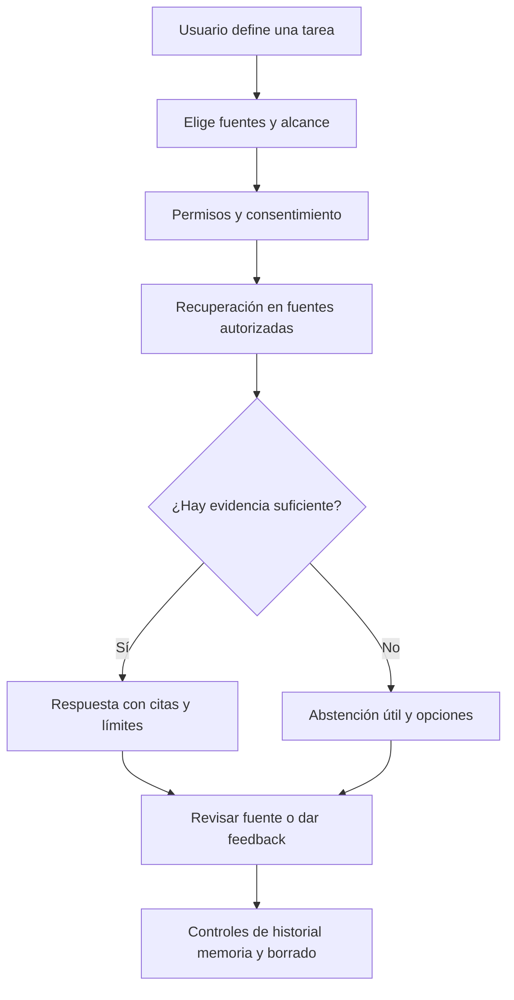

# Capítulo 17. RAG para consumidores

## ¿Por qué importa?

Un producto de consumo pone la inteligencia artificial frente a personas con objetivos, conocimientos y niveles de paciencia muy distintos. Un estudiante quiere entender un texto; alguien que organiza su vida necesita encontrar una nota; una persona que busca en su biblioteca digital espera resultados relevantes sin aprender vocabulario de bases vectoriales. La calidad del sistema se mide en la tarea que la persona logra completar y en la confianza que conserva, no en lo convincente que suena una respuesta.

En una conversación casual, un error puede parecer pequeño. En salud, finanzas, educación o asuntos personales, una recomendación inventada puede inducir una mala decisión. El producto debe mostrar la evidencia, comunicar incertidumbre y permitir que el usuario recupere el control. La abstención no es un fallo: a veces es la respuesta más responsable cuando el corpus no contiene datos suficientes.

También importa la privacidad. Un asistente puede procesar diarios, tareas, documentos laborales o preguntas que revelan circunstancias íntimas. Una función llamada «memoria» parece cómoda, pero cambia las expectativas: ¿qué se conserva?, ¿durante cuánto tiempo?, ¿quién lo usa?, ¿cómo se borra? Separar la memoria personal del conocimiento compartido es un requisito de diseño y de datos, no un detalle de interfaz.

Este capítulo se concentra en experiencia de producto, consentimiento, retención, accesibilidad y evaluación de usos de consumo. Los fundamentos de RAG aparecen en los [capítulos 1–3](book-es-cap1.md), y el tratamiento empresarial de datos sensibles en el [capítulo 15](book-es-cap15.md). No existe un patrón único: una herramienta de estudio local tiene necesidades distintas de un asistente conectado a servicios externos.

## ¿Cómo funciona?

### Una tarea antes que un chat

Antes de diseñar una caja de texto, describe una tarea concreta: «encontrar el párrafo que explica un concepto», «resumir apuntes de una materia», «buscar una receta guardada» o «preguntar sobre un manual cargado por el usuario». Esto determina qué fuentes están permitidas, qué respuesta resulta útil y qué medida de éxito puede observarse.

El chat es una interfaz flexible, pero no siempre la más clara. Una búsqueda con filtros puede ser más rápida para localizar un documento; una vista comparativa sirve para estudiar dos versiones; un resumen con secciones puede ayudar más que una conversación extensa. Proporcionar controles comprensibles —por ejemplo, «sólo esta carpeta» o «usar material de esta clase»— reduce errores de alcance.

Un patrón de interacción saludable informa tres cosas: qué se consultó, qué conclusión se obtuvo y qué se puede hacer después. Las fuentes deben ser inspeccionables y abrirse en un contexto autorizado. Si no hay evidencia, la interfaz debe diferenciarlo de una falla técnica. «No encontré pasajes en tus documentos» es distinto de «el servicio no respondió».

### Memoria frente a conocimiento

El conocimiento es el corpus consultable: libros, documentos, páginas u otro material. La memoria personal es información que el usuario pidió recordar o que el sistema guarda para adaptar interacciones futuras. Una conversación no se convierte automáticamente en memoria. Si se mezclan ambos conjuntos, una respuesta puede recuperar un dato personal fuera de contexto o un usuario puede creer que borró algo cuando sólo quitó una nota de la pantalla.

Un modelo simple separa registros:

| Tipo | Ejemplo | Control esperado |
|---|---|---|
| Fuente cargada | Apunte de biología | Ver, reemplazar, borrar y conocer estado de indexación |
| Conversación | Preguntas recientes | Historial apagable, exportable y con retención definida |
| Memoria explícita | «Estoy aprendiendo italiano» | Mostrar, editar, borrar y confirmar antes de guardar |
| Preferencia de producto | Tamaño de letra | Ajuste claro y reversible |
| Telemetría | Latencia y código de error | Minimización, agregación y retención operacional |

La interfaz y el almacenamiento deben coincidir. Si borrar una fuente no elimina sus fragmentos vectoriales, copias temporales y cachés, la promesa de borrado es incompleta. Una arquitectura de eliminación necesita un identificador que permita localizar las copias y una confirmación verificable, con una explicación de lo que puede permanecer en respaldos según la política declarada.

### Flujo centrado en el usuario



El flujo incorpora decisiones antes y después de generar. La persona elige alcance y puede verificar; el producto sabe abstenerse; y los controles de datos están disponibles durante el uso. El diagrama no significa que la generación pueda detectar por sí sola toda evidencia débil: se requieren umbrales evaluados, límites de recuperación y revisión del contenido.

### Privacidad como conjunto de decisiones

La privacidad no se resuelve con una frase de política. Hay que decidir qué texto viaja a un proveedor, si se usa para inferencia, qué se conserva en logs, cómo se protegen claves, si una cuenta familiar comparte corpus y qué ocurre al cerrar sesión. Cuando la inferencia es remota, el producto debe describir de manera comprensible los proveedores y propósitos relevantes; cuando es local, debe explicar límites del dispositivo y qué datos siguen sincronizándose.

Minimización significa recoger sólo lo necesario para la función. Si una métrica se puede calcular con duración, tamaño aproximado y código de resultado, no guardes el texto completo por comodidad. Si el usuario necesita historial, define su alcance y controles. La retención debe tener propósito: registros de diagnóstico por un periodo limitado, documentos mientras la persona los conserva, y copias de respaldo sujetas a un ciclo documentado.

La seguridad abarca autenticación, autorización, cifrado, gestión de secretos, separación entre cuentas y manejo de sesiones. Un cliente React puede esconder un documento de la pantalla, pero no revoca el acceso en la API. Cada lectura y borrado requiere autorización en el backend. Los tokens privados y claves de proveedor no se incrustan en el navegador.

### Incertidumbre y diseño de la respuesta

La respuesta debe distinguir hechos citados, inferencias y sugerencias. Para una pregunta sobre una fuente, conviene citar el pasaje más directo y quizá mencionar si hay documentos que discrepan. Una puntuación vectorial no es una probabilidad de verdad y no se debe mostrar como porcentaje de certeza sin calibración. Los umbrales se eligen con evaluación, no por una cifra intuitiva.

Cuando falta evidencia, ofrece opciones que ayuden: reformular la pregunta, elegir otra carpeta, cargar una fuente o consultar una persona experta. Evita una abstención que culpe al usuario. En un producto educativo, no reveles simplemente la solución si el objetivo es practicar; ofrece una pista progresiva y deja que el estudiante decida. El diseño de la respuesta debe ajustarse a la tarea.

El contenido recuperado puede incluir instrucciones maliciosas o irrelevantes. El sistema debe tratarlo como texto no confiable y nunca permitir que una fuente ordene enviar datos, usar herramientas o saltarse permisos. Si se integran acciones —enviar un correo, cambiar una reserva— requieren permisos específicos, confirmación y una vista previa. La seguridad no depende de pedir al modelo que «se porte bien».

### Accesibilidad y recuperación de errores

Personas con baja visión, movilidad reducida, dislexia o conexiones lentas necesitan una interfaz operable con teclado, foco visible, etiquetas semánticas, contraste suficiente y mensajes que no dependan sólo del color. Los lectores de pantalla deben anunciar cambios de estado de forma útil, sin leer cada token de una respuesta en streaming como una interrupción continua.

Cada estado necesita un tratamiento: carga, respuesta parcial, falta de evidencia, proveedor temporalmente indisponible, documento procesándose, error de formato y límite de uso. Mantén la pregunta si una operación falla; permite reintentar sin duplicar una carga; no presentes una falla de red como si no existiera contenido relevante. El [capítulo 20](book-es-cap20.md) desarrolla el diagnóstico técnico.

### Evaluar utilidad y daño

La evaluación combina pruebas automatizadas con observación de tareas. Para un conjunto de preguntas, registra documentos relevantes, criterios de respuesta y comportamiento esperado cuando no hay evidencia. Mide recuperación, exactitud factual, calidad de citas, abstención adecuada, latencia y finalización de tarea. Evalúa también por idioma, tipo de documento y dispositivo; los promedios globales pueden ocultar barreras para un grupo.

Una encuesta «¿te gustó?» es una señal, no una prueba de calidad. Una persona puede preferir una respuesta segura pero incorrecta. Combina feedback voluntario con auditoría de muestras, ejercicios con usuarios y casos de riesgo. Si una respuesta se usa para orientar una decisión importante, define límites del producto y vías de ayuda humana en el propio flujo.

## ¿Cómo se implementa?

### React: fuentes, estados y feedback

Este componente muestra una respuesta, fuentes y estados vacíos. Supone que la API ya autorizó cada fuente. Los valores `url`, `title` y `excerpt` deben validarse y no son un mecanismo de autorización. La validación de URL en el cliente sólo decide si presenta un enlace activo: no concede acceso. El servidor debe volver a autorizar cada apertura y puede responder que la fuente ya no está disponible si cambiaron los permisos o se borró.

```jsx
// Conceptual: sólo admite mismo origen o HTTPS hacia un origen permitido.
function safeSourceUrl(rawUrl, allowedOrigins) {
  if (typeof rawUrl !== 'string' || rawUrl.trim() === '') return null;
  try {
    const url = new URL(rawUrl, window.location.origin);
    if (url.protocol !== 'http:' && url.protocol !== 'https:') return null;
    const sameOrigin = url.origin === window.location.origin;
    const allowedHttps = url.protocol === 'https:' && allowedOrigins.has(url.origin);
    return sameOrigin || allowedHttps ? url.href : null;
  } catch {
    return null;
  }
}

function Result({ status, answer, sources, allowedOrigins = new Set(), onRetry, onFeedback }) {
  if (status === 'loading') return <p role="status">Buscando en tus fuentes…</p>;
  if (status === 'error') return (
    <div role="alert">
      <p>No pudimos consultar el servicio.</p>
      <button onClick={onRetry}>Reintentar</button>
    </div>
  );
  if (status === 'empty') return (
    <section aria-live="polite">
      <p>No encontré evidencia en las fuentes seleccionadas.</p>
      <p>Probá otra carpeta o agregá un documento.</p>
    </section>
  );
  return (
    <article>
      <p>{answer}</p>
      <h2>Pasajes consultados</h2>
      <ol>{sources.map((source, i) => {
        const href = safeSourceUrl(source.url, allowedOrigins);
        return (
          <li key={source.id ?? i}>
            {href
              ? <a href={href}>{source.title}</a>
              : <span>{source.title} (cita no disponible)</span>}
            <blockquote>{source.excerpt}</blockquote>
          </li>
        );
      })}</ol>
      <button onClick={() => onFeedback('useful')}>Útil</button>
      <button onClick={() => onFeedback('needs_review')}>Necesita revisión</button>
    </article>
  );
}
```

**Qué hace:** representa estados claros y conecta una salida con pasajes originales. **Por qué se usa:** reduce la confusión entre ausencia de evidencia y falla, y permite verificar. **Cómo funciona:** React elige una vista por estado; `role="status"` y `role="alert"` facilitan la comunicación accesible. Una URL como `javascript:alert(1)`, `blob:https://app.example/...` o un valor ausente (`undefined`) no supera la validación y se muestra como cita no disponible, sin ancla activa. **Cuándo conviene:** cuando hay una operación asíncrona de búsqueda o generación y una respuesta basada en fuentes. **Resultado esperado:** el usuario sabe qué está ocurriendo, puede revisar las fuentes y enviar feedback. El ejemplo es ilustrativo y no está integrado; el servidor aún debe autorizar cada apertura y comunicar cuando una fuente fue borrada o dejó de estar disponible. Debe validarse con herramientas de accesibilidad.

No actualices un mensaje `aria-live` en cada fragmento de streaming. Puedes acumular la respuesta y anunciar un estado como «respuesta completa»; en paralelo, deja el contenido navegable y una opción de detener generación. Respeta `prefers-reduced-motion` si hay animaciones.

### Express: consentimiento explícito para una memoria

Una acción de «recordar» debe ser visible y reversible. Este endpoint es conceptual: asume que un middleware de autenticación ya asignó `req.user.id`, y que `memoryStore` implementa cifrado, autorización, retención y borrado. No se incluye almacenamiento de memoria en el repositorio.

```js
app.post('/api/memories', requireUser, async (req, res, next) => {
  try {
    const { text, consent } = req.body ?? {};
    if (consent !== true || typeof text !== 'string' || text.length > 500) {
      return res.status(400).json({ error: 'explicit_consent_and_short_text_required' });
    }
    const item = await memoryStore.create({
      ownerId: req.user.id,
      text,
      purpose: 'personalization'
    });
    res.status(201).json({ id: item.id, purpose: item.purpose });
  } catch (error) { next(error); }
});
```

**Qué hace:** crea una memoria sólo después de consentimiento explícito y valida tamaño. **Por qué:** recordar datos personales modifica el comportamiento futuro y debe quedar bajo control de la persona. **Cómo:** la identidad del propietario viene de sesión, no del JSON; se conserva un propósito para administrar el registro. **Cuándo:** cuando el producto ofrece memoria persistente y el usuario la solicita. **Resultado:** el cliente obtiene un ID para listar o borrar el dato. En un producto real agrega endpoint de lectura, edición y eliminación, expiración, registro de consentimiento y autorización por propietario.

Un consentimiento no convierte automáticamente cualquier dato en apropiado para guardar. Define qué categorías se rechazan o requieren una explicación adicional. Los detalles legales dependen de las jurisdicciones y del producto; este capítulo describe controles de diseño, no asesoramiento jurídico. Consulta los requisitos vigentes para cada mercado.

### Prueba de borrado y separación

Una prueba de aceptación debe recorrer la experiencia completa: cargar una fuente, consultarla, borrar la fuente, volver a consultar y confirmar que no aparece. Repite para memoria y conversación. Incluye caché, versiones indexadas, archivos temporales, exportaciones y copias de seguridad según la política definida. Si el borrado es asíncrono, muestra estado y plazo estimado sin afirmar que ya terminó.

Un modelo de datos mínimo podría guardar `owner_id`, `record_id`, `purpose`, `created_at`, `expires_at` y estado de borrado; el texto personal se almacena protegido y separado de telemetría. La búsqueda debe aplicar el ámbito de usuario antes de formar el contexto. Las claves de caché deben contener el ámbito efectivo y la versión de fuente, como explica el [capítulo 9](book-es-cap9.md).

### Publicación y límites de inferencia

Para usuarios consumidores, el crecimiento puede ser impredecible. Implementa límites de tamaño, timeout, cuotas y concurrencia; controla si una pregunta llama a proveedores remotos y muestra el estado de la operación. El [capítulo 10](book-es-cap10.md) compara inferencia local y remota; el [capítulo 12](book-es-cap12.md) cubre colas, límites y producción.

El streaming mejora la percepción de velocidad, pero complica cancelación, métricas de salida y accesibilidad. Una llamada convencional es más simple para respuestas cortas y permite entregar JSON con fuentes de forma atómica. Para streaming, diseña eventos explícitos (inicio, texto, fuentes, final, error), propagación de cancelación y limpieza al desconectar el cliente. No dejes un trabajo costoso corriendo si el usuario ya canceló, salvo que el producto haya definido esa política.

### Pruebas de producto por escenario

Un caso de evaluación útil describe la situación completa, no sólo una pregunta aislada. Para «explica la fotosíntesis según mis apuntes», conserva el material de origen, la respuesta mínima aceptable, las citas obligatorias y lo que el asistente debe hacer si el tema no aparece. Para «¿qué me recomendaste la semana pasada?», especifica si el historial está habilitado y cómo debe responder cuando no lo está. Esta estructura convierte una conversación ambigua en un caso reproducible y permite comparar cambios de prompt o modelo.

Incluye escenarios de contradicción: una nota antigua y una nueva dan fechas distintas; dos fuentes dicen cosas incompatibles; una fuente contiene una instrucción dirigida al modelo; una pregunta pide datos de otra cuenta. El sistema debe citar procedencia y fecha, admitir conflicto y mantener los permisos. No fuerces una sola respuesta cuando la evidencia no permite elegir.

Una prueba moderada con personas puede detectar problemas que las métricas automáticas no muestran: el usuario no encuentra el botón de borrar, confunde un resumen con una cita literal o cree que una memoria es visible para otros. Pide completar una tarea y observa dónde duda. Evita recoger información personal innecesaria durante la prueba; explica el propósito y usa cuentas y documentos sintéticos cuando sea suficiente.

### Datos locales y sincronización

Un cliente que funciona sin conexión debe mostrar qué operaciones son locales y cuáles esperan sincronización. Si el usuario edita una nota mientras está offline, define cómo se resuelve un conflicto con una versión remota y cuándo se actualiza el índice. Una cola local puede guardar cambios pendientes, pero debe cifrarse cuando contiene información privada y eliminarse al cerrar sesión o revocar acceso según el modelo de producto.

La sincronización eventual implica un intervalo en que búsqueda y fuente difieren. Muestra estados como «sincronizando» y «actualizado», conserva una versión para cada índice y evita presentar una respuesta como actual si el usuario acaba de editar el documento. Para un producto estrictamente local, el dispositivo reduce transmisión a terceros, aunque impone límites de memoria, batería y capacidad de modelo. Para nube, el acceso desde varios dispositivos mejora continuidad, pero exige autenticación, cifrado, autorización y procedimientos de borrado consistentes.

## Errores frecuentes y buenas prácticas

- **Llamar memoria al historial entero.** Distingue conversación, memoria elegida y preferencias.
- **Afirmar que algo se borró al ocultarlo en pantalla.** Elimina documentos y derivados según una política verificable.
- **Ocultar la falta de fuentes.** Explica qué corpus se consultó y ofrece una alternativa útil.
- **Mostrar puntuación vectorial como certeza.** Evalúa calibración antes de presentar probabilidades.
- **Dar a una cita acceso implícito.** Vuelve a autorizar la descarga y protege enlaces.
- **Enviar texto sensible a telemetría por defecto.** Minimiza, redacta y define retención.
- **Usar un pulgar como única evaluación.** Combina señal, pruebas y revisión de casos.
- **Permitir acciones externas desde contenido recuperado.** Separa generación de ejecución y exige confirmación proporcional al riesgo.
- **Diseñar sólo para usuarios expertos.** Prueba con personas que no conocen RAG y observa si entienden fuentes, memoria y controles.

## Ejercicios

1. Describe una tarea de estudio que se beneficie de RAG. Diseña una respuesta con citas y una abstención que ayude a aprender.
2. Escribe una política visible para memoria personal: qué se guarda, cómo se consulta, edita, exporta y elimina.
3. Dibuja el ciclo de vida de una fuente y enumera cada copia que debe considerar una solicitud de borrado.
4. Implementa en papel los estados de carga, error técnico, respuesta vacía y respuesta con fuentes; verifica que no se confundan.
5. Diseña cinco casos de evaluación con al menos uno que no tenga respuesta en el corpus y uno con fuentes contradictorias.
6. Evalúa el componente con teclado y lector de pantalla. ¿Qué mensajes se anuncian y cuándo?

## Referencias y validación

Referencias: Lewis et al., [RAG for Knowledge-Intensive NLP Tasks](https://arxiv.org/abs/2005.11401); Gao et al., [RAG survey](https://arxiv.org/abs/2312.10997); documentación de [React sobre componentes y estado](https://react.dev/learn) y [W3C WAI sobre accesibilidad web](https://www.w3.org/WAI/standards-guidelines/wcag/). Revisa versiones y requisitos actuales al implementar.

**Validación:** los ejemplos de React y Express son ilustrativos y no están integrados al frontend/backend del repositorio. La API de muestra no implementa autenticación, memoria, exportación, borrado, consentimiento ni telemetría de producto. No se ejecutaron pruebas de accesibilidad ni flujos de eliminación.

**Siguiente:** [Capítulo 18](book-es-cap18.md).
