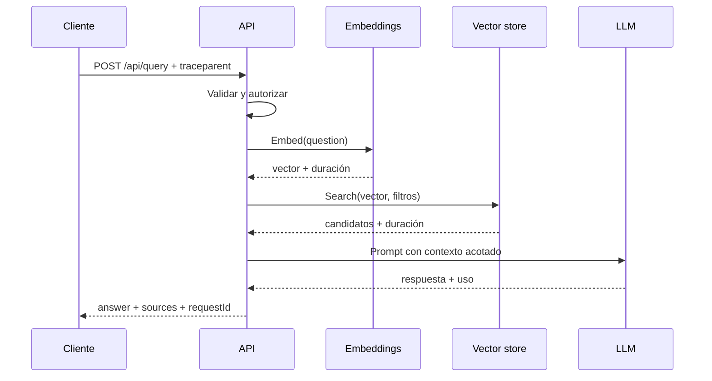

# Capítulo 18. Observabilidad y monitoreo

## ¿Por qué importa?

Una aplicación RAG reúne etapas distintas: entrada HTTP, autenticación, búsqueda, armado de contexto, generación y presentación de fuentes. Una respuesta mala puede originarse en cualquiera de ellas. Si sólo guardamos el texto final, no sabremos si la pregunta se transformó mal, si la búsqueda trajo fragmentos equivocados, si el modelo ignoró evidencia o si una cita apuntó a una versión obsoleta.

Observabilidad es la capacidad de entender el estado interno de un sistema a partir de señales que produce. Monitoreo es observar esas señales de forma continua y alertar cuando una condición requiere atención. Una analogía: el tablero del auto muestra velocidad, combustible y temperatura; una luz roja avisa de un problema, pero la telemetría del motor permite investigar por qué apareció. En RAG necesitamos ambas cosas: indicadores resumidos y contexto de diagnóstico.

La observabilidad importa también por costo y privacidad. Una consulta puede usar embeddings, vector store y un proveedor de generación, cada uno con latencia, errores y tarifas diferentes. Para investigar no es necesario registrar cada pregunta completa. Identificadores de correlación, duración, tamaño, etapa, versión de índice y códigos de error suelen bastar para localizar una falla sin copiar contenido sensible a los logs.

Este capítulo presenta el modelo de señales, instrumentación, objetivos de servicio, evaluación de calidad y operación de alertas. El [capítulo 3](book-es-cap3.md) describe las etapas del pipeline; el [capítulo 7](book-es-cap7.md) incluye criterios de medición de embeddings; el [capítulo 20](book-es-cap20.md) aplica estas señales al diagnóstico. No reemplaza el trabajo de privacidad y seguridad del [capítulo 15](book-es-cap15.md).

## ¿Cómo funciona?

### Logs, métricas y trazas

Un **log** registra un evento discreto: «la búsqueda agotó el tiempo límite». Una **métrica** agrega valores en el tiempo: «el 2 % de las consultas falló en los últimos cinco minutos». Una **traza** conecta operaciones de una solicitud: «API → embedding → Qdrant → LLM», con duración y atributos por etapa. Son complementarios; una métrica alerta, la traza localiza y el log explica un evento puntual.

| Señal | Pregunta que responde | Ejemplo | Cuidado principal |
|---|---|---|---|
| Logs estructurados | ¿Qué evento ocurrió? | `stage=retrieve error=timeout` | No incluir texto secreto ni tokens |
| Métricas | ¿Con qué frecuencia o duración? | `rag_query_duration_seconds` | Evitar etiquetas con cardinalidad infinita |
| Trazas | ¿Qué pasos tomó esta solicitud? | spans de embedding y búsqueda | Muestreo y acceso a atributos sensibles |
| Evaluaciones | ¿Fue buena la respuesta? | cita correcta en caso etiquetado | La métrica automática no equivale a verdad |

Una traza distribuida usa un `trace_id` compartido entre servicios y `span_id` para cada operación. Si el API llama a un worker o a un servicio externo, propaga el contexto de traza cuando el protocolo lo permita. No uses preguntas, correos o IDs personales como etiquetas métricas: cada valor distinto crea una serie adicional, aumenta costo y puede revelar información.

### El recorrido RAG como una traza



La secuencia enseña dónde medir, no prescribe un SDK. Cada paso debería capturar duración, resultado, timeout y atributos seguros como proveedor, modelo, número de candidatos y versión del índice. Una solicitud sin resultados no es equivalente a una consulta fallida; la traza debe mostrar esa diferencia. La muestra del repositorio hoy sólo devuelve `answer` y `sources`, y su endpoint `/health` no es un indicador completo de dependencias.

### Métricas que sí ayudan

Empieza con un conjunto pequeño y accionable:

- **Tasa de solicitudes exitosas y errores** por endpoint y etapa. Separa errores del cliente (4xx), fallas propias (5xx) y fallas de dependencias.
- **Latencia p50, p95 y p99** total y por etapa. p50 describe una experiencia típica; p95 ayuda a ver a usuarios lentos; p99 revela cola extrema, aunque es inestable con poco volumen.
- **Timeouts, reintentos y límites del proveedor**, junto con códigos 429/5xx cuando estén disponibles.
- **Tamaño de consulta y contexto**, candidatos recuperados, tokens de entrada/salida y duración de generación.
- **Proporción de abstención, respuestas sin fuentes y cobertura de citas**, interpretadas con evaluación.
- **Consumo y costo estimado** por etapa, proveedor, modelo y plan, con tarifas vigentes y supuestos declarados.
- **Estado de ingesta:** trabajos pendientes, edad del trabajo más antiguo, reintentos, documentos fallidos y retraso entre cambio de fuente e indexación.

No optimices una métrica aislada. Reducir `top_k` puede mejorar latencia y costo, pero perder evidencia. La tasa de respuestas completas puede subir al reducir abstenciones y, al mismo tiempo, empeorar la fundamentación. Vincula métricas operativas con un conjunto de evaluación y con señales de experiencia del usuario.

### Etiquetas, cardinalidad y límites

Una etiqueta de métrica debe tomar valores de un conjunto acotado: `stage=retrieve`, `provider=ollama`, `status=timeout`. Un `request_id` diferente por evento no sirve como etiqueta porque crea millones de series; mantenlo en logs o trazas. El `tenant_id` puede tener alta cardinalidad y ser dato sensible; suele ser mejor usar agregaciones controladas, muestreo de trazas o consultas en una fuente de eventos con acceso restringido.

Los histogramas permiten calcular percentiles a partir de buckets. Los percentiles de instancias distintas no se promedian de manera simple: un p95 de la flota se calcula desde distribución agregada, no como promedio de p95 por pod. Elige buckets que cubran duraciones esperadas y verifica cómo los agrega tu backend de métricas.

### Objetivos de servicio y alertas

Un SLI (indicador de nivel de servicio) es una medida concreta, por ejemplo, proporción de consultas elegibles que terminan con éxito en menos de un límite. Un SLO (objetivo) fija el nivel que se busca durante una ventana. Un SLA es un compromiso contractual y puede incluir consecuencias; no debe confundirse con una métrica interna. Para un RAG, define por separado disponibilidad de API, latencia interactiva, frescura de ingesta y calidad evaluada.

La latencia exitosa no refleja errores ni calidad. Especifica población y exclusiones: ¿se cuentan llamadas de salud?, ¿consultas canceladas?, ¿errores del cliente? Un ejemplo conceptual sería medir el porcentaje de `/api/query` que termina en menos de 8 segundos dentro de una ventana; 8 segundos es un número de demostración, no una recomendación universal. Obtén el objetivo de expectativas del usuario, mediciones y capacidad.

Una alerta útil informa impacto y acción. «p95 alto en recuperación durante 10 minutos» permite revisar vector store; «5xx altos» es demasiado genérico si se dispara por un deployment de prueba. Usa ventanas que amortigüen ruido, evita alertar por cada evento y establece runbooks. Las alertas de saturación pueden anticipar que la cola crecerá; las de síntomas pueden indicar que usuarios ya reciben errores. Ambas cumplen propósitos distintos.

### Privacidad y acceso a telemetría

Logs y trazas pueden contener texto de pregunta, extractos, identificadores de documento, URLs y prompts. Configura allowlist de campos, redacción, acceso por rol, cifrado y retención. Evita capturar cuerpos HTTP automáticamente. Para investigación con texto, crea un procedimiento excepcional con autorización, duración acotada y registro de acceso; el modo debug permanente suele expandir el riesgo sin mejorar la operación diaria.

Los identificadores seudónimos también pueden permitir correlación. Trátalos como datos con acceso controlado; no asumas que un hash es anónimo. Define si el usuario puede solicitar eliminación y qué implica para logs, trazas exportadas y backups. La telemetría de producto requiere informar finalidad y respetar las opciones y reglas aplicables.

### Calidad: monitoreo offline y online

Las métricas de infraestructura no dicen si una respuesta es correcta. Para calidad, conserva un conjunto de evaluación con pregunta, alcance, documentos esperados y criterios de respuesta; protege estos datos como cualquier otro corpus. Mide recall de contexto, precisión de recuperación, fidelidad de citas, exactitud, completitud y abstención adecuada. Los nombres y cálculos varían; importa que sean definidos y repetibles.

La evaluación offline compara una versión con otra antes del despliegue. La online vigila la distribución real: cambios de idiomas, fuentes, longitud y feedback. Un evaluador basado en otro modelo puede escalar revisión, pero también equivocarse o compartir sesgos. Calibra contra anotaciones humanas y toma una muestra manual de casos adversos. Nunca presentes una puntuación automática como certificación de verdad.

La telemetría de contenido debe ser mínima. Puede guardarse un ID de caso de evaluación y resultados agregados en lugar del cuerpo de cada respuesta. Si los términos de privacidad permiten una revisión de ejemplos, redáctalos y limita acceso. La dimensión humana de calidad se trata con más detalle en el [capítulo 19](book-es-cap19.md).

## ¿Cómo se implementa?

### Logs JSON mínimos en Express

El backend del repositorio usa `console.log` para arranque y registra errores con `console.error(error)`. El siguiente middleware conceptual agrega `requestId` y registra datos estructurados de duración y estado; no registra `req.body`. En producción debe integrarse con un colector, propagación de contexto y política de retención.

```js
import crypto from 'node:crypto';

app.use((req, res, next) => {
  const requestId = crypto.randomUUID();
  const started = performance.now();
  req.requestId = requestId;
  res.setHeader('x-request-id', requestId);
  res.on('finish', () => {
    console.log(JSON.stringify({
      event: 'http_request',
      requestId,
      method: req.method,
      route: req.route?.path ?? 'unmatched',
      status: res.statusCode,
      durationMs: Math.round(performance.now() - started)
    }));
  });
  next();
});
```

**Qué hace:** asigna un identificador correlacionable y emite un evento JSON por solicitud. **Por qué:** registros estructurados se pueden filtrar y agregar sin buscar frases libres. **Cómo funciona:** el middleware mide con reloj monotónico, añade un header y espera al evento `finish`. **Cuándo:** como base para una API pequeña, antes de adoptar una librería de observabilidad. **Resultado esperado:** una línea con método, ruta, estado, duración e ID; no contiene la pregunta ni el texto de documentos.

El ejemplo no genera una métrica de histograma ni spans de dependencias. También hay que asegurar que `req.route` esté disponible donde corre el middleware —un middleware montado antes de las rutas puede necesitar una plantilla de ruta definida por otra vía— y no usar la URL sin limpiar si contiene parámetros sensibles. Es un patrón ilustrativo, pendiente de integrar y validar contra la estructura real de Express desplegada.

### Medir etapas explícitamente

Para hacer visibles las causas, mide cada frontera con un helper. El siguiente código es demostrativo: `metrics.observe` representa un cliente de Prometheus u otro backend, que no está instalado en el proyecto. La etiqueta se limita a un conjunto fijo y el helper relanza errores para que el manejador mantenga el comportamiento correcto.

```js
async function measured(stage, operation, fn) {
  const started = performance.now();
  let outcome = 'ok';
  try {
    return await fn();
  } catch (error) {
    outcome = 'error';
    throw error;
  } finally {
    metrics.observe('rag_stage_duration_ms', performance.now() - started, {
      stage, outcome
    });
  }
}

const vector = await measured('embedding', 'query', () => embed(question));
const sources = await measured('retrieval', 'query', () => search(vector, scope));
const answer = sources.length
  ? await measured('generation', 'query', () => chat(question, sources))
  : 'No encontré evidencia en las fuentes autorizadas.';
```

El argumento `operation` no se usa arriba y se omite intencionalmente de la métrica para no multiplicar etiquetas; en una implementación real elimínalo o úsalo en el span. Un ejemplo productivo debe distinguir timeout, rechazo por cuota y error de red sin incluir mensajes que contengan secretos. Instrumenta también la cantidad de fuentes y tokens, con buckets o medidas adecuadas.

### Contrato de errores y health checks

Un endpoint `/health` responde si el proceso puede contestar. Un readiness check debe indicar si la instancia está preparada para recibir tráfico, y un liveness check sólo detectar que el proceso quedó bloqueado; reiniciar el pod por una indisponibilidad temporal del proveedor puede empeorarla. La consulta debería devolver errores distinguibles para entrada inválida, cuota, no evidencia y dependencia caída. No conviertas un error del vector store en respuesta vacía: esa diferencia es necesaria para usuarios y operadores.

El health check del repositorio actual devuelve `{"status":"ok"}` sin consultar dependencias. Sirve para comprobar que Express está activo, no que ingesta y generación funcionen. En Kubernetes, los probes deben ser baratos, tener timeouts y no invocar un modelo en cada verificación. El [capítulo 14](book-es-cap14.md) presenta límites del despliegue de ejemplo.

### Esquema de evento de consulta

Un evento de auditoría de consulta podría incluir `requestId`, etapa, modelo/configuración, versión de colección, cantidad de candidatos, duración, códigos de resultado y tokens agregados. Evita incluir texto de pregunta y pasajes por defecto. Si necesitas mantener relación con una organización, decide si se guarda identificador interno, hash con rotación o una categoría agregada; revisa que el conjunto de datos no permita reconstruir identidad.

Los eventos de ingesta necesitan `jobId`, tenant autorizado, documento opaco, versión, intento, estado y demora. Nunca anotes una ingesta exitosa sólo porque se aceptó el trabajo: separa `accepted`, `processing`, `indexed` y `failed`. El usuario debería poder consultar estado sin que esa consulta exponga metadatos de otro cliente.

### Paneles y alertas

Un panel de guardia puede mostrar tasa de solicitudes, p95 total, errores por etapa, timeouts de proveedor, retraso de ingesta, costo estimado y resultado de evaluación reciente. No conviertas el panel en una pared de gráficos: cada visualización debe conducir a una pregunta operativa. Anota despliegues y cambios de modelo para correlacionar saltos.

Prometheus y Grafana son una opción común para métricas y paneles autogestionados; implican operar almacenamiento, retención y alta disponibilidad según necesidad. Los servicios gestionados reducen tareas de plataforma, con costos, dependencia y políticas de exportación a revisar. Datadog es una alternativa comercial con capacidades integradas; la elección depende de herramientas existentes, volumen, retención, requisitos de datos y habilidades del equipo. No se indican precios porque cambian y deben consultarse en los sitios actuales.

### Muestreo y presupuestos de instrumentación

Instrumentar cada operación con todos los atributos puede ser costoso. Define primero qué preguntas debe responder cada señal y qué proporción de eventos conservarás. Las métricas agregadas suelen capturarse en su totalidad; las trazas pueden muestrearse, con mayor probabilidad para errores o solicitudes lentas. El muestreo basado en cola puede decidir al final de la solicitud si conserva una traza, pero requiere configuración coordinada entre procesos. No muestrees de manera que elimines precisamente los fallos raros que quieres investigar.

El presupuesto de telemetría incluye ingestión, almacenamiento, consultas, retención y tiempo del equipo. Antes de exportar cada span, revisa si el atributo se necesita; evita duplicar el cuerpo de la solicitud en varios servicios. Define límites de tamaño para eventos y controla la caída de exportación: la indisponibilidad del colector no debería bloquear todas las respuestas interactivas. Los buffers deben ser acotados y la pérdida de telemetría debe reportarse como tal, sin confundirla con una falla del RAG.

### Cambios de modelo e índice

Un despliegue de nueva versión puede alterar distribución de latencia, consumo y calidad. Etiqueta cada evento con IDs de configuración inmutables —modelo, plantilla de prompt, versión de chunking y colección— y anota el instante del cambio. No uses el nombre mutable de una etiqueta como única referencia si el proveedor puede actualizarla detrás de ese nombre. Cuando no exista una versión inmutable, documenta esa limitación y conserva la configuración usada.

Compara versiones en un grupo de control o con despliegue gradual, si el producto y la privacidad lo permiten. Define condiciones de reversión: error por encima del presupuesto, caída de métricas de evaluación o incremento de costo. Una regresión puede aparecer sólo en un idioma, tipo documental o clase de consulta. Por eso, una revisión por segmentos debe acompañar la cifra global. El [capítulo 19](book-es-cap19.md) cubre experimentos de optimización; las mediciones de este capítulo hacen que esos experimentos sean comparables.

### Runbook de primera respuesta

Ante una alerta, confirma primero si el síntoma afecta a usuarios: tasa de solicitudes, distribución de latencia, errores por etapa y estado de dependencias. Busca el inicio temporal y compáralo con despliegues, reindexaciones o cambios de configuración. Después sigue una traza representativa usando el ID de solicitud; si el problema es contenido incorrecto, inspecciona fuentes y versión sólo mediante un acceso autorizado. Aplica una mitigación reversible —por ejemplo, reducir concurrencia o revertir configuración— y registra el efecto.

No cambies top-k, prompt y modelo al mismo tiempo durante un incidente: perderás evidencia sobre la causa. Si existe riesgo de exposición entre usuarios, prioriza contener la ruta afectada y preservar metadatos de auditoría; no copies datos sensibles a canales informales. El runbook debe nombrar responsables, escalamiento, comandos permitidos y cómo comunicar el estado. Se revisa después de incidentes reales porque los supuestos operativos cambian.

## Errores frecuentes y buenas prácticas

- **Medir sólo el tiempo total.** Instrumenta etapas para separar generación lenta de búsqueda lenta.
- **Contar cero resultados como error.** Distingue abstención legítima, fallo técnico y corpus vacío.
- **Usar IDs únicos como etiquetas métricas.** Guárdalos en trazas/logs; mantén etiquetas acotadas.
- **Registrar cuerpos completos por defecto.** Usa allowlist, minimización y retención explícita.
- **Alertar con un umbral arbitrario.** Relaciona alerta con impacto, SLO y acción de guardia.
- **Reiniciar por cada dependencia caída.** Separa liveness de readiness y controla reintentos.
- **Interpretar latencia como calidad.** Añade evaluaciones y revisión humana de muestras.
- **Promediar percentiles.** Agrega histogramas correctamente.
- **Confiar ciegamente en un evaluador LLM.** Calibra y coteja contra casos etiquetados.
- **Olvidar la ingesta.** Una respuesta puede estar bien generada pero usar contenido desactualizado.

## Ejercicios

1. Dibuja una traza de `/api/query` y define spans y atributos seguros por etapa.
2. Propón un SLI para la latencia de consulta y otro para frescura de ingesta. Define población, ventana, exclusiones y objetivo provisional.
3. Diseña una alerta que avise de crecimiento de errores sin paginar por un fallo aislado de bajo impacto.
4. Clasifica los campos `question`, `requestId`, `tenantId`, `provider`, `durationMs`, `sourceText` como log, métrica, traza o campo que debe omitirse; explica la política.
5. Crea una evaluación de 20 preguntas con evidencia y casos sin respuesta. ¿Qué resultados deben bloquear un despliegue?
6. Investiga una respuesta incorrecta usando sólo IDs opacos, spans y versión de índice. ¿Qué datos adicionales serían imprescindibles y cómo controlarías su acceso?

## Referencias y validación

Referencias: OpenTelemetry, [documentación y conceptos](https://opentelemetry.io/docs/concepts/); Prometheus, [guía de instrumentación](https://prometheus.io/docs/practices/instrumentation/); Google SRE, [Service Level Objectives](https://sre.google/sre-book/service-level-objectives/); Lewis et al., [RAG](https://arxiv.org/abs/2005.11401). Consulta documentación vigente para instrumentación, retención y configuración de proveedores.

**Validación:** los fragmentos de middleware, `metrics.observe`, tracing y esquemas de eventos son conceptuales; no se agregaron SDKs ni infraestructura de observabilidad. El endpoint `/health` existente sólo comprueba proceso. No se ejecutaron pruebas de carga, integración, retención, alertas ni seguridad de telemetría. La selección de métricas requiere datos reales y objetivos acordados con producto y operación.

**Siguiente:** [Capítulo 19](book-es-cap19.md).
