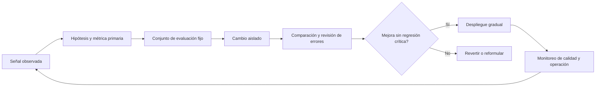

# Capítulo 19. Optimización avanzada

## ¿Por qué importa?

Un sistema RAG que ya responde preguntas puede seguir fallando como producto. Quizá encuentre documentos relacionados, pero no el párrafo que contiene el dato; quizá responda bien, aunque tarde demasiado o cueste más de lo que el usuario tolera. Optimizar significa mejorar una combinación explícita de calidad, latencia, costo, seguridad y facilidad de operación. No significa sumar modelos o parámetros hasta que una demostración parezca más inteligente.

La optimización importa porque cada etapa limita a las siguientes. Si el recuperador no trae evidencia pertinente, un modelo más grande normalmente no puede citar un pasaje que nunca vio. Si la evidencia sí aparece, pero el generador la interpreta mal, cambiar el índice puede empeorar la búsqueda sin resolver la causa. Como en una cadena de producción, acelerar la estación equivocada no aumenta el ritmo final.

Este capítulo convierte la observabilidad del [capítulo 18](book-es-cap18.md) en un ciclo de experimentación. No vuelve a explicar embeddings, chunking, caché o índices: consulta los [capítulos 2](book-es-cap2.md), [7](book-es-cap7.md), [8](book-es-cap8.md) y [9](book-es-cap9.md). Nos concentraremos en cómo medir, decidir qué cambiar y conservar evidencia de que el cambio ayudó.

### Optimizar es elegir un compromiso

No hay una configuración óptima fuera de un caso de uso. Un buscador jurídico puede preferir alta cobertura y revisión humana; una ayuda de soporte quizá deba contestar en menos de un segundo; un asistente de investigación puede aceptar demoras a cambio de varias fuentes. Antes de tocar el código, escribí qué resultado importa, para quién y bajo qué límites.

Una función objetivo sencilla puede servir para ordenar decisiones, aunque no debe ocultar requisitos obligatorios:

| Dimensión | Pregunta útil | Ejemplo de señal |
|---|---|---|
| Calidad | ¿La evidencia correcta aparece y sostiene la respuesta? | Recall@k, citas correctas, abstención adecuada |
| Latencia | ¿Cuánto espera la persona y qué parte domina el tiempo? | p50/p95 total y por etapa |
| Costo | ¿Qué recursos consume una operación y una unidad de valor? | costo por consulta resuelta, tokens, CPU, almacenamiento |
| Seguridad | ¿El alcance y los datos se mantienen autorizados? | pruebas de aislamiento, filtraciones confirmadas |
| Operabilidad | ¿Podemos detectar y revertir una regresión? | cobertura de trazas, rollback probado |

Una mejora de costo no compensa una filtración, y una respuesta veloz no es útil si inventa información. Tratá seguridad y cumplimiento como restricciones, y compara calidad, costo y latencia dentro de ese espacio permitido. La optimización puede ser una frontera de Pareto: una opción domina a otra si mejora al menos una dimensión sin empeorar ninguna; las opciones no dominadas representan compromisos que producto debe elegir.

## ¿Cómo funciona?

### Primero se establece una línea de base

Una línea de base describe el sistema y la carga antes de modificarlo. Incluye versión de aplicación, prompt, modelo, configuración de recuperación, colección, distribución de consultas, región y estado de dependencias. También contiene un conjunto de preguntas representativas y mediciones repetibles. Sin esta fotografía, “ahora parece mejor” no permite distinguir una mejora del azar, una consulta más fácil o un proveedor que tuvo menos carga.

El conjunto de evaluación comienza pequeño y explícito. Para cada pregunta registra el contexto permitido, uno o más documentos o pasajes esperados, respuesta aceptable, respuesta que debe abstenerse y, si aplica, segmento de usuario o idioma. Etiquetar cuesta tiempo; por eso es mejor empezar con casos de alto valor y ampliar con errores reales anonimizados y revisados. No extraigas datos sensibles a una hoja compartida sólo para acelerar la tarea.

Separá ejemplos de desarrollo y de evaluación. Si se ajusta el prompt mirando siempre las mismas veinte preguntas, el sistema puede memorizar sus formas y fallar en nuevas variantes. Conservá un conjunto de regresión estable, otro de ajuste y una muestra reciente que refleje el tráfico. Para documentos que cambian, registra versión y fecha: una etiqueta basada en una fuente obsoleta puede marcar como incorrecta una respuesta correcta.

### Métricas de recuperación y generación

En recuperación, **Recall@k** pregunta qué proporción de la evidencia etiquetada apareció entre los primeros k resultados. **Precision@k** pregunta qué proporción de esos resultados era pertinente. Una búsqueda de contexto amplio suele favorecer recall; un contexto corto suele necesitar precisión. El valor de k no es mágico: cambia el costo de generación, la probabilidad de ruido y el límite de contexto. Para RAG con varios pasajes relevantes, define si la unidad es documento, fragmento o evidencia mínima.

En generación, separa fidelidad al contexto, respuesta completa, exactitud de citas y abstención apropiada. La exactitud factual puede requerir referencia experta; una comparación textual no alcanza cuando dos respuestas correctas usan palabras distintas. Un evaluador basado en un LLM puede ayudar a priorizar revisión, pero debe calibrarse con personas y tratarse como estimación, no como verdad automática. Evaluá por tipo de pregunta, idioma y fuente, pues un promedio puede tapar fallos concentrados.

El costo y el tiempo se miden por etapa. La latencia total puede descomponerse en validación, embedding, recuperación, reranking, armado de contexto y generación. En costos, considera además ingesta, almacenamiento, transferencias, cómputo reservado, observabilidad y reintentos. Una caché que reduce llamadas al modelo puede aumentar memoria o servir contenido desactualizado; su política de clave e invalidación debe preservar el ámbito del usuario, como se explica en el [capítulo 9](book-es-cap9.md).

| Síntoma medido | Hipótesis inicial | Evidencia que la confirma o descarta |
|---|---|---|
| Recall@k bajo | consulta, representación o filtros deficientes | evidencia etiquetada ausente en candidatos amplios |
| Recall alto, respuesta incompleta | selección de contexto o síntesis | pasaje correcto llega al prompt, pero se omite |
| p95 alto sólo en generación | modelo, tokens o proveedor | traza de etapa y conteo de tokens |
| costo alto por respuesta | contexto largo, modelo o reintentos | consumo distribuido por etapa y resultado |
| pocos resultados recientes | ingesta atrasada o filtro temporal | estado/versiones del documento y cola |

### Un ciclo experimental controlado

La forma segura de optimizar es formular una hipótesis, cambiar una variable principal, medir con el mismo conjunto y conservar el resultado. Por ejemplo: “El recall bajo en nombres de producto se debe a que el usuario usa un alias; añadir expansión de consulta aumentará Recall@10 sin elevar el p95 más de 150 ms”. La frase define segmento, cambio, métrica primaria y presupuesto de regresión. Si se cambian a la vez embedding, chunking, prompt y modelo, no podremos atribuir el resultado.

El flujo habitual tiene cinco pasos: identificar un síntoma real; localizar la etapa responsable; seleccionar un cambio reversible; comparar contra una referencia; desplegar gradualmente y observar. Un cambio puede ser configuración, datos, código o proveedor. Guarda el identificador del experimento y la configuración usada en las trazas o el registro de evaluación, como recomienda el capítulo anterior.



El diagrama muestra un ciclo y no una secuencia de ajustes permanentes. Una métrica primaria evita escoger después la estadística que luce mejor; las métricas de seguridad, calidad mínima y latencia actúan como guardas. Para cambios con gran incertidumbre conviene una comparación offline antes de exponer usuarios. Una prueba A/B puede comparar comportamiento real, pero requiere asignación consistente, suficiente volumen, revisión de privacidad y una condición de detención.

### ¿Qué optimizar primero?

**Recuperación híbrida.** La búsqueda léxica, por ejemplo BM25, detecta coincidencias exactas como códigos, nombres propios o identificadores. La búsqueda vectorial aproxima significado y puede recuperar paráfrasis. Combinar ambas señales es útil cuando el vocabulario de usuario no coincide exactamente con el documento y cuando los términos exactos siguen importando. No sumes puntuaciones crudas sin normalización: sus escalas y distribuciones pueden ser distintas. La fusión por rango recíproco (RRF) combina posiciones en rankings y reduce dependencia de escalas, aunque agrega consultas y complejidad.

**Reranking.** Un recuperador rápido genera un conjunto amplio de candidatos; un reranker compara cada pasaje con la pregunta de forma más fina y vuelve a ordenarlo. Es parecido a que una biblioteca primero encuentre estantes posibles y después una persona revise los libros. El reranker no recupera documentos ausentes del conjunto inicial. Un top-N demasiado grande aumenta latencia y costo; uno pequeño puede descartar evidencia necesaria. Medí ganancia de calidad frente a demora, y prueba si basta con rerankear sólo consultas difíciles.

**Reescritura y expansión de consulta.** Un modelo o reglas pueden convertir una pregunta conversacional en una consulta de búsqueda más explícita, resolver referencias al contexto o producir variantes. Ayuda con acrónimos y términos alternativos; también puede cambiar la intención. Conserva la pregunta original, registra la reescritura de manera protegida y prueba preguntas ambiguas, negativas y con entidades exactas. Si la reescritura requiere una llamada adicional al LLM, verifica si el beneficio compensa el costo.

**Contexto y generación.** Más pasajes no implican mejor respuesta. El contexto irrelevante distrae al modelo, aumenta tokens y puede mezclar versiones. Deduplica fragmentos superpuestos, conserva encabezados y metadatos útiles, y limita el contexto al presupuesto probado. Instrucciones de cita y abstención deben acompañarse de evaluación: un prompt no convierte un modelo en verificador infalible. Si la respuesta puede ser extractiva, quizá un formato estructurado o una cita directa sea mejor que una explicación extensa.

**Caché.** Hay varias capas: embedding de consulta, resultados de búsqueda, respuesta final o artefactos de ingesta. Cada una necesita clave, alcance, expiración e invalidación propios. Las consultas semánticamente parecidas no son necesariamente equivalentes; una caché de respuestas puede ignorar cambios de permisos o documentos. Incluye en la clave la versión de configuración y el contexto de autorización pertinente, o evita cachear la salida sensible. Revisá el capítulo 9 antes de diseñar esta capa.

**Batching y concurrencia.** Agrupar embeddings de una ingesta puede amortizar llamadas y mejorar utilización. Aumentar concurrencia puede ocultar latencia de red, hasta saturar CPU, cuota o proveedor y empeorar las colas. Define límites, timeout y backpressure; mide throughput junto con p95 y tasa de error. La latencia media sola puede ocultar que una fracción de usuarios espera mucho más.

| Técnica | Beneficio probable | Costo o riesgo | Elegir cuando |
|---|---|---|---|
| Híbrida léxica y vectorial | mejora términos exactos y semántica | dos rutas, fusión y mantenimiento | fallan consultas con códigos o vocabulario desigual |
| Reranking | ordena mejor candidatos existentes | llamada adicional y latencia | la evidencia aparece, pero queda debajo del corte |
| Reescritura | resuelve referencias y variantes | deriva de intención y costo | errores se concentran en formulación de consultas |
| Caché | evita trabajo repetido | obsolescencia, aislamiento y memoria | hay repetición y política de invalidez clara |
| Modelo mayor | puede mejorar razonamiento y redacción | costo, latencia y posible variación | evaluación muestra una brecha de generación |

### Capacidad, colas y presupuesto de latencia

El presupuesto de latencia debe asignarse por ruta. Una consulta interactiva puede tener un objetivo total y límites por dependencia; una ingesta asíncrona puede priorizar completitud y tiempo hasta indexación. Si cada etapa usa su propio timeout máximo sin coordinación, la suma puede superar el plazo de usuario. Reserva margen para serialización y red; cancela trabajo que ya no será útil después de que el cliente cierre la conexión, cuando las dependencias lo permitan.

La cola también es una señal de saturación. Un sistema puede conservar buen tiempo de respuesta promedio mientras acumula trabajos que terminarán tarde. Limita tamaño y concurrencia, monitoriza espera y define qué hacer al alcanzar capacidad: rechazar con señal explícita, posponer o aplicar prioridad. Escalar horizontalmente no resuelve un límite impuesto por cuota externa ni una colección saturada; primero identifica el recurso limitante.

## ¿Cómo se implementa?

### Ejemplo progresivo: medir una etapa en Node.js

El siguiente helper conceptual mide una operación asíncrona sin cambiar su resultado. `recordMetric` representa el cliente de métricas que el equipo elija; no existe en las dependencias del repositorio de acompañamiento y el código no está conectado a Prometheus. Usa etiquetas de conjunto pequeño —por ejemplo `stage` y `outcome`— y evita IDs de usuario, preguntas o documentos como etiquetas, porque crearían cardinalidad y riesgo de privacidad.

```js
async function measureStage(stage, operation, recordMetric) {
  const started = performance.now();
  let outcome = 'ok';
  try {
    return await operation();
  } catch (error) {
    outcome = 'error';
    throw error;
  } finally {
    recordMetric({
      name: 'rag_stage_duration_ms',
      value: performance.now() - started,
      labels: { stage, outcome }
    });
  }
}

const passages = await measureStage('retrieval', () => retrieve(question), recordMetric);
```

**Qué hace:** conserva el valor o error de `retrieve` y registra duración y resultado. **Por qué:** permite separar búsqueda lenta de generación lenta. **Cómo funciona:** `performance.now()` mide tiempo monotónico; `finally` registra incluso si hubo excepción. **Cuándo conviene:** al instrumentar etapas que ya están delimitadas. **Resultado esperado:** observaciones agregables para éxito y error. En producción, el registro de telemetría debe ser acotado y no bloquear la respuesta si el colector cae; el mecanismo concreto queda pendiente de integrar y validar.

### Ejemplo de fusión de rankings por RRF

Este código es una implementación didáctica de la fusión por rango recíproco. Recibe listas ya ordenadas de IDs y produce una puntuación de fusión. No consulta motores de búsqueda, no tiene pruebas de calidad incorporadas y no sustituye el análisis de duplicados o permisos. `k` es un parámetro de suavizado; el valor debe ajustarse con evaluación, no copiarse como constante universal.

```js
function reciprocalRankFusion(rankings, k = 60) {
  const scores = new Map();
  for (const ranking of rankings) {
    ranking.forEach((id, index) => {
      scores.set(id, (scores.get(id) ?? 0) + 1 / (k + index + 1));
    });
  }
  return [...scores.entries()]
    .map(([id, score]) => ({ id, score }))
    .sort((a, b) => b.score - a.score);
}

const fused = reciprocalRankFusion([
  ['chunk-7', 'chunk-2', 'chunk-9'], // ranking léxico
  ['chunk-2', 'chunk-4', 'chunk-7']  // ranking vectorial
]);
```

**Qué hace:** premia elementos que aparecen en posiciones altas de una o más listas. **Por qué:** los scores originales pueden no ser comparables. **Cómo funciona:** cada posición aporta `1 / (k + rango)` y luego se suman contribuciones por ID. **Cuándo conviene:** cuando ya existen dos rankings útiles y la evaluación muestra que complementan sus errores. **Resultado esperado:** una lista fusionada que combina señales sin usar su escala nativa. Antes de producción deben filtrarse candidatos por autorización en ambas consultas y verificar qué representación del ranking usa el proveedor.

### Comparación offline de configuraciones

Un experimento real necesita guardar datos de referencia y medir más de una dimensión. El siguiente pseudocódigo es intencional: `evaluate` representa una herramienta propia y `cases` un conjunto etiquetado; no forman parte del proyecto ni fueron ejecutados. Compara una sola variable principal, `topK`; ambas variantes mantienen recuperación vectorial y reranking desactivado, con los demás parámetros y casos constantes. En una evaluación estadística, además se debe estimar incertidumbre y evitar conclusiones a partir de pocas consultas.

```js
const baseline = await evaluate(cases, {
  retrieval: 'vector', topK: 8, rerank: false
});
const candidate = await evaluate(cases, {
  retrieval: 'vector', topK: 20, rerank: false
});

console.table([
  { variant: 'baseline', recallAt10: baseline.recallAt10,
    p95Ms: baseline.p95Ms, costPerQuery: baseline.costPerQuery },
  { variant: 'candidate', recallAt10: candidate.recallAt10,
    p95Ms: candidate.p95Ms, costPerQuery: candidate.costPerQuery }
]);
```

**Qué hace:** plantea una comparación vectorial con `topK` 8 frente a 20, sin reranking. **Por qué:** aislar una variable principal permite atribuir diferencias observadas a ese cambio, sujeto a variabilidad de la evaluación. **Cómo funciona:** ambas variantes reciben los mismos casos y mantienen iguales el método de recuperación, el estado de reranking y los demás parámetros. **Cuándo conviene:** al investigar si ampliar candidatos mejora la recuperación y si el costo adicional resulta aceptable. **Resultado esperado:** métricas comparables para inspeccionar; el pseudocódigo no incluye resultados medidos ni garantiza una mejora. Una comparación híbrida o con fusión RRF, y una evaluación de reranking, requieren experimentos separados. El ejemplo no calcula intervalos de confianza, costo real ni métricas de generación; esos componentes requieren una implementación y datos verificables.

### Despliegue gradual y reversión

Cuando la prueba offline es satisfactoria, publica con una estrategia reversible: feature flag, porcentaje pequeño de tráfico o grupo interno. Conserva configuración anterior, registra qué solicitudes usan cada variante y define por adelantado condiciones para detener. Un despliegue gradual no debe asignar clientes de manera que se mezclen sus datos ni cambiar su colección sin una migración controlada. El cambio de embeddings puede requerir un índice paralelo y reingesta; consulta el [capítulo 8](book-es-cap8.md).

Un A/B evalúa diferencias en un resultado definido, pero puede ser injusto si los grupos tienen cargas distintas o si hay poco volumen. Para eventos raros, una prueba sintética repetible y revisión experta pueden aportar más que una comparación online breve. Anota exclusiones y períodos de calentamiento. Si los resultados son inconclusos, el resultado correcto es “no sabemos todavía”, no escoger el número más favorable.

### Errores frecuentes y buenas prácticas

- Cambiar varias etapas de una vez: aislar una variable principal y registrar configuración.
- Perseguir una métrica promedio: revisar percentiles y segmentos importantes.
- Aumentar `topK` por intuición: medir recuperación, ruido, tokens y demora juntos.
- Usar un modelo grande para corregir recuperación vacía: primero inspeccionar candidatos.
- Optimizar sólo costo por llamada: contar también ingesta, reintentos, almacenamiento y trabajo humano.
- Confiar en puntuaciones automáticas sin calibración: cotejar una muestra con jueces humanos.
- Hacer caché de respuestas sin alcance de autorización: incorporar permisos y versiones o no cachear.
- Desplegar un índice nuevo sin plan de reversión: mantener alias/versiones y validar antes del cambio.
- Tratar una mejora global como universal: revisar idioma, fuente, tipo de consulta y usuarios afectados.

## Ejercicios

1. Diseñá un conjunto de 30 preguntas para un manual técnico: 20 con evidencia, 5 ambiguas y 5 sin respuesta. Define criterios de éxito y privacidad.
2. Para una consulta con baja precisión@5, enumera tres causas posibles y la evidencia que pedirías antes de cambiar `topK`.
3. Compara recuperación vectorial y BM25 para preguntas con códigos de producto y paráfrasis. Predice dónde gana cada método y prueba la predicción.
4. Establece un presupuesto de latencia de 1,5 segundos. Divide el presupuesto entre embedding, búsqueda, reranking, generación y margen; explica cómo actuar si una dependencia supera su parte.
5. Propón una clave de caché para respuesta final que considere idioma, versión de prompt, colección y autorización. Explica el riesgo de omitir cada campo.
6. Diseñá un rollback para cambiar proveedor de embeddings. Incluye colección, dimensiones, reingesta, tráfico de prueba y condición de reversión.

## Referencias y validación

Referencias verificables: Lewis et al., [Retrieval-Augmented Generation for Knowledge-Intensive NLP Tasks](https://arxiv.org/abs/2005.11401); Gao et al., [Retrieval-Augmented Generation for Large Language Models: A Survey](https://arxiv.org/abs/2312.10997); documentación oficial de [Qdrant Query Points](https://qdrant.tech/documentation/search/); documentación de [OpenTelemetry](https://opentelemetry.io/docs/concepts/). Para métricas de ranking, consulta la definición académica de [reciprocal rank fusion](https://doi.org/10.1145/1571941.1572114). Las APIs y versiones de proveedores deben revisarse antes de implementar.

**Validación editorial:** se conservaron los metadatos y el enlace de continuidad al capítulo 20. Los ejemplos de medición, RRF y evaluación son didácticos; no se ejecutaron ni están conectados al backend del repositorio. No se modificaron código, configuración ni otros capítulos. El diagrama usa sintaxis Mermaid `flowchart` y queda pendiente renderizarlo en el motor de publicación final.

**Siguiente:** [Capítulo 20](book-es-cap20.md).
