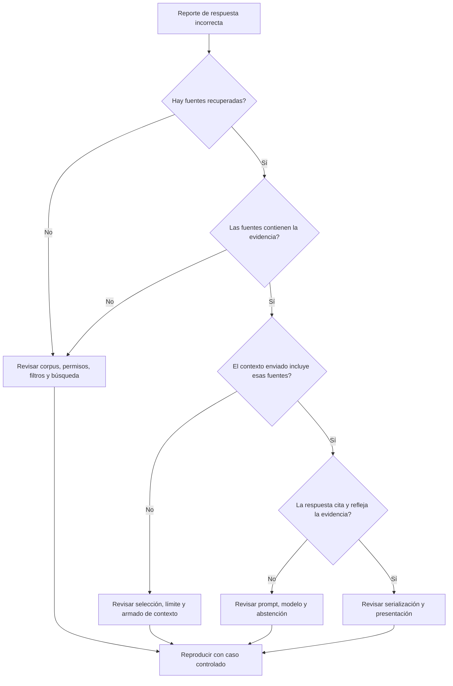

# Capítulo 20. Diagnóstico y solución de problemas

## ¿Por qué importa?

Un sistema RAG combina componentes que fallan de maneras distintas: la API puede estar activa mientras el vector store no responde; una pregunta puede llegar al modelo aunque la búsqueda haya recuperado pasajes equivocados; una ingesta puede terminar en HTTP 201 y, aun así, producir fragmentos inútiles. Un diagnóstico ordenado evita arreglar el síntoma visible y dejar intacta la causa.

El problema tiene una dimensión adicional: las respuestas plausibles disimulan fallas. Un error HTTP se nota enseguida; una cita que apunta al documento equivocado puede pasar por correcta hasta que alguien toma una decisión. Por eso, diagnosticar RAG exige revisar tanto el recorrido técnico como la evidencia, la autorización, la actualidad y el comportamiento de abstención.

Este capítulo ofrece un método que empieza por acotar el impacto y sigue la solicitud etapa por etapa. Se apoya en los conceptos de [arquitectura de consulta e ingesta](book-es-cap3.md), [despliegue](book-es-cap14.md), [seguridad empresarial](book-es-cap15.md), [observabilidad](book-es-cap18.md) y [optimización](book-es-cap19.md). El repositorio de acompañamiento es deliberadamente pequeño: su `/health` confirma que Express está vivo, no que todos los servicios funcionen ni que el resultado sea correcto.

### El principio: conservar evidencia antes de cambiar

Durante un incidente es tentador reiniciar todo, reindexar y cambiar el prompt en la misma intervención. Esa combinación puede ocultar el problema, borrar el estado útil y hacer imposible saber qué lo resolvió. Primero registra cuándo empezó, qué rutas están afectadas, qué versión/configuración corre y qué evidencia segura hay disponible. Luego aplica la mitigación más acotada que reduzca el daño.

Una analogía útil es el diagnóstico médico: el síntoma orienta, pero no identifica por sí solo la causa. “La respuesta está mal” puede significar documento faltante, búsqueda deficiente, filtro demasiado restrictivo, prompt ambiguo, modelo alterado o frontend que muestra una cita incorrecta. Cada hipótesis requiere una comprobación distinta.

## ¿Cómo funciona?

### Clasificar el síntoma por etapa

Una consulta recorre una cadena: entrada y autenticación, normalización, embedding, búsqueda, filtros, reranking opcional, selección de contexto, generación y presentación. La ingesta recorre otra: recepción, extracción, limpieza, fragmentación, embeddings, escritura, publicación y actualización del estado. El primer objetivo es averiguar hasta dónde avanzó la operación.

| Síntoma | Primer lugar para investigar | Pregunta concreta |
|---|---|---|
| 400 o respuesta inmediata | validación de entrada/API | ¿El contrato y el payload coinciden? |
| 401/403 o resultados vacíos para un usuario | identidad, permisos y filtros | ¿Qué alcance derivó el servidor? |
| timeout o 502 | dependencia y límites de tiempo | ¿Qué etapa agotó el plazo? |
| respuesta sin fuentes | corpus, ingesta y recuperación | ¿El documento existe, está publicado y coincide con el filtro? |
| fuente correcta, respuesta incorrecta | contexto, prompt y generación | ¿La evidencia llegó completa y qué pidió el modelo? |
| demora alta | trazas y colas | ¿Qué etapa aporta la mayor parte del p95? |
| contenido obsoleto | sincronización y versiones | ¿La versión nueva se procesó y se volvió activa? |
| error sólo en navegador | React, CORS y contrato HTTP | ¿La API responde fuera del navegador? |

No concluyas que “Qdrant está caído” porque una consulta dio cero pasajes. Cero resultados puede ser una abstención válida, un corpus vacío, un filtro incorrecto o un fallo que la aplicación convirtió erróneamente en lista vacía. De forma parecida, una respuesta 502 en la API del ejemplo significa que falló una dependencia upstream; el detalle puede aparecer sólo en logs de desarrollo y no debe exponerse a usuarios en producción.

### Árbol de decisión para una respuesta incorrecta

Inspecciona primero las fuentes devueltas, con acceso autorizado. Si no contienen la respuesta necesaria, investiga disponibilidad del documento, versión, extracción, chunking, embedding, filtros y ranking. Si contienen evidencia suficiente, revisa qué fragmentos entraron al prompt, el orden, instrucciones, salida del modelo y correspondencia de citas. Si el texto es correcto pero la interfaz muestra otra fuente, sigue el contrato de respuesta hasta React.



El árbol propone el orden de inspección, no obliga a registrar texto sensible. En producción, las fuentes pueden revisarse mediante una herramienta restringida, IDs opacos y auditoría; si no se permite conservar contenido, reproduce el caso desde la fuente autorizada en un entorno seguro. El objetivo es responder una pregunta cada vez y preservar una cadena de evidencia verificable.

### Fallos de ingesta y frescura

“Documento aceptado” no equivale a “documento disponible para consulta”. Separa estados como recibido, en procesamiento, indexado, publicado y fallido. Si la carga se procesa por cola, el endpoint puede confirmar la aceptación antes de que el trabajo termine. Inspecciona ID del trabajo, versión, cantidad de fragmentos, errores de extracción y confirmación de escritura. Un mensaje de éxito debe indicar qué significa exactamente.

Los problemas de frescura a menudo son de coordinación. La fuente se actualizó, pero el conector no detectó cambios; se indexó una versión nueva, pero no se activó; se eliminó el origen, pero quedaron vectores; o un caché sigue sirviendo la respuesta anterior. Define una fuente de verdad, versiona los documentos y revisa coherencia entre almacenamiento original, índice y caché. Al cambiar modelo de embeddings o dimensión, no mezcles espacios incompatibles en una colección; el backend de ejemplo verifica dimensión y recomienda una colección nueva.

### Errores de recuperación

**No aparece el pasaje esperado.** Comprueba primero que el texto se extrajo correctamente. Tablas, PDF escaneados, encabezados repetidos y columnas pueden convertirse en una secuencia de texto confusa. Después verifica filtros, idioma, normalización, modelo de embedding, colección y configuración. La similitud semántica no reemplaza búsqueda léxica cuando importan códigos exactos. La búsqueda híbrida y el reranking se estudian en el [capítulo 19](book-es-cap19.md).

**Aparecen pasajes relacionados pero insuficientes.** Puede que el chunk corte una condición, encabezado o unidad del párrafo; también puede que `topK` sea bajo o que el recuperador penalice una variante lingüística. Inspecciona fragmentos con su contexto circundante, no sólo scores. Incrementar `topK` indiscriminadamente agrega ruido y costo. Evalúa las preguntas fallidas con etiquetas y cambia una variable por vez.

**Aparecen resultados de otro ámbito.** Trata este caso como incidente de seguridad, no como simple problema de relevancia. Revisa la identidad derivada en servidor, filtros aplicados en la consulta, metadatos cargados, cachés, logs y rutas alternativas. Contén la ruta que puede revelar datos, conserva evidencia mínima y notifica según el procedimiento de la organización. No reproduzcas el caso usando datos ajenos en un canal informal. El [capítulo 16](book-es-cap16.md) explica el aislamiento de tenants.

**Scores no comparables.** Scores de proveedores distintos pueden tener semántica y escala diferentes. Un umbral que funcionaba con un modelo no se traslada automáticamente. Registra proveedor, colección, método y versión; calibra el umbral en datos propios y contempla preguntas sin evidencia. Un score alto no demuestra que el pasaje responda la pregunta.

### Errores de generación y citas

Si la evidencia adecuada está en el contexto y la respuesta inventa, verifica que el texto se haya serializado como datos y no como instrucciones, que el prompt defina qué hacer ante ausencia y que las citas se vinculen a IDs estables. Un modelo puede ignorar instrucciones, confundir dos fuentes o producir una referencia inexistente. La frase “usa sólo el contexto” reduce ambigüedad, pero no es una garantía formal.

Una cita debe permitir al usuario abrir o identificar la fuente real. No uses el número de posición como identidad persistente: el orden puede cambiar entre consultas. Conserva ID del documento, versión y ubicación del pasaje en el backend, y valida que cada cita de salida pertenezca a los candidatos enviados. Si el modelo genera referencias estructuradas, rechaza IDs que no estén en la lista permitida.

Una respuesta sin soporte debe abstenerse de manera útil: indicar que no se encontró evidencia suficiente, y orientar al usuario sobre cómo precisar la búsqueda. Distingue “no hay documentos indexados” de “hay documentos pero la búsqueda no encontró evidencia” y de “falló la dependencia”. Mostrar los tres como la misma respuesta oculta incidentes y confunde al usuario.

### Latencia, errores intermitentes y degradación

Una medición total no explica por qué una consulta tardó. Usa spans o mediciones por etapa para distinguir cola, embedding, búsqueda, generación y serialización. Mira p50, p95 y p99 con volumen y ventana definidos. Un p95 de 2 segundos significa que 5% de las observaciones son al menos así de lentas en esa población y período; no significa que el usuario típico espere exactamente dos segundos.

Los reintentos pueden ayudar con fallos transitorios, pero también multiplican carga cuando una dependencia está saturada. Limita intentos, aplica backoff con jitter, respeta timeouts y evita reintentar errores de validación o autorización. Si una dependencia falla, decide explícitamente si la función puede degradarse: quizá se pueda servir una búsqueda lexical, pero no afirmar que la respuesta es completa. La degradación debe quedar visible para el usuario y en telemetría.

El backend del libro impone un timeout de 120 segundos para sus llamadas HTTP. Es adecuado sólo como valor demostrativo y no debe copiarse a una API interactiva sin presupuesto. Los límites deben coordinarse con proxy, cliente y plataforma. En Kubernetes, readiness y liveness cumplen funciones distintas: una dependencia caída puede retirar una instancia del tráfico, pero reiniciar todos los pods no la recupera y puede agravar la tormenta; ver [capítulo 14](book-es-cap14.md).

### Diagnóstico seguro y privacidad

El contenido de pregunta, fragmentos, prompts y salidas puede contener información personal, secretos comerciales o instrucciones maliciosas. No habilites logs completos por defecto. Empieza con IDs de solicitud, etapas, duración, códigos de estado, conteos y versiones. Para inspección de contenido, usa autorización específica, acceso temporal, minimización, redacción y auditoría. El muestreo no hace seguro un dato sensible; sólo reduce la cantidad conservada.

Los logs deben evitar tokens de acceso, claves API y cuerpos completos. Los mensajes de excepción de proveedores pueden incluir URLs o fragmentos de respuesta: sanea antes de exportar. Define retención, quién puede consultar trazas, dónde se almacenan y cómo se eliminan copias. Un identificador hash puede seguir siendo correlacionable y no debe considerarse anónimo automáticamente. El [capítulo 18](book-es-cap18.md) desarrolla diseño de telemetría.

## ¿Cómo se implementa?

### Reproducción mínima desde Node.js

Una reproducción útil reduce el problema a una pregunta y configuración controladas. El ejemplo siguiente utiliza el endpoint del proyecto y muestra las fuentes devueltas. El texto es de demostración; en un entorno real reemplázalo por un caso permitido y evita guardar la salida sensible. Ejecutarlo requiere tener el servicio local levantado; en este capítulo no se ejecutó ni se validó contra contenedores.

```js
const response = await fetch('http://localhost:3001/api/query', {
  method: 'POST',
  headers: { 'content-type': 'application/json' },
  body: JSON.stringify({ question: 'How long is the warranty?' })
});

const result = await response.json();
console.log({
  status: response.status,
  sourceCount: result.sources?.length ?? 0,
  sourceNames: result.sources?.map(source => source.name) ?? [],
  answer: result.answer
});
```

**Qué hace:** ejecuta una consulta HTTP y resume sus fuentes y respuesta. **Por qué:** desacopla un posible fallo de React y permite inspeccionar el contrato de la API. **Cómo funciona:** envía JSON y transforma la respuesta en un objeto. **Cuándo conviene:** cuando el navegador falla o se necesita una reproducción consistente. **Resultado esperado:** estado HTTP, cantidad/nombres de fuentes y respuesta. Para datos sensibles, quita `answer` de la salida o redacta contenido; el nombre de fuente tampoco siempre es seguro para registrar.

Este script no distingue un body no JSON, timeout, error de red ni status no exitoso. Para un diagnóstico automatizado, agrega manejo separado de esos casos y un timeout razonable; evita convertir cualquier excepción en `sources: []`, porque eso confundiría falla técnica con búsqueda vacía. El endpoint actual del repositorio devuelve `502` cuando falla un upstream y expone detalle sólo fuera de producción.

### Comprobar dependencias desde el entorno adecuado

Desde la máquina local, estos comandos comprueban los servicios publicados en puertos del host. En particular, las URL con `localhost` prueban la conexión desde la máquina local; no comprueban si el contenedor `backend` puede alcanzar a Qdrant u Ollama por la red de Compose:

```bash
docker compose -f docker-compose.dev.yml ps
curl -fsS http://localhost:3001/health
curl -fsS http://localhost:6333/collections
curl -fsS http://localhost:11434/api/tags
```

**Qué hacen:** muestran servicios Compose, prueban el proceso Express y consultan Qdrant y Ollama. **Por qué:** separan “API apagada” de “servicio local no accesible”. **Cómo funcionan:** cada llamada consulta un endpoint simple; `-f` hace que curl devuelva error ante estados HTTP fallidos. **Cuándo convienen:** diagnóstico inicial del entorno local, no como prueba completa de consulta. **Resultado esperado:** respuesta de salud y listados JSON accesibles. La salud de proceso no confirma que el modelo requerido esté descargado, que la colección tenga la dimensión correcta ni que la consulta produzca evidencia útil.

Para probar la conectividad desde `backend`, primero deben estar iniciados los servicios de Compose y el contenedor `backend` debe estar ejecutándose con Node.js 22, como en `docker-compose.dev.yml`. Estos comandos usan los nombres de servicio y las URL internas configuradas allí. Son **ejemplos no ejecutados ni validados en esta tarea**:

```bash
docker compose -f docker-compose.dev.yml exec backend node -e 'fetch("http://qdrant:6333/collections").then(r => { console.log("HTTP", r.status); if (!r.ok) process.exitCode = 1; }).catch(err => { console.error(err.message); process.exitCode = 1; })'
docker compose -f docker-compose.dev.yml exec backend node -e 'fetch("http://ollama:11434/api/tags").then(r => { console.log("HTTP", r.status); if (!r.ok) process.exitCode = 1; }).catch(err => { console.error(err.message); process.exitCode = 1; })'
```

**Resultado esperado:** ambos comandos reciben una respuesta HTTP exitosa (`2xx`) desde el servicio correspondiente; Ollama puede devolver una lista vacía si todavía no tiene modelos descargados, y eso no invalida esta comprobación de conectividad. Un código de salida distinto de cero indica que falló esa comprobación: revisa que los servicios estén activos, la red de Compose y los logs del servicio señalado. Un resultado exitoso sólo confirma acceso a esos endpoints desde `backend`; no prueba una consulta RAG completa ni la disponibilidad del modelo requerido.

En Kubernetes, ejecuta verificaciones desde el namespace y la red donde corre el backend. `localhost` dentro de un contenedor significa ese contenedor, no la laptop ni otro servicio. Usa el nombre DNS del Service, revisa endpoints, eventos y logs con permisos apropiados. El ejemplo Kind del repositorio sólo despliega la API; Qdrant y Ollama deben estar accesibles por separado para que una consulta integral funcione. No interpretes un pod `Running` como sinónimo de aplicación lista.

### Instrumentar una ruta Express de forma acotada

Este middleware conceptual asigna un `requestId` y mide tiempo total, sin registrar el cuerpo de la solicitud. La librería de métricas no está instalada en el backend; `observe` es una función pendiente. En Express, la ruta disponible en `req.route` puede no estar asignada en un middleware global anterior a las rutas, así que el ejemplo emite el path HTTP sólo como ilustración y debe reemplazarse por una plantilla segura definida en cada handler.

```js
import crypto from 'node:crypto';

app.use((req, res, next) => {
  const requestId = crypto.randomUUID();
  const started = performance.now();
  res.setHeader('x-request-id', requestId);

  res.on('finish', () => {
    observe('http_request_duration_ms', performance.now() - started, {
      method: req.method,
      status: String(res.statusCode)
    });
  });
  next();
});
```

**Qué hace:** añade un identificador correlacionable y registra duración al terminar la respuesta. **Por qué:** permite enlazar una queja con señales de operación sin copiar el contenido. **Cómo funciona:** `finish` se emite cuando Express termina de enviar la respuesta; el reloj monotónico mide duración. **Cuándo conviene:** en una API que necesita empezar a correlacionar logs y métricas. **Resultado esperado:** una medida por solicitud y un header de ID. Una implementación completa debe incluir ruta de cardinalidad baja, manejo de solicitudes abortadas y propagación a llamadas downstream; no se debe asumir que este fragmento está listo para producción.

### Respuestas HTTP claras y registro de errores

Los errores deben distinguir entradas inválidas, falta de autorización, límite de cuota, ausencia de evidencia y fallo upstream. Usa códigos y cuerpos estables que el frontend pueda tratar, mientras el detalle operativo queda en logs controlados. No devuelvas stack traces ni mensajes completos del proveedor. Asigna un ID para que soporte pueda localizar un evento con permiso.

```js
app.use((error, req, res, next) => {
  const requestId = res.getHeader('x-request-id');
  logger.error({
    event: 'request_failed',
    requestId,
    errorType: error.name,
    code: error.code ?? 'unexpected'
  });
  res.status(502).json({
    error: 'upstream_service_failed',
    requestId
  });
});
```

**Qué hace:** registra campos acotados y devuelve un error genérico correlacionable. **Por qué:** da soporte diagnóstico sin revelar detalles internos al cliente. **Cómo funciona:** el middleware central de errores recibe excepciones de las rutas y responde con código y request ID. **Cuándo conviene:** cuando la API llama servicios externos. **Resultado esperado:** la persona recibe un contrato estable y el equipo localiza la falla en telemetría. `logger` es conceptual, y el status debe mapearse al tipo real de error: no todo error es 502; por ejemplo, una solicitud inválida no debe etiquetarse como falla upstream.

### Protocolo de incidente

Un runbook conciso puede seguir esta secuencia:

1. **Evaluar impacto:** alcance de usuarios, rutas, tenants, datos y duración. Si hay posible exposición, restringe la ruta afectada y activa el proceso de seguridad.
2. **Fijar el instante y versión:** identifica último despliegue, prompt, colección, modelo, configuración y cambios de fuente.
3. **Seguir una solicitud:** usa request ID, spans y códigos; confirma qué etapa terminó y cuál falló.
4. **Probar una hipótesis:** reproduce con un caso controlado y datos autorizados. Cambia una variable.
5. **Mitigar:** rollback de configuración, desactivar una función, limitar concurrencia o pausar ingesta, según el riesgo.
6. **Confirmar recuperación:** repite la medición y valida una consulta funcional representativa, no sólo health.
7. **Documentar causa y acción:** separa causa confirmada de hipótesis, registra impacto y seguimiento.

La primera prioridad es contener el daño; la investigación causal puede continuar después. Para una caída de proveedor, evita lanzar reintentos sincronizados desde todas las instancias. Para mala calidad, evita “arreglar” el sistema con un umbral global antes de saber qué casos falla. Para una posible filtración, no ejecutes pruebas de cruce sobre datos productivos sin controles aprobados.

## Errores frecuentes y buenas prácticas

- Reiniciar todo antes de conservar la configuración y los eventos relevantes.
- Usar `/health` como prueba de extremo a extremo; el endpoint actual sólo comprueba Express.
- Tratar cero fuentes, timeout y corpus vacío como la misma condición.
- Inspeccionar generación antes de verificar que la evidencia correcta llegó al contexto.
- Elevar límites y reintentos para “resolver” saturación, multiplicando carga.
- Reindexar sin comparar documentos y versiones, o sin preservar posibilidad de reversión.
- Copiar prompts y documentos sensibles a logs, tickets o conversaciones de soporte.
- Exponer stack traces, URLs privadas, headers o respuestas de proveedor al usuario.
- Confundir score alto con relevancia probada y latencia baja con calidad.
- Cerrar un incidente sin una reproducción o señal que demuestre recuperación.

## Ejercicios

1. Una API devuelve 200 y una respuesta incorrecta. Escribe una secuencia de cinco comprobaciones desde fuentes recuperadas hasta interfaz.
2. Un documento actualizado no aparece en búsqueda. Dibuja estados desde la fuente hasta publicación y define qué ID buscarías en cada transición.
3. El p95 subió después de habilitar reranking. ¿Qué señales compararías y cómo distinguirías mayor tiempo de proveedor de mayor cola?
4. Diseña un contrato que diferencie `no_evidence`, `dependency_unavailable` y `document_not_indexed`. Incluye código HTTP y mensaje apto para usuario.
5. Una fuente de otro cliente apareció en una respuesta. Enumera las primeras acciones de contención y las verificaciones de autorización sin reproducir contenido sensible.
6. Revisa los logs de una aplicación RAG hipotética. Clasifica `requestId`, pregunta, tenant, modelo, duración y texto fuente según necesidad, riesgo, retención y acceso.

## Referencias y validación

Referencias verificables: OpenTelemetry, [conceptos de observabilidad](https://opentelemetry.io/docs/concepts/); Google SRE, [prácticas de monitoreo](https://sre.google/sre-book/monitoring-distributed-systems/) y [gestión de incidentes](https://sre.google/sre-book/managing-incidents/); documentación de [Express: manejo de errores](https://expressjs.com/en/guide/error-handling.html); Qdrant, [documentación de búsqueda](https://qdrant.tech/documentation/search/). Para la arquitectura de RAG, consulta Lewis et al., [artículo original](https://arxiv.org/abs/2005.11401).

**Validación editorial:** los metadatos y enlaces de continuidad se conservaron. Los comandos de dependencias corresponden al entorno local descrito por el README; no se ejecutaron en esta edición. Los fragmentos de Node.js/Express son didácticos y necesitan integración, revisión de versión y pruebas antes de producción. No se alteró ningún archivo fuera de `ESPAÑOL/book-es-cap20.md`. El diagrama está escrito como Mermaid `flowchart`; queda pendiente su render en el publicador final.

**Siguiente:** [Apéndices](apendices-es.md).
