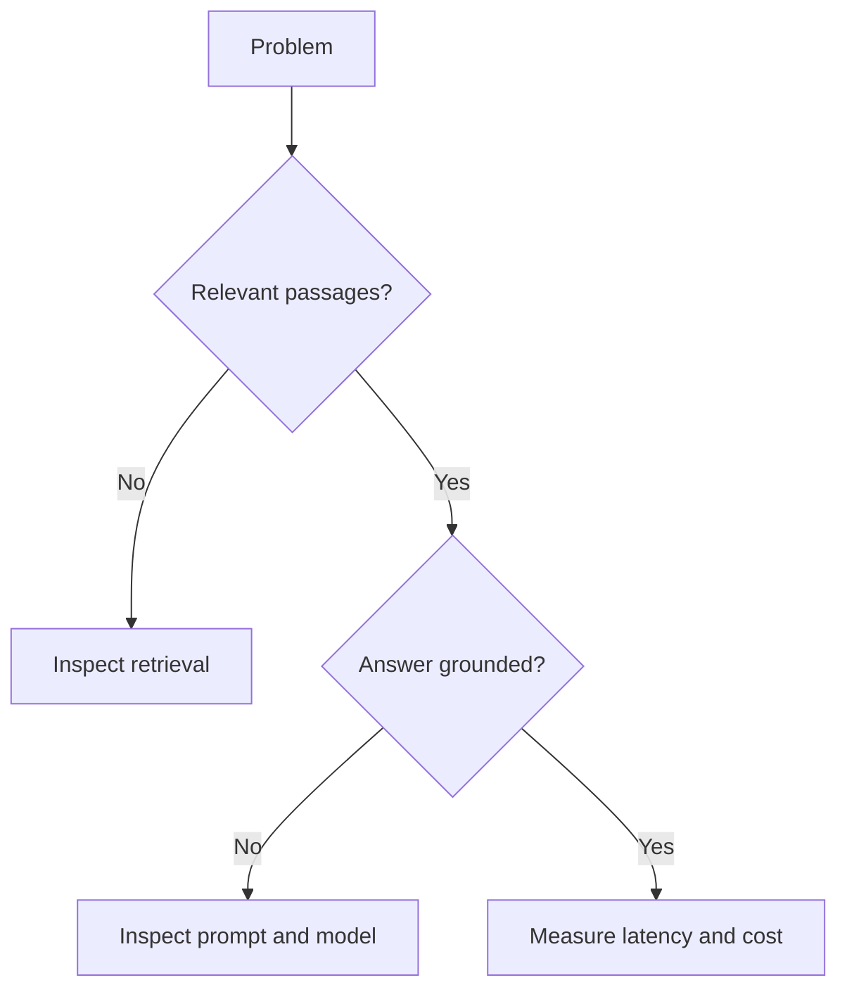

# Capítulo 20. Diagnóstico y solución de problemas

## ¿Por qué importa?

Ante una respuesta incorrecta, inspecciona primero los pasajes recuperados: si son irrelevantes, el problema está en retrieval; si son correctos pero la síntesis falla, revisa prompt y generación. Ante lentitud, mide cada etapa. Ante costos altos, revisa número de consultas, contexto, reintentos y caché antes de escalar hardware.

## ¿Cómo se hace?

Trabajá sobre el repositorio de acompañamiento. Conservá los nombres de variables, las dimensiones de embeddings y los contratos HTTP. Antes de sustituir un proveedor, medí un caso correcto y uno incorrecto. El código de referencia usa `backend/src/core.js` para centralizar la integración y `backend/src/server.js` para validar el tráfico HTTP.

## Laboratorio: instrucciones verificables

Estos bloques se ejecutan desde la raíz del repositorio una vez iniciados los contenedores, salvo que se indique lo contrario. Las salidas mostradas son patrones esperados; los identificadores y el texto de respuesta pueden variar.

### 1. Hacer una pregunta

```bash
# From repository root / Desde la raíz del repositorio
curl -fsS -X POST http://localhost:3001/api/query -H 'Content-Type: application/json' -d '{"question":"How long is the warranty?"}'
# Expected / Esperado: JSON answer and sources / JSON con answer y sources
```

### 2. Comprobar modelo local

```bash
# From repository root / Desde la raíz del repositorio
curl -fsS http://localhost:11434/api/tags
# Expected / Esperado: JSON models list / JSON con modelos
```

### 3. Comprobar base vectorial

```bash
# From repository root / Desde la raíz del repositorio
curl -fsS http://localhost:6333/collections
# Expected / Esperado: JSON collections list / JSON con colecciones
```

### 4. Comprobar contenedores

```bash
# From repository root / Desde la raíz del repositorio
docker compose -f docker-compose.dev.yml ps
# Expected / Esperado: Four running services / Cuatro servicios en ejecución
```



## Tres entornos: el mismo contrato HTTP

**A. Local simple (Docker Compose).** Copiá `.env.example` a `.env`, ejecutá `sh scripts/setup-dev.sh`, y comprobá `http://localhost:5173` (frontend), `http://localhost:3001/health` (API), `http://localhost:6333` (Qdrant) y `http://localhost:11434` (Ollama). Esto requiere Docker instalado y conexión para descargar imágenes y modelos.

**B. Testing (Kind).** Ejecutá `sh scripts/setup-kind.sh`. Usá `kubectl get pods` y `kubectl port-forward svc/rag-api 3001:3001`. Importante: el manifiesto incluido solo despliega el backend; para que funcionen ingesta y consulta debés desplegar Qdrant y Ollama dentro del clúster o configurar destinos accesibles. El health check sí permite probar la red del backend.

**C. Producción.** Publicá una imagen en tu registry, configurá secretos y servicios persistentes administrados y actualizá con `IMAGE=<your-image> sh scripts/deploy-prod.sh`. No es un aprovisionamiento cloud completo: EKS requiere VPC, nodos y control de acceso; Cloud Run y Azure Container Apps requieren sus propios despliegues, además de un vector store accesible. Presupuestá cada componente por separado.

## Errores frecuentes y criterio de avance

- Evitá guardar llaves API en Git o en React.
- Una recuperación sin documentos debe informarse con claridad y no inventar una respuesta.
- Un modelo distinto puede cambiar las dimensiones: creá un índice nuevo y reingerí.
- El ejemplo no implementa autenticación, colas de ingesta ni controles multi-tenant. Incorporalos antes de exponer datos reales.
- Proseguí si podés explicar dónde ocurre la recuperación, obtener una fuente trazable y detectar un fallo de proveedor.

**Siguiente:** [Capítulo Apéndices](apendices-es.md).
