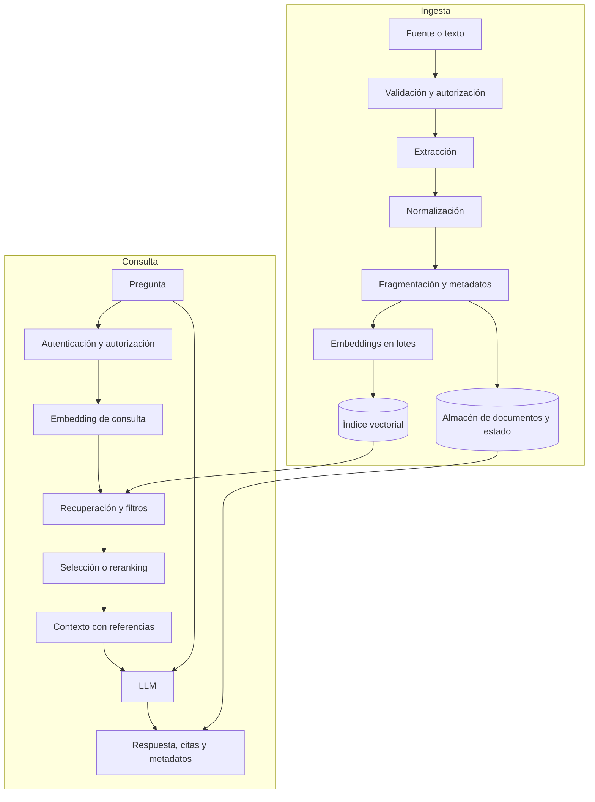

# Capítulo 3. Arquitectura de ingesta y consulta

## ¿Por qué importa?

Una aplicación RAG no es una llamada aislada a un modelo. Es una cadena de transformaciones que comienza en documentos y termina en una respuesta que alguien puede usar. Si cada responsabilidad queda mezclada en una función, un fallo de extracción puede parecer un problema del modelo, un cambio de proveedor puede romper el índice y una reintención puede duplicar datos. Diseñar los recorridos de ingesta y consulta como procesos separados hace que el sistema sea comprensible, comprobable y más fácil de evolucionar.

La ingesta convierte fuentes en unidades buscables y conserva información para interpretarlas después. La consulta usa ese índice para encontrar evidencia y producir una respuesta. Se relacionan a través del almacenamiento, pero tienen ritmos y requisitos distintos: una ingesta puede procesar un documento durante minutos y reintentarse; una consulta interactiva suele tener un objetivo de latencia mucho menor. Una arquitectura útil permite actualizar documentos sin reconstruir todo el sistema y atender consultas sin repetir la extracción completa.

Este capítulo presenta los componentes, contratos y fallos de ambos recorridos. El [capítulo 1](book-es-cap1.md) explicó el propósito de RAG y el [capítulo 2](book-es-cap2.md) desarrolló embeddings y chunking. Aquí esos conceptos se colocan en una arquitectura que se puede probar y operar.

## ¿Cómo funciona?

### Dos recorridos, un contrato de evidencia

En la ingesta, la aplicación recibe o descubre una fuente, verifica que pueda procesarla, extrae texto, lo normaliza, lo divide y genera embeddings. Cada vector se almacena asociado al fragmento y metadatos suficientes para filtrar y citar. En consulta, recibe una pregunta, verifica identidad y permisos, crea su embedding, recupera candidatos, selecciona contexto, llama al generador y devuelve respuesta con fuentes.



El diagrama separa responsabilidades, no exige que cada caja sea un microservicio. En una aplicación pequeña, varias funciones pueden vivir en un único backend. Lo importante es que existan fronteras lógicas: entrada validada, unidad de texto identificable, vector compatible, búsqueda acotada y respuesta que conserve sus fuentes.

### Ingesta: preparación reproducible

**1. Recepción y autorización.** La fuente puede ser texto pegado, un archivo, una base de datos o un conector. Se valida formato, tamaño, tipo permitido y permisos. Si hay múltiples organizaciones, el sistema debe asociar el material a su propietario antes de indexarlo. La autorización forma parte de la ingesta porque guardar un documento bajo el tenant equivocado puede exponerlo luego aunque la búsqueda funcione correctamente.

**2. Extracción.** Se transforma el formato de origen en texto y estructura. Extraer un TXT es simple; PDF con columnas, DOCX, HTML, hojas de cálculo e imágenes necesitan tratamiento específico. Tablas, encabezados, notas al pie y orden de lectura pueden alterar el sentido si se pierden. La calidad de la recuperación queda limitada por la información que el extractor consiguió preservar.

**3. Normalización y enriquecimiento.** Se limpian espacios y caracteres defectuosos sin destruir contenido útil. Se identifican idioma, título, páginas y secciones; se registran fuente, fecha, hash y versión. Conviene guardar tanto el original como el texto procesado cuando las exigencias del producto lo permiten: el primero sirve como referencia y el segundo como material indexable. El almacenamiento debe respetar políticas de retención y privacidad.

**4. Fragmentación.** El texto se transforma en unidades que puedan recuperarse. La estrategia puede respetar títulos y párrafos, usar tamaño en tokens o dividir por estructura. Cada unidad obtiene un identificador estable y una posición dentro del documento. El método afecta número de vectores, costo, contexto y calidad del ranking.

**5. Embeddings y persistencia.** Se calculan vectores con un modelo fijo y se escriben junto con payloads o referencias al texto. Si el lote tiene miles de fragmentos, procesarlos secuencialmente puede demorar demasiado; procesarlos sin límite puede saturar memoria o alcanzar cuotas del proveedor. Se trabaja por lotes con concurrencia acotada, reintentos limitados y registro del avance.

**6. Estado y publicación.** Un documento no debería considerarse listo sólo porque empezó a procesarse. Se puede mantener estados como `received`, `processing`, `ready` y `failed`, con etapa, fecha e información de error. La consulta debe ver versiones completas. Una estrategia de publicación indexa la nueva versión en paralelo, verifica sus resultados y luego cambia cuál está activa. El costo adicional de almacenamiento compra una transición más segura y la posibilidad de volver atrás.

El flujo compacto del repositorio educativo recibe `name` y `text`, usa un hash para identificar el documento, crea fragmentos de 700 caracteres con solapamiento de 100, calcula embeddings, verifica o crea una colección de Qdrant y escribe los puntos con payload. Es valioso como demostración de ida y vuelta, pero no es un gestor de documentos completo: no hay parser de archivos, autenticación, cola, estado durable por etapa ni política de reemplazo visible. La arquitectura debe reconocer qué simplificaciones hizo el prototipo.

### Consulta: evidencia antes que generación

Una consulta interactiva comienza con validación: existe una pregunta, el usuario está autenticado y el conjunto de documentos autorizado se conoce. Luego se crea el embedding y se busca dentro de una colección y un alcance. Los filtros de permisos deben aplicarse en la propia búsqueda o antes de construir contexto; recuperar primero información prohibida y descartarla después de llamar al modelo sigue siendo una filtración.

La búsqueda suele pedir más candidatos que los que se envían al modelo. Después se pueden aplicar deduplicación, umbral calibrado, filtros, fusión léxica/vectorial o reranking. La selección final respeta un presupuesto de contexto y conserva citas. Si no hay candidatos pertinentes, se puede responder que no hay evidencia, solicitar aclaración o pasar a una fuente alternativa autorizada. Un vector store suele devolver resultados aun si ninguno es suficientemente útil; el sistema debe decidir cómo detectar ese caso.

El prompt combina reglas, pregunta y evidencia. La generación puede producir una respuesta breve, estructurada o con referencias. Luego la API devuelve datos que la interfaz pueda presentar. Para evitar confiar ciegamente en la forma del texto, una aplicación puede validar citas y campos de salida, y evaluar si el contenido está respaldado. La salida debe ser una respuesta del sistema, no evidencia de que una acción externa ocurrió.

### Responsabilidades y contratos

Los componentes pueden ser funciones o servicios independientes. Cada frontera necesita entradas, salidas y fallos definidos. Una abstracción de embeddings, por ejemplo, debería especificar texto aceptado, forma del vector, modelo, dimensión, comportamiento ante límites y errores temporales. Una abstracción de búsqueda define filtros, orden, cantidad de candidatos y estructura de metadatos. El generador recibe contexto identificado, pregunta y requisitos de salida.

| Componente | Entrada | Salida que conviene conservar | Fallos que debe exponer |
|---|---|---|---|
| Extractor | Fuente y tipo | Texto, estructura, páginas, advertencias | Archivo corrupto, formato no soportado |
| Chunker | Texto estructurado | Fragmentos, orden, versión de estrategia | Entrada vacía, límites inválidos |
| Embedding | Texto y modelo | Vector, modelo, dimensión, consumo | Cuota, timeout, vector de forma errónea |
| Índice | Vector, texto y metadatos | IDs persistentes, versión indexada | Incompatibilidad, indisponibilidad |
| Retriever | Consulta, filtros y límite | Candidatos con puntuación y origen | Índice vacío, filtro inválido |
| Generador | Pregunta y contexto | Respuesta, uso y latencia | Timeout, rechazo, salida inválida |
| API | Identidad y solicitud | Respuesta HTTP trazable | Error estable y seguro para el cliente |

Los contratos permiten reemplazar una implementación sin reescribir toda la aplicación, aunque no eliminan diferencias entre proveedores. Una abstracción demasiado estrecha puede ocultar capacidades útiles; una interfaz que refleja cada detalle de un proveedor vuelve costosa la migración. Conviene encapsular lo estable del dominio —texto, vector, referencias, límites— y permitir configuración explícita donde realmente varíen los servicios.

### Modelo de datos mínimo

Un punto indexado puede incluir `pointId`, `documentId`, `chunkIndex`, `text`, `sourceName`, `sourceVersion`, `tenantId`, `createdAt`, `validFrom`, `validTo`, `embeddingModel` y datos de página o sección. Algunos campos pueden quedarse en una base documental y otros en el payload vectorial. Mantener una copia completa en cada punto facilita recuperar texto, pero duplica almacenamiento; guardar referencias reduce duplicación, aunque exige otra consulta y consistencia entre almacenes.

El identificador debe permitir actualizar y eliminar. Un hash del contenido ayuda a detectar que no cambió, pero usar sólo ese hash como identidad puede mezclar documentos iguales con permisos o propietarios diferentes. La identidad lógica (documento dentro de un tenant) y la huella de contenido responden a preguntas distintas: «¿qué documento es?» y «¿qué versión de texto contiene?». Diseñalas por separado.

### Idempotencia, actualización y borrado

Un trabajo es idempotente si repetirlo produce el mismo estado final sin duplicar efectos. Las redes fallan después de que el servidor guardó datos, pero antes de que el cliente recibiera la confirmación. Si al reintentar se generan nuevos IDs aleatorios, aparecen copias. IDs deterministas derivados de documento, versión y posición pueden hacer que una escritura reemplace el mismo punto.

La actualización requiere decidir qué pasa con fragmentos sobrantes. Si la nueva versión tiene menos fragmentos que la anterior, una simple escritura no elimina los puntos antiguos. Una opción es indexar con un identificador de versión nuevo, validarlo y luego borrar la versión anterior; otra actualiza por documento y limpia los índices de posición excedentes. La primera facilita rollback y aísla lectores; la segunda ahorra espacio y puede ser más simple, pero necesita controlar concurrencia.

El borrado también atraviesa varias capas: objeto original, texto procesado, vectores, cachés, logs y copias de respaldo. Una política que sólo borra puntos del índice puede dejar datos recuperables en el almacén original o en backups. Los requisitos de retención deben traducirse en un proceso que registre cada ubicación y confirme resultado.

### Trabajo síncrono o asíncrono

Para un texto pequeño, la API puede recibirlo y completar la ingesta en una sola solicitud. Es simple, permite devolver errores de inmediato y funciona bien en laboratorios. El tiempo de la petición crece con la longitud, la cantidad de embeddings y las esperas externas; puede superar límites HTTP.

Una cola desacopla recepción y procesamiento. La API valida, guarda un trabajo y responde con un ID; uno o varios workers extraen, fragmentan y escriben, reportando estado. Esto agrega componentes, operación, orden y lógica de reintentos, pero absorbe picos y permite trabajos largos. No es necesario adoptar colas antes de medir, aunque sí conviene definir desde temprano estados y claves idempotentes.

| Aspecto | Síncrono | Cola y workers |
|---|---|---|
| Complejidad inicial | Baja | Media o alta |
| Tiempo de respuesta al cliente | Hasta completar procesamiento | Rápido al aceptar trabajo |
| Reintentos y recuperación | Se mezclan con la petición | Se pueden manejar por trabajo |
| Picos de carga | Presionan el API | Se amortiguan con backlog |
| Visibilidad de progreso | Limitada | Estado explícito por etapa |
| Mejor encaje | Demo, texto corto y bajo volumen | Archivos grandes o flujo sostenido |

### Consistencia y degradación

Los componentes no comparten siempre una transacción. Puede guardarse el documento original y fallar la escritura vectorial; puede crearse el índice y no actualizarse el estado; el proveedor de embeddings puede devolver 429. Diseñá estados recuperables, reintentos con espera creciente y límites máximos, y mecanismos para detectar puntos huérfanos. Un reintento infinito puede consumir recursos y esconder fallos persistentes.

En consulta, si el modelo generativo está caído pero la búsqueda funciona, tal vez sea útil mostrar fuentes sin respuesta generada. Si la base vectorial está indisponible, no debería fabricarse una contestación con contexto viejo salvo que exista caché explícita y política de frescura. Una degradación debe ser deliberada, observable y comunicada en el contrato; devolver siempre HTTP 200 con una respuesta vacía hace difícil diagnosticar el problema.

## ¿Cómo se implementa?

### Contrato HTTP del prototipo

El servidor incluido en `backend/src/server.js` ofrece `GET /health`, `POST /api/ingest` y `POST /api/query`. La ingesta comprueba nombre de hasta 180 caracteres y texto no vacío de hasta 100.000 caracteres. La consulta requiere una pregunta de hasta 2.000 caracteres. Ante errores de servicios upstream responde 502; el detalle sólo aparece fuera de producción. Esto es un ejemplo concreto de límites en el borde de la API.

Las solicitudes ilustrativas siguientes corresponden a los contratos del README. Se espera que la primera de escritura devuelva un `documentId` y cantidad de chunks; la consulta devuelve `answer` y `sources`. El contenido exacto y los identificadores dependen de modelos y datos. **No se ejecutaron en esta tarea** y no equivalen a una validación de integración.

```bash
# Desde la raíz, con el entorno del repositorio iniciado.
curl -fsS -X POST http://localhost:3001/api/ingest \
  -H 'Content-Type: application/json' \
  -d '{"name":"manual.txt","text":"La garantía dura dos años desde la fecha de compra."}'
# Esperado: JSON con documentId y chunks.
```

**Qué hace:** envía texto al endpoint de ingesta. **Cuándo usarlo:** en el laboratorio local para seguir el documento por el flujo. **Resultado esperado:** identificador estable y número de fragmentos. Este comando depende de backend, Qdrant y Ollama o proveedor configurado; su funcionamiento completo está pendiente de validación según `VALIDATION.md`.

```bash
# Consulta el documento indexado; las fuentes devueltas pueden variar.
curl -fsS -X POST http://localhost:3001/api/query \
  -H 'Content-Type: application/json' \
  -d '{"question":"¿Cuánto dura la garantía?"}'
# Esperado: JSON con answer y sources.
```

**Qué hace:** envía una pregunta a la ruta de recuperación y generación. **Cuándo usarlo:** después de una ingesta exitosa y con los servicios disponibles. **Resultado esperado:** respuesta fundamentada y lista de pasajes. El ejemplo no demuestra aislamiento por usuario ni una abstención calibrada; esos requisitos no están implementados en el backend educativo.

### Un contrato interno para aislar proveedores

El siguiente fragmento conceptual reúne dependencias detrás de interfaces pequeñas. No representa módulos ya presentes ni fue ejecutado. Su propósito es ilustrar qué datos conviene pasar de una etapa a otra sin acoplar el flujo al formato de una API específica.

```js
// Fragmento conceptual: contratos del dominio para una aplicación RAG.
async function prepararDocumento({ source, extract, split, embedBatch, index }) {
  const extracted = await extract(source);
  const chunks = split(extracted.text, { metadata: extracted.metadata });
  const vectors = await embedBatch(chunks.map((chunk) => chunk.text));
  if (vectors.length !== chunks.length) throw new Error("Cantidad de vectores inesperada");
  return index(chunks.map((chunk, i) => ({ ...chunk, vector: vectors[i] })));
}
```

**Qué hace:** define un recorrido donde cada adaptador cumple una responsabilidad y se comprueba correspondencia entre fragmentos y vectores. **Cuándo usarlo:** al planificar una implementación que puede cambiar parser, proveedor de embeddings o índice. **Resultado esperado:** puntos con texto, metadatos y vector alineados. Faltan aquí validación de dimensión, lotes, estado durable, retries y rollback; agregar esas reglas depende de requisitos reales.

### API pequeña y cola: una forma de expansión

En producción, la ruta de ingesta puede convertirse en una aceptación de trabajos. Este ejemplo también es **conceptual**; `queue.add` representa una cola elegida por el equipo, y el almacenamiento del documento debe ocurrir antes de confirmar la aceptación.

```js
// Conceptual: la API acepta un trabajo y delega el procesamiento pesado.
app.post("/api/ingest-jobs", async (req, res, next) => {
  try {
    const { name, text } = req.body ?? {};
    if (typeof name !== "string" || typeof text !== "string" || !text.trim()) {
      return res.status(400).json({ error: "name y text son obligatorios" });
    }
    const job = await queue.add("ingest", { name, text }, { jobId: hash(name, text) });
    return res.status(202).json({ jobId: job.id, status: "queued" });
  } catch (error) {
    return next(error);
  }
});
```

**Qué hace:** valida una entrada mínima, encola un trabajo con una clave de idempotencia y responde `202 Accepted`. **Cuándo usarlo:** para procesamiento que excede el tiempo razonable de una petición o necesita absorción de picos. **Resultado esperado:** un identificador consultable para ver el estado. El pseudocódigo no es ejecutable tal como está: `queue`, `hash` y almacenamiento no están definidos; hay que implementar autorización, límites, persistencia y políticas de retry.

### Trazas por etapas

Cada ingesta y consulta debería tener un identificador de correlación. Una traza de consulta puede registrar tiempos de embedding, búsqueda, reranking y generación; cantidad de candidatos y tokens; estado final y versión del índice. Para ingesta: documento anonimizado o ID, etapas, conteos, duración, estado y versión de pipeline. Los registros deben evitar contenido sensible por defecto.

Separar métricas y trazas permite responder preguntas operativas. ¿La latencia subió porque el proveedor responde lento o porque se envían más fragmentos? ¿Bajó la tasa de recuperación tras una reindexación? ¿Los errores se concentran en un formato de archivo? El capítulo 18 trata observabilidad; aquí importa incluir identificadores y fronteras desde el diseño, pues agregarlas después puede ser costoso.

### Versionado y migración del índice

Un índice no es sólo una colección con vectores. Debe asociarse a una receta: fuentes seleccionadas, parser, limpieza, chunker, modelo de embeddings, métrica, estructura de payload y versión. Al hacer un cambio incompatible, crear un índice nuevo mantiene el anterior disponible durante la comparación. Se ejecuta una batería de consultas, se revisan permisos y citas y, si el resultado cumple criterios, el tráfico se dirige al nuevo índice. Después de un periodo de estabilidad se retira el antiguo conforme a retención.

El repositorio detecta diferencias de dimensión, un fallo útil pero parcial. La verificación de producción debería rechazar además un modelo o configuración incompatible aunque la dimensión coincida. Antes de una migración, estimá volumen de reembeddings, almacenamiento temporal, ventana de escritura, posibilidad de cambios en fuentes durante el proceso y estrategia de reversión.

## Errores frecuentes y buenas prácticas

- **Procesar todo dentro de una petición larga.** Funciona para muestras pequeñas; mide duración y migra a trabajos asíncronos cuando haga falta.
- **No conservar procedencia por fragmento.** Sin documento, sección, versión y permisos, citar y borrar se vuelve difícil.
- **Reintentar con IDs nuevos.** Una falla de red puede duplicar puntos; define identidad determinista y operación idempotente.
- **Actualizar escribiendo encima sin limpiar sobrantes.** Un documento reducido puede seguir exponiendo fragmentos antiguos.
- **Usar una colección compartida sin filtros de acceso.** La búsqueda semántica no es autorización; aplica permisos antes de construir el contexto.
- **Aceptar indexación parcial como completa.** Publica estados explícitos y sólo habilita la versión cuando está lista.
- **Suponer transacción entre base documental y vectorial.** Diseña reconciliación, borrado y recuperación de puntos huérfanos.
- **Ocultar todos los fallos como una respuesta normal.** Devuelve errores estables, registra detalles internos seguros y mide dependencias.
- **Versionar sólo el código.** La versión del índice, extractor, chunker y embedding también afecta resultados.
- **Convertir cada componente en un servicio.** Separar procesos tiene costo operativo; empieza con módulos y separa cuando escala, equipo o aislamiento lo justifiquen.

Al diseñar un flujo, escribí un diagrama del recorrido normal y otro de los fallos: timeout de embedding, índice caído, reintento tras escritura exitosa, documento eliminado a mitad del procesamiento y proveedor generativo sin respuesta. Para cada caso especificá si se reintenta, se marca como fallido, se compensa o se comunica una degradación.

## Ejercicios prácticos

1. Dibujá los dos flujos para una biblioteca de manuales internos. Marcá dónde se aplican permisos y dónde se conservan las citas.
2. Definí los estados de una ingesta que puede fallar después de guardar el original pero antes de escribir vectores. Explicá cómo se reanuda.
3. Proponé IDs deterministas para documento, versión y fragmento. ¿Qué ocurriría si cambia el tamaño de chunk?
4. Diseñá una política de actualización que permita validar la versión nueva antes de activarla y volver atrás si empeoran consultas de referencia.
5. Para cada componente de la tabla de contratos, escribí un error transitorio y uno permanente, y definí qué respuesta corresponde.
6. Compará una ingesta síncrona de texto de 2 KB con una carga de miles de páginas. Elegí arquitectura y justificá la decisión.
7. Enumerá todas las copias de datos que deben borrarse ante una solicitud de eliminación: original, texto extraído, índice, caché, logs y backups.
8. Inspeccioná `backend/src/server.js` y `backend/src/core.js`. Identificá tres validaciones existentes y tres capacidades de producción ausentes.

## Referencias y continuidad

- Gao et al., [“Retrieval-Augmented Generation for Large Language Models: A Survey”](https://arxiv.org/abs/2312.10997), panorama de componentes y líneas de diseño.
- Lewis et al., [“Retrieval-Augmented Generation for Knowledge-Intensive NLP Tasks”](https://arxiv.org/abs/2005.11401), antecedente académico del enfoque.
- La implementación didáctica está en [backend/src/core.js](../backend/src/core.js) y [backend/src/server.js](../backend/src/server.js). Los límites de la demostración están detallados en [README](../README.md) y [VALIDATION.md](../VALIDATION.md).
- Seguís con [capítulo 4](book-es-cap4.md), donde se prepara el entorno local, y [capítulo 5](book-es-cap5.md), dedicado a la API Express.

**Estado de los ejemplos:** los dos comandos `curl` reflejan contratos presentes en el repositorio, pero no fueron ejecutados durante esta edición; la validación end-to-end consta como pendiente en `VALIDATION.md`. Los fragmentos de cola e interfaces son conceptuales y no se ejecutaron. No se modificó ningún archivo de código.
