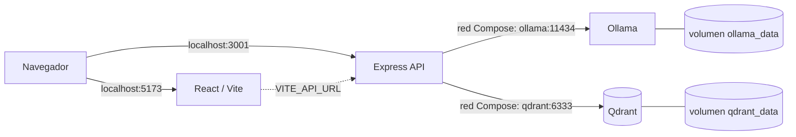

# Capítulo 4. Entorno local y primer RAG

## ¿Por qué importa?

Una aplicación RAG une piezas que suelen ejecutarse como procesos distintos: una interfaz, una API, un modelo de embeddings, una base vectorial y un modelo generativo. Antes de optimizar la recuperación o decidir dónde desplegar, necesitamos observar estas piezas funcionando juntas y poder distinguir un error de configuración de un error de diseño. Un entorno local reproducible convierte una arquitectura abstracta en algo que podemos inspeccionar, apagar, reiniciar y modificar sin consumir servicios de producción.

El laboratorio de este capítulo usa Docker Compose para coordinar Qdrant, Ollama, un backend Express y un frontend React. Qdrant conserva vectores y texto; Ollama sirve modelos locales; Express orquesta ingesta y consulta; React ofrece formularios para probarlas. La separación se parece a una pequeña cocina: la interfaz toma el pedido, el backend coordina, el índice encuentra ingredientes y el modelo prepara una respuesta. La analogía sirve para recordar que cada servicio tiene una responsabilidad y puede fallar independientemente.

El objetivo no es afirmar que cuatro contenedores forman una plataforma lista para internet. El repositorio es una demostración educativa: no tiene autenticación, autorización por documento, aislamiento multi-tenant, cargas de archivos ni una cola de trabajos. No se deben indexar datos confidenciales ni publicar sus puertos en una red pública. README y [VALIDATION.md](../VALIDATION.md) describen los límites conocidos. Aquí aprenderemos a iniciar el sistema, seguir una consulta completa y reconocer qué falta antes de crecer.

Los capítulos 1–3 ya explicaron qué es RAG, cómo se representan y fragmentan textos, y cómo se conectan ingesta y consulta. Este capítulo evita repetir esas bases: las usa para recorrer una instalación concreta. En [capítulo 5](book-es-cap5.md) se abre la API que recibe el tráfico y en [capítulo 6](book-es-cap6.md) se sigue la interacción del navegador.

## ¿Cómo funciona?

### La arquitectura local como conjunto de servicios

Un contenedor empaqueta un proceso y sus dependencias en una unidad aislada. Docker Compose lee una descripción YAML y crea redes, contenedores, variables y volúmenes para un proyecto. No es una máquina virtual completa: los contenedores comparten el kernel del sistema anfitrión, aunque tengan sus propios sistemas de archivos y espacios de procesos. Para aprender, esto permite levantar servicios compatibles con una configuración repetible; para producción, hace falta añadir controles, persistencia, observabilidad y operación.

En Compose, los servicios se resuelven por nombre dentro de la red del proyecto. Por eso el backend usa `http://qdrant:6333` y `http://ollama:11434`, mientras que el navegador usa `http://localhost:3001`: desde el contenedor `localhost` significa ese mismo contenedor, pero desde el equipo significa la máquina anfitriona. Confundir ambos contextos es una de las causas más comunes de errores de conexión.



El diagrama muestra además que los datos persistentes están asociados a volúmenes. Si se elimina y recrea un contenedor, la capa escribible del contenedor desaparece, pero el volumen nombrado continúa hasta que se lo borre explícitamente. Esta diferencia protege los modelos descargados y la colección frente a la recreación habitual de servicios. También significa que reiniciar la aplicación no garantiza un entorno vacío: una prueba puede estar usando datos indexados en una sesión anterior.

### Ingesta y consulta en la demostración

En la ingesta, React envía un nombre y texto a `POST /api/ingest`. Express valida tipos y longitudes, y llama a `indexText`. El backend normaliza espacios, corta texto en ventanas de 700 caracteres con 100 de solapamiento, solicita un embedding para cada fragmento, crea o comprueba la colección y escribe puntos con texto y metadatos en Qdrant. El ID se deriva de un hash del documento y la posición del fragmento. La implementación se concentra en `backend/src/core.js`; el recorrido y sus límites se estudian en el capítulo siguiente.

En una consulta, React envía una pregunta a `POST /api/query`. Express valida el tamaño, obtiene un embedding de la pregunta, busca hasta cuatro puntos en Qdrant y pasa los pasajes a Ollama para generar una respuesta. La API incluye tanto la respuesta como los pasajes recuperados. Si no hay fuentes, devuelve un mensaje de ausencia de documentos. El prototipo sirve para observar el ciclo, pero no implementa un umbral de relevancia calibrado ni una política completa de abstención: tener resultados no prueba que sean evidencia suficiente.

La primera respuesta puede tardar más que las siguientes. Ollama puede necesitar descargar los modelos configurados (`nomic-embed-text` y `llama3.2:1b` por defecto) y cargarlos en memoria. El tiempo depende de la red, disco, CPU/GPU, cuantización y tamaño de los modelos. No conviene prometer una duración fija ni interpretar una descarga lenta como un bloqueo de la API sin mirar primero el estado de Ollama.

### Qué aporta cada dependencia

| Componente | Responsabilidad en el laboratorio | Ventaja | Límite o alternativa |
|---|---|---|---|
| Docker Compose | Crear y conectar servicios locales | Arranque repetible con pocos comandos | No reemplaza orquestación y políticas de producción; alternativa: ejecutar procesos manualmente |
| Ollama | Servir embeddings y chat localmente | Permite experimentar sin enviar texto a una API remota | Consume recursos locales y el resultado depende del hardware/modelo; alternativa: proveedor gestionado |
| Qdrant | Guardar y buscar vectores con payload | API específica para búsqueda vectorial y filtros | Es un servicio adicional que requiere persistencia y copias; alternativas: pgvector u otros motores |
| Express | Validar HTTP y coordinar servicios | Ligero y fácil de leer para el primer backend | La muestra no incluye seguridad de producción, colas ni límites avanzados |
| React/Vite | Formularios y presentación de resultados | Iteración rápida durante el aprendizaje | El navegador es un entorno público; secretos y credenciales pertenecen al servidor |

La selección del laboratorio favorece la claridad, no demuestra superioridad universal. Si ya operás PostgreSQL y la búsqueda vectorial es una función más del producto, pgvector puede reducir servicios. Si no podés reservar CPU y memoria para inferencia, un proveedor remoto puede ser más práctico, con evaluación de privacidad, latencia y costo. El capítulo 8 compara bases vectoriales; el 10 desarrolla las compensaciones entre ejecución local y remota.

### Límites de red y persistencia

La publicación `ports` permite acceder desde el host. En el archivo Compose se exponen los puertos de Qdrant y Ollama además de los de la API y la interfaz para facilitar diagnóstico. En un entorno compartido, cada puerto publicado aumenta la superficie accesible y debe restringirse. La API de Qdrant del laboratorio no tiene configuración de autenticación; mantenela en una computadora controlada y no la expongas a internet.

Compose `depends_on` expresa orden de creación, pero no siempre garantiza que la dependencia esté lista para aceptar solicitudes. El backend puede iniciarse antes de que Ollama termine de descargar o cargar modelos. Para una solución más robusta se agregan health checks, reintentos con espera limitada y señales de readiness. Un endpoint `/health` que responde `ok` solo confirma que Express contesta; no necesariamente verifica que Qdrant y el proveedor generativo estén disponibles. En producción suelen distinguirse liveness (el proceso está vivo) y readiness (puede recibir trabajo).

Los volúmenes nombrados (`qdrant_data`, `ollama_data`) conservan estado entre recreaciones. `docker compose down` suele detener y retirar contenedores y red, conservando volúmenes; `docker compose down -v` elimina además los volúmenes y con ellos los datos. Antes de usar la segunda forma, confirmá que querés borrar modelos y la colección. Para restablecer solo los datos de demostración, se puede borrar la colección desde la API de Qdrant, después de verificar el nombre configurado.

## ¿Cómo se implementa?

### Preparar y arrancar

Desde la raíz, copiá `.env.example` a `.env` y ejecutá el script de preparación. El script configura Compose y descarga los modelos indicados. Las rutas y valores por defecto están en `docker-compose.dev.yml` y `.env.example`; al cambiar el proveedor, revisá también la URL que ve cada proceso. El fragmento es un procedimiento del repositorio, no una receta universal para toda plataforma Docker.

```bash
cp .env.example .env
sh scripts/setup-dev.sh
docker compose -f docker-compose.dev.yml ps
```

**Qué hace:** crea la configuración local, inicia los servicios y muestra sus estados. **Por qué se usa:** evita levantar cada dependencia en una terminal distinta y establece una red común. **Cómo funciona:** Compose construye la API y la interfaz desde sus Dockerfiles, inicia Qdrant y Ollama y conecta los servicios mediante DNS interno. **Cuándo conviene:** para un MVP local, una clase o una reproducción de errores. **Resultado esperado:** cuatro servicios en ejecución, aunque el estado `running` no asegura que los modelos estén descargados ni que una consulta completa funcione. Las salidas no fueron ejecutadas durante esta edición; el estado de validación del repositorio consta en `VALIDATION.md`.

Comprobá los endpoints de salud de cada dependencia. Qdrant debe responder con información de colecciones; Ollama debe responder con la lista de modelos. Las respuestas son JSON y variarán según si ya indexaste contenido o descargaste modelos. Si un comando falla, anotá primero el servicio y el puerto: un error de conexión es diferente de una respuesta HTTP de rechazo.

```bash
curl -fsS http://localhost:3001/health
curl -fsS http://localhost:6333/collections
curl -fsS http://localhost:11434/api/tags
```

**Qué hacen:** consultan respectivamente la API, Qdrant y Ollama. **Por qué se usan:** separan conectividad de lógica RAG. **Cómo funcionan:** cada proceso escucha su puerto publicado en el host y devuelve una respuesta HTTP. **Cuándo conviene:** al arrancar o localizar una dependencia caída. **Resultado esperado:** JSON de estado, colecciones y modelos. Un `/health` exitoso no demuestra que las tres dependencias estén listas.

### Probar el ciclo completo

Una prueba útil comienza con contenido cuya respuesta conocemos. El siguiente ejemplo envía texto plano, modalidad que el backend sí admite. El punto final no procesa archivos adjuntos ni interpreta PDF: el campo `text` es contenido ya extraído por quien llama.

```bash
curl -fsS -X POST http://localhost:3001/api/ingest \
  -H 'Content-Type: application/json' \
  -d '{"name":"garantia.txt","text":"La garantía cubre dos años desde la compra. No cubre daños por líquidos."}'
```

**Qué hace:** crea embeddings para los fragmentos y los escribe en la colección configurada. **Por qué se usa:** prepara evidencia que puede reutilizarse en consultas. **Cómo funciona:** la API valida la entrada y delega extracción (en este caso trivial), fragmentación, embedding y persistencia. **Cuándo conviene:** con texto pequeño de prueba y sin datos sensibles. **Resultado esperado:** un `documentId` y el número de fragmentos indexados. La forma corresponde al contrato visible en el backend; el comportamiento integral requiere servicios en ejecución.

Luego preguntá por una condición expresada de otra manera. Una consulta como «¿Qué daños quedan afuera?» permite comprobar si la búsqueda encuentra el pasaje pertinente y si la respuesta conserva la exclusión. Observá la lista `sources`, no sólo la prosa final: un texto convincente respaldado por un fragmento incorrecto revela un problema de recuperación o de selección.

```bash
curl -fsS -X POST http://localhost:3001/api/query \
  -H 'Content-Type: application/json' \
  -d '{"question":"¿Qué daños quedan excluidos de la garantía?"}'
```

**Qué hace:** solicita una respuesta basada en pasajes recuperados. **Por qué se usa:** verifica que pregunta, embedding, búsqueda y generación se conecten. **Cómo funciona:** el backend vectoriza la pregunta, busca puntos y pasa sus textos al chat local. **Cuándo conviene:** después de una ingesta conocida, para depuración y demostración. **Resultado esperado:** JSON con `answer` y `sources`; texto y puntuaciones concretas dependen del modelo y el índice. No es una prueba de calidad del sistema ni sustituye un conjunto de evaluación.

### Diagnosticar por capas

| Síntoma | Comprobación inicial | Interpretación probable |
|---|---|---|
| La interfaz no abre | `docker compose ps` y puerto 5173 | Vite no inició, el puerto está ocupado o la imagen falló |
| La página abre pero no conecta | `VITE_API_URL`, CORS y `curl /health` | URL pública equivocada o backend inaccesible |
| Ingesta devuelve 502 | Logs de backend, Ollama y Qdrant | Dependencia no lista, modelo ausente o error HTTP ascendente |
| Error de dimensión | Modelo y configuración de la colección | Colección creada con otro embedding; separar índice y reingerir |
| Respuesta sin fuentes | Resultado de ingesta y colección | No se indexó, se cambió la colección o no hubo coincidencias |
| Respuesta irrelevante con fuentes | Inspeccionar texto recuperado y chunk | Problema de corpus, fragmentación, ranking o consulta |

Los logs ayudan, pero pueden contener texto de solicitudes. Antes de compartirlos, revisá que no incluyan contenido privado ni credenciales. El backend de muestra imprime errores completos en consola local; el detalle HTTP se oculta parcialmente según `NODE_ENV`, pero esto no sustituye una política de redacción y retención.

### Elegir el entorno siguiente

Compose es el punto de partida cuando el objetivo es aprender el flujo o iterar una demostración. Kind permite practicar manifiestos y conectividad Kubernetes, pero el manifiesto de este repositorio despliega únicamente la API; Qdrant y Ollama no aparecen como cargas del clúster. Un health check y `port-forward` pueden enseñar conectividad, pero ingesta y consulta necesitan dependencias alcanzables.

Producción requiere un análisis separado: plataforma de ejecución, persistencia, secretos, identidad, permisos, backup, restauración, telemetría, límites de costo y escalado. Un script que actualiza una imagen no aprovisiona una VPC, una base administrada ni políticas IAM. No se debe inferir que el laboratorio puede exponerse simplemente porque la API responde en `0.0.0.0`.

### Reproducibilidad: registrar la receta del experimento

Un resultado local sólo puede compararse con otro si conocemos las condiciones del ensayo. Anotá la versión de Node y Docker, los tags de imagen, los nombres de los modelos, el proveedor de embeddings, el nombre de la colección y el texto usado. Si cambia el embedding o el chunker, una diferencia de respuesta puede venir de la representación, y no de una mejora del modelo generativo. Esta receta no tiene que convertirse en un sistema de tracking sofisticado: un archivo de notas del experimento alcanza para el primer MVP.

Las variables de `.env.example` dan valores por defecto para `EMBED_MODEL`, `CHAT_MODEL`, proveedor, URLs y colección. El archivo `.env` local puede incluir secretos si se configura un proveedor remoto; debe quedar fuera de Git. Antes de cambiar una variable conviene identificar qué proceso la consume. `VITE_API_URL` pertenece al frontend y es pública; `OPENAI_API_KEY` es una credencial del backend. El nombre de variable no garantiza privacidad: el momento y lugar de compilación determinan si aparece en el bundle.

Una secuencia reproducible guarda también un pequeño corpus ficticio y tres preguntas conocidas: una directa, una parafraseada y una cuya respuesta no existe. Así el lector puede reiniciar servicios y verificar el mismo comportamiento general sin depender de datos personales. Las respuestas exactas de modelos generativos no son necesariamente deterministas, por lo que se evalúan propiedades (fuente pertinente, condiciones conservadas, abstención apropiada), no igualdad literal de cada frase.

### Qué observar en el primer recorrido

Al hacer una pregunta, cronometra el tiempo total y registra en qué etapa ocurre la demora. En un laboratorio se puede inspeccionar los logs y las respuestas HTTP; a medida que el sistema crezca, conviene instrumentar por separado embedding, búsqueda y generación. Esta separación permite distinguir un modelo que tarda en cargar de una búsqueda lenta o un proveedor remoto limitado. No compares tiempos sin registrar si el modelo ya estaba caliente, porque la primera llamada suele tener un costo de inicialización distinto.

Al inspeccionar la fuente devuelta, verificá que texto, nombre y posición sean coherentes con el material que enviaste. La API de ejemplo devuelve pasajes y puntuaciones, lo que hace visible una parte del mecanismo; no demuestra que el documento esté actualizado ni que el solicitante tuviera derecho a verlo. En sistemas con información real, autorización y procedencia deben acompañar el resultado hasta el punto de respuesta. Este laboratorio enseña el flujo técnico y deja esas garantías como trabajo de arquitectura, no como propiedades implícitas del motor vectorial.

## Errores frecuentes y buenas prácticas

- **Usar `localhost` dentro de un contenedor para llegar a otro.** Dentro del backend, usar nombres Compose como `qdrant` y `ollama`.
- **Asumir que `depends_on` equivale a readiness.** Comprobar endpoints y considerar espera/reintento con límite.
- **Confundir proceso activo con inferencia lista.** Confirmar que el modelo requerido figura y puede responder.
- **Eliminar volúmenes para resolver cualquier error.** Puede borrar índices y modelos; identificar primero el estado a limpiar.
- **Cambiar el modelo sin migrar la colección.** Dimensión y espacio vectorial deben corresponder; crear colección nueva y reingerir.
- **Publicar puertos de administración.** Restringirlos al equipo local y no usar la configuración de demostración en redes compartidas.
- **Tratar `health` como prueba integral.** Un chequeo de proceso no mide recuperación ni generación.
- **Indexar datos reales sin controles.** La demo carece de autenticación, permisos por documento y aislamiento entre usuarios.
- **Suponer que texto pegado equivale a carga de archivo.** Extracción, OCR, antivirus, límites y validación de tipos son trabajos adicionales.

## Ejercicios

1. Dibujá el recorrido de la pregunta desde el navegador hasta Qdrant y Ollama. Indicá qué URL se usa desde el host y cuál desde la red de Compose.
2. Reiniciá los contenedores manteniendo los volúmenes y comprobá qué estado persiste. Luego describí, sin ejecutar una eliminación, qué efecto tendría `down -v`.
3. Ingerí un párrafo con una regla y una excepción. Escribí dos consultas: una que use las mismas palabras y otra parafraseada. Compará las fuentes.
4. Simulá el razonamiento de diagnóstico para un backend que responde `health` pero falla en `/api/ingest`. ¿Qué dependencias consultarías primero y por qué?
5. Explicá qué cambiaría para ejecutar Ollama fuera de Compose. Especificá qué URL debe usar el backend y qué riesgos de exponer el puerto hay.
6. Escribí una lista de requisitos que faltan para aceptar documentos de un equipo con información privada. Clasificá cada requisito como identidad, autorización, extracción, operación o auditoría.

## Referencias y continuidad

- [README del repositorio](../README.md): inicio rápido, requisitos orientativos y advertencias de seguridad.
- [VALIDATION.md](../VALIDATION.md): límites verificados y tareas de validación pendientes.
- [Docker Compose: documentación oficial](https://docs.docker.com/compose/): modelo de servicios, redes y volúmenes.
- [Ollama: API de embeddings](https://docs.ollama.com/api/embed) y [API de chat](https://docs.ollama.com/api/chat): contratos que utiliza el adaptador local.
- [Qdrant: documentación](https://qdrant.tech/documentation/): colecciones, puntos, payload y búsqueda.
- [Capítulo 3](book-es-cap3.md) explica el flujo arquitectónico; [capítulo 5](book-es-cap5.md) profundiza en Express; [capítulo 6](book-es-cap6.md) desarrolla la interfaz.

**Validación de ejemplos:** los comandos reflejan rutas y variables de la configuración suministrada, pero no se ejecutaron en esta edición. El resultado de una consulta depende de modelos descargados y del contenido del índice. La configuración local es didáctica y no debe exponerse como servicio público.
