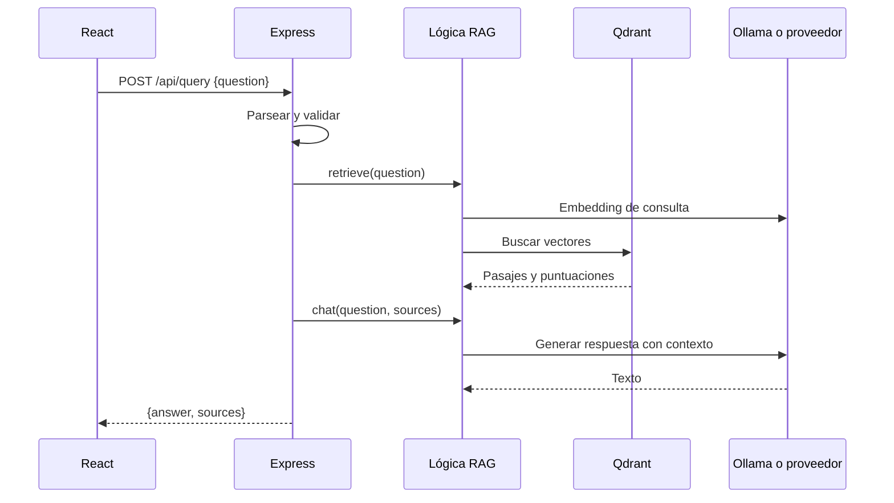

# Capítulo 5. Backend con Express

## ¿Por qué importa?

En una aplicación RAG, el navegador no debería decidir cómo se buscan los documentos, conectarse directamente a una base vectorial ni conservar credenciales de proveedores. El backend funciona como la puerta de entrada y el coordinador: recibe solicitudes, valida datos, aplica reglas de acceso, llama a los servicios internos y devuelve un contrato estable. Si cada cliente implementa el flujo por su cuenta, una actualización de modelos, permisos o almacenamiento obliga a corregir muchas aplicaciones y es fácil que una de ellas omita una protección.

Express es un framework web para Node.js que ayuda a definir rutas y middleware HTTP. Su sencillez permite ver la secuencia sin ocultarla detrás de una plataforma extensa. En el ejemplo del repositorio, `backend/src/server.js` expone `/health`, `/api/ingest` y `/api/query`; `backend/src/core.js` contiene las operaciones de fragmentación, embeddings, almacenamiento y generación. Esa separación inicial es pequeña pero valiosa: HTTP y reglas de RAG no son la misma responsabilidad.

La API del repositorio sirve para aprender y probar con texto pequeño. Valida tipos y tamaños, pero no autentica usuarios, no autoriza acceso a cada documento, no aplica cuotas por cliente y procesa la ingesta dentro de la solicitud. Esas omisiones son explícitas, no detalles que deban suponerse resueltos por Express. Un servidor que escucha en `0.0.0.0` y devuelve `200` puede seguir siendo inadecuado para datos reales. Este capítulo construye una lectura profesional del backend mínimo y muestra cómo evolucionar el contrato sin confundir ejemplo con plataforma lista.

El capítulo 3 presenta la arquitectura completa; el [capítulo 4](book-es-cap4.md) permite levantar servicios locales. Aquí seguimos el contrato de red y las fronteras de responsabilidad. El [capítulo 6](book-es-cap6.md) consume esos endpoints desde React.

## ¿Cómo funciona?

### Una solicitud HTTP atraviesa capas

HTTP define mensajes entre cliente y servidor. Una solicitud lleva método, ruta, encabezados y, en operaciones como `POST`, un cuerpo. La API responde con un código de estado, encabezados y normalmente JSON. El método expresa intención: `GET /health` consulta estado; `POST /api/ingest` crea una operación de indexación; `POST /api/query` solicita una respuesta. Los códigos ayudan al cliente a decidir si corregir la entrada, reintentar o informar un fallo.

Express ejecuta middleware y después selecciona una ruta. `express.json()` interpreta cuerpos JSON y `cors()` indica qué orígenes de navegador pueden leer respuestas. La ruta valida el cuerpo y llama a la lógica del dominio. Si ocurre una excepción, `next(error)` la entrega al middleware final de errores. La forma de esta tubería importa: validación de entrada antes de llamadas costosas, respuesta consistente y errores internos registrados sin exponer información sensible al usuario.



El diagrama representa el camino feliz de la muestra. En una implementación real, los pasos de embeddings y chat pueden usar proveedores distintos. Una falla del vector store no debe interpretarse como «no se encontraron resultados»: ausencia de resultados es un resultado válido; indisponibilidad es un error operacional. Mantener esa diferencia permite que la interfaz informe con honestidad y que la observabilidad contabilice fallas.

### Contratos y códigos de estado

Un contrato JSON define los campos aceptados y devueltos. La ruta de ingesta recibe `name` y `text`; la de consulta recibe `question`. Un cliente debe poder aprender qué enviar sin conocer Ollama, Qdrant ni el proveedor que se seleccione. Los contratos deberían documentar tipos, límites, campos opcionales, estados y ejemplos. En sistemas que evolucionan, versionar o extender el contrato con compatibilidad evita romper clientes desplegados por separado.

| Caso | Estado adecuado o recomendado | Motivo |
|---|---:|---|
| Ingesta aceptada | `201 Created` | Se creó una representación indexada |
| Consulta atendida | `200 OK` | La solicitud se procesó, incluso si la respuesta expresa falta de evidencia |
| Entrada inválida | `400 Bad Request` | El cliente puede corregir tipo, contenido o longitud |
| Dependencia ascendente fallida | `502 Bad Gateway` | La API no pudo completar el trabajo por un servicio externo |
| La API o proxy agota su espera por una respuesta upstream | `504 Gateway Timeout` | El intermediario no recibió una respuesta a tiempo; el trabajo downstream puede continuar |
| Error de autenticación (si se agrega) | `401 Unauthorized` | Falta identidad válida |
| Identidad sin permiso (si se agrega) | `403 Forbidden` o `404` según política | La operación no está autorizada |
| Límite excedido (si se agrega) | `429 Too Many Requests` | El cliente debe reducir o espaciar solicitudes |

La muestra responde `502` para errores capturados y oculta `detail` cuando `NODE_ENV` es `production`. Para una API de producción se recomienda un esquema estable de error con un identificador de solicitud, y no retornar mensajes crudos de proveedores, nombres internos ni contenido del documento. Los detalles completos se registran de forma controlada en el servidor, con redacción apropiada.

### Validación: formato, límites y significado

Validar no es sólo comprobar que el JSON se pueda parsear. Hay que comprobar el tipo, la presencia, los límites y las reglas de negocio. El backend de ejemplo limita el cuerpo JSON total a 1 MB, `name` a 180 caracteres, `text` a 100.000 y `question` a 2.000. También rechaza texto vacío. Estas restricciones evitan algunas entradas accidentales y reducen consumo, aunque no son una defensa completa frente a abuso: el tamaño en caracteres no coincide con tokens, memoria o tiempo computacional.

La validación semántica depende del producto. Una futura API podría exigir un nombre normalizado, idioma permitido, tamaño máximo calculado en bytes, tipo de archivo permitido o vigencia. Si se reciben identificadores de tenant, no deben aceptarse como prueba de identidad: el servidor debe obtener el principal de un mecanismo de autenticación y resolver los permisos desde una fuente confiable. De lo contrario, un atacante puede cambiar un campo para consultar el corpus ajeno.

### Separación entre transporte y dominio

`server.js` traduce HTTP a llamadas del núcleo. `core.js` no conoce Express: fragmenta, crea embeddings, persiste puntos y recupera resultados. Esta separación facilita cambiar la interfaz de transporte o probar funciones deterministas sin levantar toda la pila. En aplicaciones mayores se pueden añadir módulos de servicios, repositorios, validadores y adaptadores, pero cada capa agrega navegación. Conviene introducirla cuando resuelve una necesidad concreta, no por el número de carpetas de una arquitectura de referencia.

El núcleo de ejemplo hace llamadas `fetch` directas a Ollama, OpenAI opcional y Qdrant. La configuración se toma de variables de entorno. Esto evita poner secretos en el repositorio y el navegador, pero no hace que las variables se gestionen automáticamente de forma segura: el proceso de despliegue debe inyectarlas, restringir accesos y rotarlas. Tampoco se debe registrar el encabezado `Authorization`.

### Operaciones de ingesta y consulta

La ingesta de muestra es sincrónica: el cliente mantiene abierta la conexión mientras se calculan embeddings y se escriben puntos. Para texto corto y un laboratorio, la simplicidad es razonable. Para documentos largos, lotes grandes o proveedores lentos, se consumen conexiones y memoria por más tiempo, y una interrupción deja al cliente sin saber si la operación terminó. Una arquitectura asíncrona acepta el trabajo, devuelve un ID y permite consultar estados como `queued`, `processing`, `completed` y `failed`. Agregar cola implica idempotencia, reintentos, retención y monitoreo; no es automáticamente más simple ni necesario para el prototipo.

La búsqueda devuelve cuatro pasajes por defecto. Ese número es un parámetro pedagógico, no un óptimo universal. Más pasajes pueden ampliar cobertura, pero elevan tokens, latencia y ruido. Menos pasajes son económicos, aunque pueden omitir una condición. La evaluación debe medir recuperación y calidad de respuesta con consultas representativas. Los capítulos 18 y 19 profundizan monitoreo y optimización.

## ¿Cómo se implementa?

### Una ruta Express mínima

El fragmento siguiente refleja la estructura del código real, abreviando sólo el middleware global de errores. No debe confundirse con una API lista para internet: el proyecto la expone para un entorno de desarrollo y carece de autenticación y autorización.

```js
app.use(express.json({ limit: '1mb' }));

app.post('/api/ingest', async (req, res, next) => {
  try {
    const { name, text } = req.body || {};
    if (typeof name !== 'string' || name.length > 180 ||
        typeof text !== 'string' || !text.trim() || text.length > 100000) {
      return res.status(400).json({ error: 'name and text required' });
    }
    const result = await indexText(name, text);
    return res.status(201).json(result);
  } catch (error) {
    return next(error);
  }
});
```

**Qué hace:** limita JSON, comprueba la entrada y delega indexación. **Por qué se usa:** la capa HTTP evita gastar embeddings en solicitudes evidentemente inválidas. **Cómo funciona:** Express interpreta JSON; la ruta valida y espera la promesa del núcleo; `next(error)` deriva fallos al manejador central. **Cuándo conviene:** para operaciones de bajo volumen y duración acotada en una API pequeña. **Resultado esperado:** `400` ante entrada inválida o `201` con el identificador y cantidad de fragmentos. El código corresponde en estructura a `backend/src/server.js`; el texto del error se simplificó para destacar el patrón.

En código real es preferible centralizar la validación para evitar que mensajes y límites diverjan entre rutas. Una biblioteca de esquemas puede ayudar si hay muchos contratos, pero añade dependencia y conceptos. La decisión se toma por legibilidad, reutilización y necesidad de generar documentación, no porque todo objeto JSON requiera un framework de validación.

### Error de proveedor y respuesta controlada

Un error ascendente puede originarse por timeout, modelo inexistente, credencial inválida o servicio caído. La API debe devolver una respuesta que el cliente entienda y un registro útil para operadores. El siguiente patrón es conceptual; ilustra la frontera entre detalle interno y mensaje público.

```js
app.use((error, req, res, _next) => {
  const requestId = req.id || 'id-no-configurado';
  console.error({ requestId, message: error.message });
  res.status(502).json({
    error: 'upstream_service_failed',
    requestId
  });
});
```

**Qué hace:** convierte excepciones no manejadas por las rutas en un error HTTP limitado y asociable a un registro. **Por qué se usa:** evita filtrar mensajes sensibles y ofrece soporte diagnóstico. **Cómo funciona:** Express reconoce el middleware de errores por sus cuatro parámetros; un identificador de solicitud debería asignarse antes mediante middleware dedicado. **Cuándo conviene:** como base para fallos de dependencias, ajustando estados y clasificación al origen. **Resultado esperado:** el cliente recibe código estable y soporte puede buscar el `requestId`. Es conceptual: la muestra del repositorio no crea `req.id`.

No todo error debe convertirse en `502`. Un dato inválido corresponde a `400`; un fallo del proveedor de identidad quizá a `503`; una operación conflictiva puede ser `409`. El manejador central no debe borrar el significado de los errores conocidos. Se pueden definir clases o códigos internos y mapearlos con cuidado.

### Recuperación, persistencia y consistencia

La muestra calcula vectores, asegura una colección de dimensión compatible y guarda puntos en Qdrant. La colección se crea en el primer uso con distancia coseno. Un modelo que genere dimensión diferente dispara un error; incluso dimensiones iguales no garantizan espacios compatibles, así que un cambio de modelo debe quedar versionado y normalmente requiere colección nueva y reindexación.

El ID de documento se calcula mediante SHA-256 del nombre y texto; los IDs de fragmentos se derivan de ese digest y su posición. Esto hace que reintentar el mismo contenido tienda a reemplazar los mismos puntos en vez de insertar duplicados. Sin embargo, cambiar el texto genera otro digest y no elimina automáticamente los puntos viejos. Una actualización de documento exige una política explícita de borrado o versionado, especialmente si el contenido se vuelve menos extenso. El prototipo guarda `name`, `text`, `position` y `documentId`, pero no implementa una API de borrado.

No existe una transacción común entre una base de documentos, un proveedor de embeddings y Qdrant. Si falla a mitad de proceso, algunas etapas pueden haber terminado. En sistemas más robustos se registra estado, versión del documento, claves idempotentes y tareas de reconciliación. La recuperación puede eliminar la versión incompleta o reanudarla. Para el laboratorio, texto corto y ejecución secuencial mantienen el ejemplo entendible.

### Ajustar tiempos y concurrencia

El helper de `core.js` usa un timeout de 120 segundos en `fetch`. Un límite evita dejar solicitudes pendientes indefinidamente, pero debe elegirse según el modelo y el tamaño esperado. Si la API permite concurrencia ilimitada, varias consultas simultáneas pueden consumir la RAM disponible o saturar un proveedor. El backend de muestra no incorpora rate limiting, cola ni semáforo de inferencia. En producción hay que medir latencia p50/p95, volumen y límites del proveedor; luego definir presupuestos por operación.

Los presupuestos de espera del navegador, la API/proxy y el proveedor son límites distintos. Coordinarlos ayuda a devolver un error útil antes de que una capa exterior cierre la conexión, pero vencer un plazo no demuestra que las capas internas hayan detenido el trabajo:

| Límite que vence | Qué deja de esperar | Qué puede seguir ejecutándose | Qué puede inferir el cliente |
|---|---|---|---|
| Cliente (por ejemplo, `fetch`) | El navegador deja de esperar y puede abortar su solicitud local | La API y el proveedor pueden seguir procesando si la cancelación no llega o no se propaga | No recibió respuesta; no sabe si el servidor terminó. El aborto del cliente no confirma una cancelación ni que sea seguro repetir una operación con efectos o costo |
| API o proxy | El intermediario deja de esperar y, si puede responder, devuelve `504 Gateway Timeout` | La API, una tarea interna o el proveedor pueden continuar si no se cancelaron efectivamente | `504` indica que el intermediario agotó su plazo, no que el trabajo haya sido revertido |
| Llamada de la API al proveedor | La API deja de esperar la dependencia; según el error y el mapeo de la tabla, responde `502 Bad Gateway` | El proveedor podría seguir procesando si no recibió o no respetó la cancelación | `502` indica un fallo de dependencia, no una búsqueda válida sin evidencia |

Una consulta procesada sin evidencia sigue siendo una respuesta válida del endpoint y usa `200 OK` según la tabla; no es timeout ni error técnico. Los presupuestos y mapeos anteriores son recomendaciones conceptuales. La demo fija 120 segundos para sus llamadas internas con `fetch`, pero no expone un timeout configurable ni coordina plazos con cliente o proxy; tampoco implementa cancelación efectiva de extremo a extremo. El ejemplo de [timeout de `fetch` del capítulo 20](book-es-cap20.md) muestra cómo detectar el vencimiento en el cliente, sin afirmar que eso detenga el trabajo del servidor.

Los reintentos deben reservarse para errores transitorios y tener límite y espera creciente. Reintentar automáticamente una solicitud no idempotente puede duplicar efectos; los puntos deterministas mitigan algunas repeticiones de escritura, pero no resuelven todos los pasos ni costos de llamadas al modelo. Los timeouts también crean ambigüedad: el servidor puede haber completado el trabajo aunque el cliente ya haya cerrado la conexión.

## Seguridad y buenas prácticas

- **Autenticar y autorizar antes de recuperar.** La búsqueda vectorial no aplica por sí sola permisos de negocio. Filtrar por tenant en servidor y verificar documentos autorizados.
- **Mantener secretos en servidor.** No incluir claves en código React, variables `VITE_*` ni el bundle; Vite expone esas variables al navegador.
- **Limitar entrada y costo.** Aplicar límites de bytes, tokens, tasa, concurrencia y presupuesto por identidad.
- **Separar errores públicos e internos.** Mensajes del proveedor pueden incluir URLs, payloads y datos del usuario.
- **Tratar documentos como datos no confiables.** Un texto puede incluir instrucciones maliciosas; el prompt no constituye una barrera de seguridad completa.
- **Proteger CORS con criterio.** CORS controla navegadores, no autentica clientes ni impide llamadas directas a la API.
- **No confundir hash con autorización.** Un ID difícil de adivinar no reemplaza permisos ni una política de acceso.
- **Controlar borrado y vigencia.** Diseñar cómo se retiran fragmentos, cachés y copias después de una actualización o eliminación.
- **Medir dependencias.** Registrar duración, estado y tamaño de cada etapa, evitando contenido sensible en logs.
- **Documentar el contrato.** Incluir límites, campos, estados de error y ejemplos para que el frontend no replique reglas implícitas.

| Decisión | Opción sencilla | Opción para mayor carga | Señal para evolucionar |
|---|---|---|---|
| Ingesta | HTTP sincrónico | Cola y workers | Tiempo largo, reintentos o lotes |
| Proceso Node | Un proceso API | Réplicas horizontales | Concurrencia y disponibilidad requeridas |
| Almacenamiento | Una colección | Colecciones/versiones con migración | Cambios de modelo o corpus grande |
| Validación | Condiciones locales | Esquemas y contrato generado | Muchos consumidores y campos |
| Error handling | Middleware central | Taxonomía y telemetría | Operación necesita diagnóstico y SLO |

### Configuración por entorno y ciclo de vida

La configuración cambia entre desarrollo, pruebas y producción: URL del vector store, proveedor, colección y puerto no deberían quedar dispersos en el código. Las variables de entorno permiten inyectar esos valores al proceso. `dotenv/config` carga un archivo `.env` en el ejemplo local; en una plataforma administrada se suele usar el mecanismo de configuración y secretos de la plataforma. El backend puede validar al arrancar que las variables necesarias existan y detenerse con un error claro, en vez de aceptar tráfico y fallar más tarde en la primera consulta.

Una comprobación de arranque no debería imprimir el secreto. Puede indicar «falta OPENAI_API_KEY» o el nombre lógico del proveedor, nunca el valor de la credencial. También es útil validar combinaciones: si `EMBED_PROVIDER=openai`, debe existir su clave; si se elige Ollama, debe ser posible alcanzar la URL configurada. La muestra valida algunas credenciales justo antes de usarlas; una aplicación de producción puede preferir fallar rápido para hacer visible un despliegue mal configurado.

El proceso debe manejar terminación ordenada cuando la plataforma envía una señal: dejar de aceptar solicitudes nuevas, esperar operaciones en curso durante un periodo acotado y cerrar conexiones. Express en la muestra usa `app.listen` sin un procedimiento de apagado explícito. Esto es suficiente para una demostración, pero en un servicio con cola o conexiones persistentes hay que evitar cortar una escritura a mitad de camino o mantener el pod indefinidamente. El tiempo máximo de cierre debe ser menor que el periodo de gracia que concede la plataforma.

### Resiliencia sin ocultar fallos

Una dependencia remota puede fallar temporalmente. Un timeout evita esperas ilimitadas; un circuito puede dejar de llamar a un servicio que falla repetidamente y permitir que se recupere; un límite de concurrencia evita que el backend inicie más inferencias de las que puede sostener. Son mecanismos con costo conceptual y operacional. Para un MVP local quizá baste un timeout y un mensaje de error; para tráfico de usuarios, las métricas y los límites de capacidad deben indicar qué mecanismo hace falta.

No devuelvas una respuesta generada anteriormente como si fuera nueva sólo porque la búsqueda falló. Una caché, si existe, debe etiquetar vigencia y política de obsolescencia. Tampoco reintentes un error de validación: la entrada no va a corregirse sola. Clasificá cada fallo por transitorio, permanente o causado por el cliente; reintenta únicamente clases transitorias con presupuesto finito. Para llamadas facturables, contabilizá que un timeout del cliente no necesariamente significa que el proveedor no procesó la solicitud.

El backend también necesita límites de tamaño en distintas unidades. Caracteres protegen el contrato de forma simple, bytes acotan el cuerpo HTTP, tokens ayudan a predecir el contexto del generador y tiempo de CPU/RAM gobierna el consumo real. Ninguna cifra cubre todas las dimensiones. El límite de 1 MB de Express y los topes de caracteres del ejemplo son una primera barrera de laboratorio; una API de carga documental requiere medir el tamaño real después de extracción y antes de generar embeddings.

## Ejercicios

1. Dado cada caso —pregunta vacía, JSON malformado, Qdrant caído, embeddings con dimensión nueva— asigná código HTTP, mensaje público y dato de log.
2. Leé `backend/src/server.js` y explicá por qué una ruta valida antes de llamar a `indexText`.
3. Diseñá un contrato para consultar por `conversationId`. Indicá cómo se autentica al usuario y por qué no confiarías en un `tenantId` enviado libremente.
4. Proponé estados y respuesta para una ingesta asíncrona de un archivo grande. ¿Cómo evitarías crear dos trabajos por un reintento del cliente?
5. Explicá qué ocurre si un documento se indexa dos veces con contenido idéntico y qué ocurre al reemplazarlo por una versión más corta.
6. Agregá a un diagrama conceptual validación, autorización, búsqueda, generación y registro de fuentes. Marcá qué etapa no debería ver el secreto del proveedor.
7. Identificá tres datos que no registrarías en logs y tres métricas que sí medirías para investigar una consulta lenta.

## Referencias y continuidad

- [Express 5: documentación oficial](https://expressjs.com/en/5x/api.html): aplicaciones, middleware y manejo de solicitudes.
- [Node.js: documentación de `fetch`](https://nodejs.org/api/globals.html#fetch): solicitudes HTTP integradas y AbortSignal.
- [Qdrant: API de puntos](https://qdrant.tech/documentation/concepts/points/): IDs, payload y escritura de vectores.
- [OWASP API Security Top 10](https://owasp.org/API-Security/editions/2023/en/0x00-header/): riesgos de autorización, consumo de recursos y configuración.
- La implementación educativa se encuentra en [server.js](../backend/src/server.js) y [core.js](../backend/src/core.js); el contrato público del repositorio se describe en [README](../README.md).
- Continuá con [capítulo 6](book-es-cap6.md) para conectar React, y consultá el [capítulo 12](book-es-cap12.md) antes de tratar el MVP como producto.

**Validación de ejemplos:** el fragmento de ruta reproduce la estructura del backend, con una respuesta abreviada; el middleware de errores es conceptual. No se agregaron dependencias ni se ejecutaron pruebas durante esta edición. La API no cuenta con autenticación, autorización, cuotas, carga de archivos, cola o aislamiento multi-tenant.
