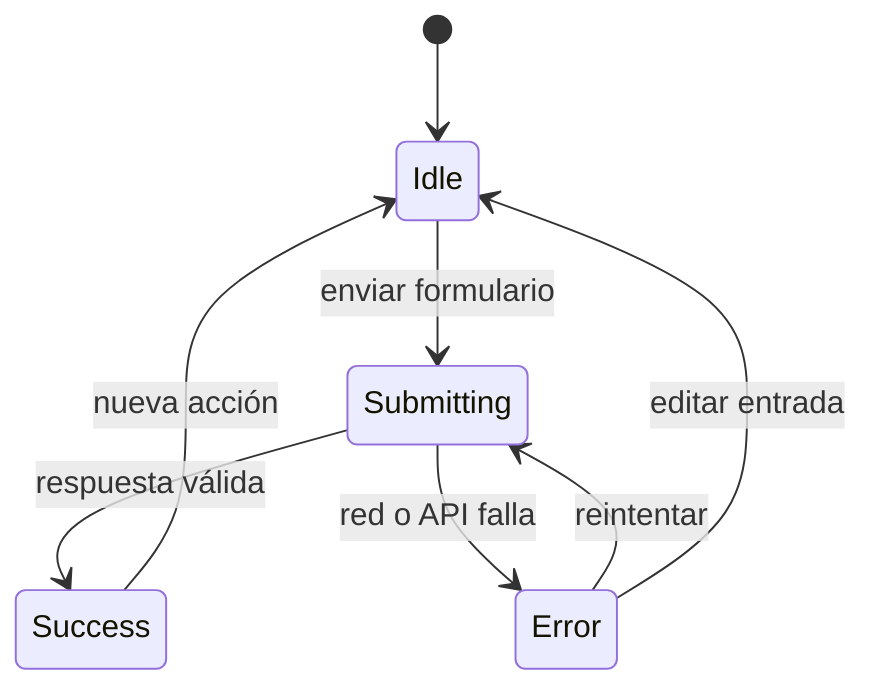

# Capítulo 6. Frontend con React

## ¿Por qué importa?

Una persona no ve embeddings, payloads ni llamadas HTTP: ve un formulario, un estado de espera, una respuesta y las fuentes que permiten revisarla. El frontend convierte el flujo RAG en una experiencia comprensible. Cuando indica qué se está procesando, muestra fallos recuperables y conserva la evidencia, ayuda al usuario a juzgar la respuesta. Cuando sólo presenta texto fluido, puede hacer que una respuesta incierta parezca confirmada.

React es una biblioteca de JavaScript para construir interfaces a partir de componentes. El ejemplo local utiliza React con Vite y mantiene estados para nombre, texto, pregunta, resultado y estado de operación. Al enviar, usa `fetch` hacia la API Express; no se conecta a Qdrant ni al proveedor de modelos. Esa frontera es esencial: los navegadores están bajo control del usuario y todo lo incluido en el bundle, incluidas las variables `VITE_*`, puede inspeccionarse.

La interfaz suministrada es intencionalmente pequeña y educativa. Permite pegar texto, indexarlo y consultar el contenido. No incluye selección de archivos, sesiones, autenticación, permisos, cancelación, historial, controles de privacidad ni recuperación ante respuestas malformadas. No conviene agregar botones y asumir que esas capacidades aparecen por ello. Este capítulo explica las responsabilidades del cliente, muestra una evolución progresiva y conecta cada decisión con la API de [capítulo 5](book-es-cap5.md).

## ¿Cómo funciona?

### Componentes y estado

Un componente React combina una descripción de interfaz y comportamiento. `useState` guarda valores que pueden cambiar mientras se usa la página; cuando se actualizan, React vuelve a renderizar el componente. El estado debe representar información que la interfaz necesita mostrar: texto escrito, respuesta recibida, error, actividad. Un valor derivable de otros estados normalmente no necesita duplicarse, porque dos copias pueden desincronizarse.

En la aplicación de acompañamiento, `name` y `document` controlan los campos de ingesta; `question` controla el campo de consulta; `result` guarda la respuesta y fuentes; `status` muestra un mensaje como «Indexando...» o un fallo. Es un modelo mínimo que permite leer el flujo de extremo a extremo. A medida que crece, conviene separar formularios y paneles en componentes, pero conservar una sola fuente de verdad por cada dato.



El estado del diagrama es por operación. Una interfaz debe evitar que una sola cadena represente estados incompatibles, por ejemplo mostrar «Consultando» y «Error» al mismo tiempo. Para la demostración, un estado `status` sirve; en una aplicación más completa es preferible modelar `idle`, `loading`, `success` y `error` con datos asociados. El estado del frontend no sustituye los estados de ingesta del servidor, que pueden sobrevivir a una pestaña cerrada.

### Formularios y solicitudes asíncronas

`fetch` devuelve una promesa. La respuesta HTTP puede llegar correctamente a nivel de red aunque tenga estado 400 o 502; por eso el cliente debe revisar `response.ok`. Después debe interpretar JSON y validar que los campos esperados existan. Un `try/catch` cubre errores de red y errores lanzados por la propia aplicación, pero no convierte automáticamente una respuesta HTTP no exitosa en excepción.

El usuario también necesita saber qué botón está ejecutando una acción, si se puede enviar otra vez y qué hacer si hay un fallo. Bloquear envíos duplicados durante una operación ayuda a prevenir consultas accidentales; no reemplaza idempotencia del backend, porque un doble clic, reintento de red o cliente alternativo aún pueden duplicar una acción.

El flujo es similar para ingesta y consulta, pero sus resultados no son iguales. Una ingesta aceptada devuelve `documentId` y `chunks`; una consulta devuelve `answer` y `sources`. Separar manejadores y estados permite mostrar errores pertinentes, limpiar sólo el campo apropiado y evitar borrar una respuesta anterior durante un nuevo intento.

### Fuentes y confianza

El backend retorna una lista de fuentes con nombre, texto, posición y puntuación. Presentarlas da al usuario acceso a la evidencia recuperada. La puntuación ayuda a comparar resultados dentro de una ejecución, pero no es una probabilidad de verdad y no debería traducirse visualmente a «92 % confiable» sin calibración. Para una experiencia seria, mostrar título, sección, página, fecha de actualización y un enlace al documento original, siempre que el servidor proporcione esos campos.

También hay que diferenciar «no encontré documentos», «encontré pasajes pero no alcanzan», «falló el servicio» y «la respuesta no está disponible». El endpoint actual distingue parcialmente la ausencia total de resultados y errores ascendentes, pero no implementa una categoría calibrada de evidencia insuficiente. El frontend puede reflejar con precisión lo que recibe, no inventar certeza ni reinterpretar un error como abstención.

### Accesibilidad y diseño de interacción

Una interfaz accesible se puede usar con teclado, lector de pantalla y distintos tamaños de pantalla. Los campos necesitan etiquetas identificables; los botones deben tener nombres claros; el estado de una operación debe anunciarse mediante una región `role="status"`; los errores deben describir cómo corregirlos. El ejemplo ya incorpora `aria-label` en el campo de nombre y un elemento de estado, aunque etiquetas visibles y estados por formulario mejorarían la experiencia.

El orden de lectura debe coincidir con el orden lógico: ingresar documento, confirmar el resultado de indexación, formular consulta y revisar respuesta/fuentes. No dependas sólo de color para indicar error. El texto del área de respuesta debe poder copiarse; las fuentes deben ser navegables y distinguibles. En móvil, botones y controles deben tener áreas cómodas y la pantalla no debería desplazarse horizontalmente por nombres de archivo largos.

## ¿Cómo se implementa?

### Cliente API pequeño y errores explícitos

En el ejemplo, `API` se toma de `import.meta.env.VITE_API_URL` o usa `http://localhost:3001`. El helper `call` serializa el cuerpo, establece `Content-Type`, espera JSON y lanza un error si el estado no es exitoso. Esto reduce duplicación entre ingesta y consulta. El helper no configura timeout, cancelación ni validación de esquema, por lo que los consumidores aún deben manejar esos límites.

```js
const API = import.meta.env.VITE_API_URL || 'http://localhost:3001';

async function call(path, body, signal) {
  const response = await fetch(`${API}${path}`, {
    method: 'POST',
    headers: { 'content-type': 'application/json' },
    body: JSON.stringify(body),
    signal
  });
  const data = await response.json();
  if (!response.ok) throw new Error(data.detail || data.error || 'HTTP error');
  return data;
}
```

**Qué hace:** encapsula solicitudes JSON y convierte códigos no exitosos en errores manejables; acepta opcionalmente un `AbortSignal` para cancelar la espera del navegador. **Por qué se usa:** hace que ambos formularios llamen el mismo contrato sin conocer el proveedor RAG. **Cómo funciona:** `fetch` envía `POST`; luego el helper parsea JSON y revisa `ok`. **Cuándo conviene:** en una aplicación pequeña con pocos endpoints y respuesta JSON uniforme. **Resultado esperado:** un objeto JavaScript o una excepción que el formulario puede mostrar. El patrón refleja `frontend/src/main.jsx`; en una aplicación robusta también manejaría respuestas no JSON, timeout y validación de estructura.

Los nombres `VITE_*` no son secretos. Vite sustituye estas variables durante la construcción para que el navegador conozca la URL. La URL del backend es información de configuración pública; una clave de OpenAI, un token de base vectorial o una contraseña nunca debe almacenarse allí. La autenticación se implementa con un flujo diseñado para el usuario, y las credenciales de servicio permanecen en el servidor.

### Formularios progresivos

El manejador de ingesta evita el comportamiento de recarga tradicional, informa que el trabajo comenzó, llama al endpoint y muestra la cantidad de fragmentos. Para un MVP, esto comunica actividad y resultado. Una mejora inmediata es tener un booleano independiente `ingesting`, deshabilitar el botón durante el envío y restaurar el estado con `finally`, de manera que un fallo no deje el botón bloqueado.

```jsx
function IngestForm({ name, setName, document, setDocument, onSubmit, busy }) {
  return (
    <form onSubmit={onSubmit}>
      <label htmlFor="doc-name">Nombre del documento</label>
      <input id="doc-name" value={name}
        onChange={(event) => setName(event.target.value)} />
      <label htmlFor="doc-text">Contenido de texto</label>
      <textarea id="doc-text" value={document}
        onChange={(event) => setDocument(event.target.value)} />
      <button type="submit" disabled={busy || !document.trim()}>
        {busy ? 'Indexando…' : 'Indexar documento'}
      </button>
    </form>
  );
}
```

**Qué hace:** presenta campos controlados y un botón que refleja contenido y actividad. **Por qué se usa:** mejora accesibilidad y reduce envíos vacíos o duplicados accidentales. **Cómo funciona:** `value` y `onChange` conectan los campos con estado React; `busy` controla disponibilidad. **Cuándo conviene:** en formularios con operaciones asíncronas. **Resultado esperado:** el formulario permanece sincronizado con estado y comunica cuándo no debe enviarse. Es un componente conceptual; el proyecto actual mantiene el formulario dentro de `App` y valida texto en el backend.

La validación del navegador sólo mejora la experiencia. El cliente puede modificarse, por lo que las mismas reglas críticas deben aplicarse en la API. No conviene mostrar límites distintos en frontend y backend: compartir la especificación o documentar claramente límites evita que el usuario descubra el rechazo después de escribir un texto largo.

### Estados de carga sin carreras

Una interfaz puede iniciar una segunda consulta antes de que termine la primera. Si ambas respuestas llegan fuera de orden, una respuesta antigua podría sobrescribir la nueva. Este ejemplo conceptual cancela la solicitud anterior e identifica cada operación: el identificador impide actualizar estado desde una respuesta vieja incluso si la cancelación llega tarde. Ignora `AbortError`, que indica una cancelación esperada, y aborta la solicitud activa al desmontar el componente. Cancelar en el navegador no garantiza que el servidor haya detenido embeddings o generación; para liberar esos recursos, el backend también debe detectar y propagar la cancelación.

```jsx
const [queryState, setQueryState] = useState({ status: 'idle', result: null, error: '' });
const activeController = useRef(null);
const requestId = useRef(0);

useEffect(() => () => {
  requestId.current += 1; // invalida cualquier respuesta pendiente
  activeController.current?.abort();
  activeController.current = null;
}, []);

async function ask(event) {
  event.preventDefault();
  activeController.current?.abort();
  const controller = new AbortController();
  activeController.current = controller;
  const thisRequest = ++requestId.current;
  setQueryState({ status: 'loading', result: null, error: '' });
  try {
    const result = await call('/api/query', { question }, controller.signal);
    if (thisRequest !== requestId.current) return;
    setQueryState({ status: 'success', result, error: '' });
  } catch (error) {
    if (error.name === 'AbortError' || thisRequest !== requestId.current) return;
    setQueryState({ status: 'error', result: null, error: error.message });
  } finally {
    if (thisRequest === requestId.current) activeController.current = null;
  }
}
```

**Qué hace:** representa estados de carga, éxito y error, y evita que una consulta anterior reemplace el resultado actual. **Por qué se usa:** evita mostrar respuestas fuera de orden. **Cómo funciona:** al comenzar otra consulta se aborta la anterior; el identificador protege el estado si una respuesta alcanza a completarse de todos modos. El cleanup invalida y cancela la solicitud activa al desmontar. **Cuándo conviene:** cuando una persona puede enviar otra consulta antes de que termine la anterior. **Resultado esperado:** sólo la consulta más reciente puede actualizar la vista; una cancelación no aparece como error. Este fragmento es conceptual y no ejecutado. Por ejemplo, si se envía «contrato» y luego «factura» antes de que termine la primera, se aborta «contrato» y, aunque su respuesta llegue tarde, sólo «factura» puede actualizar el estado. El navegador cancela su solicitud, pero el backend debe propagar esa señal para intentar detener embeddings o generación.

El código de muestra utiliza un solo `status` para ingesta y consulta. Si el usuario puede iniciar ambas tareas, una operación podría ocultar el estado de la otra. Mantener `ingestState` y `queryState` separados es una evolución sencilla. Cuando existan más operaciones, los hooks propios o una biblioteca de datos remotos pueden gestionar caché, reintentos y cancelación; conviene adoptarlos cuando la complejidad lo justifique.

### Renderizar fuentes como evidencia

Una lista de fuentes debe usar una clave estable. El ejemplo utiliza el índice de arreglo como `key`, suficiente para una lista estática pequeña pero menos apropiado si los elementos se insertan o reordenan. Si la API provee identidad de documento y posición, esa combinación puede servir como clave. No se debe crear un enlace a un archivo privado sólo desde el nombre recibido: el servidor debe validar permiso al abrirlo.

```jsx
function Sources({ sources }) {
  if (!sources?.length) return <p>No se recibieron pasajes fuente.</p>;
  return (
    <section aria-labelledby="sources-heading">
      <h2 id="sources-heading">Pasajes recuperados</h2>
      <ol>
        {sources.map((source) => (
          <li key={`${source.name}:${source.position}`}>
            <strong>{source.name}</strong>
            <p>{source.text}</p>
            <small>Posición {source.position}; puntuación {source.score}</small>
          </li>
        ))}
      </ol>
    </section>
  );
}
```

**Qué hace:** muestra textos que el backend recuperó junto con metadatos simples. **Por qué se usa:** el usuario puede inspeccionar de qué pasajes depende la respuesta. **Cómo funciona:** React itera el arreglo y renderiza un elemento por resultado. **Cuándo conviene:** en interfaces de preguntas donde la trazabilidad importa. **Resultado esperado:** respuesta y evidencia visibles, sin presentar la puntuación como probabilidad de corrección. Es conceptual y asume que `position` existe, como en el contrato actual.

### Presentación de errores y estados vacíos

Un error técnico debe traducirse en una acción útil, no en una pila de JavaScript. Para una pregunta sin fuentes, puede mostrarse «No hay documentos indexados todavía» si ese es el mensaje del servidor; para una falla de red, sugerir comprobar conexión y reintentar. No se debe asegurar que el documento no existe cuando la API estuvo caída. En producción, mensajes internos se asocian a un identificador de soporte, no se exponen directamente.

Una respuesta vacía también es una oportunidad de guiar: explicar cómo cargar un documento, mostrar historial de ingestas exitosas o comunicar que el corpus está vacío. El cliente no debería mantener una respuesta antigua junto a un indicador de nueva consulta si eso puede inducir a pensar que es el resultado actual. Limpiar o etiquetar explícitamente resultados previos evita ambigüedad.

### CORS, URLs y despliegue

CORS es una regla aplicada por navegadores para controlar qué orígenes pueden leer respuestas. El backend de ejemplo permite el origen indicado por `FRONTEND_URL` o `http://localhost:5173`. CORS no es autenticación: `curl`, aplicaciones móviles y scripts pueden llamar al endpoint, y un navegador puede enviar solicitudes simples aunque después bloquee leer la respuesta. La autorización siempre pertenece a la API.

Vite define `VITE_API_URL` en la compilación/entorno del frontend. Localmente apunta a `http://localhost:3001`; si se despliega detrás de un proxy, puede ser preferible una ruta relativa como `/api` para evitar orígenes y configuración CORS. Cualquier URL introducida en el bundle es visible; nunca pongas allí un secreto pensando que una variable de entorno de compilación queda oculta.

## Diseño de interfaz y decisiones

| Decisión | Implementación sencilla | Alternativa | Cuándo cambiar |
|---|---|---|---|
| Estado remoto | `useState` y `fetch` | TanStack Query u otra biblioteca | Hay caché, deduplicación, revalidación y muchos recursos |
| Formularios | Estado controlado | Biblioteca de formularios y esquema | Formularios extensos o validación compleja |
| Estilos | CSS local del proyecto | Sistema de diseño | Varias vistas deben compartir patrones accesibles |
| URL API | Variable pública `VITE_API_URL` | Proxy/ruta relativa | Despliegue necesita mismo origen o varios entornos |
| Resultado | Texto y fuentes | Componentes ricos con enlaces al origen | Hay metadatos, paginación y navegación documental |
| Archivos | Texto pegado | Carga con backend de parsing | El producto requiere PDF, DOCX, imágenes u otros |

La biblioteca elegida debe responder al volumen de comportamiento, al equipo y a requisitos de accesibilidad. No agregues estado global antes de tener estado realmente compartido. No conviertas cada párrafo en un componente si eso vuelve más difícil seguir un formulario pequeño. La interfaz del MVP puede ser simple y aun así informar bien sus límites.

### Texto, privacidad y consentimiento

El campo de texto puede contener información que la persona no esperaba enviar a un servicio externo. Una interfaz debe explicar, antes de la acción, qué se indexa, quién puede consultarlo y si el procesamiento sale del dispositivo. Si el proveedor es remoto, el backend transmite el texto a ese proveedor; una etiqueta «local» en la página no lo vuelve local. La política real debe coincidir con la configuración desplegada y la documentación del producto.

No guardes automáticamente el contenido en `localStorage` por comodidad. El almacenamiento del navegador persiste después de cerrar la pestaña y puede compartirse en equipos. Si se necesita borrador local, explicar el alcance y ofrecer limpieza. Para telemetría, preferí eventos como duración y tipo de resultado frente a registrar preguntas enteras. Un identificador de documento tampoco siempre es anónimo: puede vincularse con una persona en los sistemas que lo originaron.

### Probar el contrato en aislamiento

Antes de depurar estilos, probá la API con un cliente independiente, como `curl` o una herramienta HTTP. Si ese cliente recibe un contrato válido pero React no, el problema probablemente está en la URL, CORS, serialización o renderizado. Si ambos fallan igual, conviene revisar Express y sus dependencias. Este orden evita atribuirle a React fallos que ocurren en Qdrant y permite acotar el diagnóstico por frontera.

La interfaz debería manejar también una respuesta de éxito con campos ausentes o tipos inesperados. Un proveedor puede devolver una cadena vacía, una lista `sources` nula por un defecto o un proxy HTML en lugar de JSON. El helper actual presupone JSON y la forma conocida. Para un prototipo local, esa expectativa explícita mantiene el código pequeño; si la API tiene varios consumidores o versiones, validar la respuesta en el cliente ayuda a producir un error comprensible y a detectar incompatibilidades temprano.

## Errores frecuentes y buenas prácticas

- **Poner una clave de proveedor en React.** Todo el bundle y tráfico del navegador son inspeccionables; las claves se guardan en el backend.
- **Confiar sólo en validación HTML.** Repetir validaciones de seguridad y tamaño en Express.
- **No revisar `response.ok`.** `fetch` no rechaza automáticamente respuestas HTTP 400 o 500.
- **Mostrar `error.message` sin criterio.** Puede contener detalles de infraestructura; traducir errores conocidos y mantener el resto genérico.
- **Usar CORS como control de acceso.** CORS no evita llamadas directas ni otorga identidad.
- **Representar puntuación como certeza.** La similitud no equivale a probabilidad de respuesta correcta.
- **Dejar botones habilitados durante envío.** Evitar envíos accidentales y comunicar progreso; el servidor debe seguir siendo idempotente.
- **Sobrescribir respuestas sin indicar el cambio.** Evitar que resultados antiguos parezcan actuales durante una consulta nueva.
- **Omitir etiquetas y foco.** Probar teclado, navegación por tabulación y lectores de pantalla.
- **Suponer que cancelar en el navegador cancela el trabajo.** La solicitud puede continuar en backend; diseñar cancelación de extremo a extremo si importa.
- **Dar soporte de archivo sólo por cambiar el control HTML.** El backend debe recibir, validar, parsear y proteger el archivo.

## Ejercicios

1. Dibujá las transiciones de estado de la ingesta y la consulta por separado. Incluí éxito, error de validación, error de red y fuentes vacías.
2. Inspeccioná `frontend/src/main.jsx`. Identificá estados controlados, endpoint, campos de salida y un caso en el que el estado global podría ocultar información.
3. Modificá conceptualmente el helper `call` para que maneje una respuesta que no sea JSON. ¿Qué mensaje recibe el usuario y qué debería quedar sólo en logs?
4. Diseñá una tarjeta de fuente que incluya documento, página y fecha. Indicá qué debe validar el backend antes de entregar un enlace al original.
5. Explicá por qué una llamada desde el navegador con un `tenantId` arbitrario no constituye autorización.
6. Escribí una prueba manual de teclado para operar ingesta y consulta sin mouse. Incluí foco, envío y lectura de estado.
7. Proponé comportamiento para dos consultas enviadas rápidamente y para una pestaña cerrada durante una ingesta. ¿Qué responsabilidad corresponde al cliente y cuál al servidor?
8. Enumerá qué datos de usuario podrían terminar en el bundle, consola, almacenamiento del navegador y tráfico HTTP; definí cuáles evitarías guardar.

## Referencias y continuidad

- [React: estado y respuesta a eventos](https://react.dev/learn/state-a-components-memory) y [formularios](https://react.dev/reference/react-dom/components/form): modelo de componentes e interacción.
- [MDN: Fetch API](https://developer.mozilla.org/en-US/docs/Web/API/Fetch_API/Using_Fetch): solicitudes, respuestas y manejo de errores HTTP.
- [MDN: CORS](https://developer.mozilla.org/en-US/docs/Web/HTTP/Guides/CORS): alcance del control de origen en navegadores.
- [Vite: variables de entorno y modos](https://vite.dev/guide/env-and-mode): variables expuestas al cliente.
- El ejemplo real está en [frontend/src/main.jsx](../frontend/src/main.jsx), y la API consumida en [backend/src/server.js](../backend/src/server.js).
- Volvé al [capítulo 5](book-es-cap5.md) para el contrato HTTP; después seguí con [capítulo 7](book-es-cap7.md) para elegir modelos de embeddings.

**Validación de ejemplos:** el helper coincide en estructura con el frontend existente; los formularios de componentes, el estado discriminado y la lista de fuentes son ejemplos conceptuales y no fueron integrados ni ejecutados. La interfaz existente no incorpora autenticación, carga de archivos, cancelación ni controles de acceso. Ninguna clave secreta debe llegar a React.
