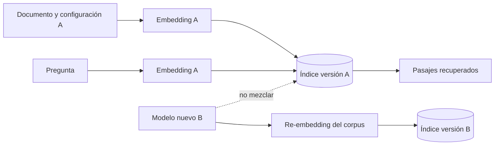

# Capítulo 7. Elegir un proveedor de embeddings

## ¿Por qué importa?

Un sistema RAG depende de que una pregunta y los fragmentos útiles puedan compararse en un espacio común. El proveedor de embeddings aporta el modelo que realiza esa transformación. Una elección equivocada puede hacer que la recuperación pierda documentos relevantes, confunda términos del dominio, agregue latencia o exponga texto a un servicio externo. Por eso, seleccionar un modelo no es una compra aislada: define una parte del contrato de datos y de operación de la aplicación.

Imaginemos una biblioteca con un catálogo que usa un idioma distinto al de sus lectores. Los libros siguen ahí, pero las consultas apuntan a estantes incorrectos. Un modelo de embeddings cumple una función parecida a la del sistema de catalogación: expresa documentos y preguntas con una convención compartida. Si se cambia esa convención, no alcanza con actualizar la búsqueda; también hay que volver a representar e indexar los documentos. El capítulo 2 explica qué es un embedding y cómo se relaciona con la fragmentación; aquí nos concentramos en elegir, evaluar y operar el proveedor.

Una lista de dimensiones, una demostración comercial o una puntuación pública no predicen por sí solas la calidad en nuestro corpus. Un manual legal en español, una base de tickets con abreviaturas y una colección de código presentan dificultades diferentes. La decisión necesita combinar una prueba con preguntas reales, restricciones de privacidad, disponibilidad, latencia, costo total y capacidad del equipo para mantener el servicio.

## ¿Cómo funciona?

### El contrato entre modelo e índice

Para cada fragmento de documento y para cada consulta, un modelo recibe texto y devuelve un vector de números. El vector tiene una dimensión fija para una configuración dada. La base compara el vector de la pregunta con los vectores almacenados y ordena candidatos mediante una métrica como coseno o producto interno. Si los documentos se generaron con un modelo y las consultas con otro, la comparación carece de una semántica garantizada, incluso cuando ambos vectores tienen la misma longitud.

La longitud no identifica al modelo. Dos proveedores pueden devolver vectores de 1.024 números y representar sus espacios de forma distinta. En cambio, una dimensión diferente suele ser un indicador inmediato de incompatibilidad: la base rechaza el vector o la aplicación falla al buscar. Aun si una API permite reducir dimensiones, esa reducción sigue siendo parte de la configuración y debe coincidir entre ingesta y consulta. La guía oficial de OpenAI, por ejemplo, describe modelos con dimensiones configurables; no se debe interpretar esa función como compatibilidad automática con otros modelos.

Conviene versionar una configuración completa, no sólo escribir «OpenAI» u «Ollama». Una ficha de modelo puede incluir proveedor, identificador exacto, revisión disponible, dimensiones, modalidad, preprocesamiento, idioma esperado y fecha de evaluación. Algunas API gestionadas actualizan modelos bajo un identificador estable; en esos casos, fijar el nombre no siempre congela el comportamiento. Hay que consultar la política de versiones vigente del proveedor y conservar los metadatos de la prueba que autorizó el cambio.



### Qué significa «mejor» en una evaluación

La evaluación debe medir si los resultados correctos aparecen arriba, no si los vectores parecen matemáticamente sofisticados. Para comenzar, armemos una colección pequeña de preguntas representativas y anotemos qué pasajes deberían responder cada una. Incluyamos consultas exactas, paráfrasis, abreviaturas, nombres propios, números, preguntas sin respuesta y casos con vocabulario ambiguo. Si el sistema atiende español rioplatense, probemos esa variedad lingüística en lugar de asumir que una puntuación en inglés se traslada sin cambios.

Una métrica habitual es *recall@k*: de los pasajes relevantes conocidos para una pregunta, qué proporción aparece entre los primeros `k` resultados. *MRR* (reciprocal rank medio) recompensa que el primer resultado relevante quede cerca del comienzo. *nDCG* permite ponderar relevancias graduadas y el orden de varios resultados. Ninguna métrica decide qué respuesta es aceptable para el negocio. Una tasa alta de recuperación tampoco prueba que el generador cite bien o que la respuesta final sea correcta; esas etapas necesitan evaluarse por separado, como se explica en el capítulo 18.

La comparación debe mantener constantes el corpus, la limpieza, los fragmentos, el `topK`, los filtros y el conjunto de consultas. Si cambiamos a la vez el proveedor y el tamaño de fragmento, no sabremos qué provocó la diferencia. Guardemos también consultas y resultados con sus identificadores de versión para poder reproducir el análisis. El costo de crear una prueba pequeña es bajo frente a descubrir, ya en producción, que el nuevo modelo no entiende nombres de productos o preguntas en otro idioma.

| Criterio | Pregunta concreta | Evidencia útil |
|---|---|---|
| Calidad | ¿Aparece el pasaje que contiene la respuesta? | Recall@k, MRR o nDCG sobre consultas anotadas |
| Idioma y dominio | ¿Comprende términos, siglas y nombres del corpus? | Casos reales y revisión de falsos positivos |
| Dimensión | ¿Coincide con la configuración de la colección? | Respuesta de API y validación al iniciar |
| Latencia | ¿Cuánto tarda una solicitud individual y en lote? | p50/p95/p99 en condiciones representativas |
| Capacidad | ¿Qué tamaño de entrada, lote y tasa admite? | Límites y errores documentados por el proveedor |
| Privacidad | ¿Dónde se procesa y qué retención aplica? | Contrato, región y configuración del servicio |
| Operación | ¿Podemos monitorear, versionar y cambiar de proveedor? | Adaptador propio, telemetría y procedimiento de migración |

### Clases de despliegue y sus intercambios

Una API gestionada reduce el trabajo de instalar modelos, mantener aceleradores y escalar inferencia. A cambio, el texto sale de nuestra infraestructura, dependemos de conectividad y cuotas, y debemos considerar latencia externa, cambios de contrato y costos de uso. Antes de enviar documentos confidenciales hay que revisar las condiciones vigentes del proveedor, la región, la retención y las obligaciones de la organización; «API» no significa automáticamente que un dato se almacene ni que no se almacene.

Un modelo ejecutado en infraestructura propia ofrece más control sobre el flujo de datos y puede ser conveniente en redes aisladas. Sin embargo, «local» no significa gratuito: consume CPU, GPU, memoria, energía y tiempo de operación. El rendimiento depende del modelo, cuantización, hardware, tamaño de lote y concurrencia. En una laptop sirve para aprender; el perfil de esa máquina no basta para calcular capacidad de producción.

Un servicio de modelos alojados por un tercero queda entre esos extremos: conserva la facilidad de invocar una API, pero la ubicación y responsabilidad operativa dependen de quién hospeda el modelo. Los pesos abiertos tampoco garantizan una licencia adecuada, buen rendimiento multilingüe, un endpoint administrado o soporte. Revisemos por separado licencia, condiciones de uso, datos de entrenamiento declarados, hardware necesario y procedimiento para aplicar actualizaciones.

| Opción | Ventajas | Costos y riesgos | Suele convenir cuando |
|---|---|---|---|
| API gestionada | Inicio rápido, capacidad administrada, poca infraestructura propia | Datos enviados a terceros, red y cuotas; consumo variable | El equipo prioriza experimentar y la política de datos lo permite |
| Inferencia local | Control de red y datos; puede funcionar sin conexión externa | Hardware, actualización, capacidad y guardias quedan a cargo del equipo | Hay restricciones de residencia o un volumen estable que justifica operar |
| Modelo alojado en nube propia | Integración con IAM y red del entorno, control de despliegue | Aprovisionamiento de aceleradores y responsabilidad de disponibilidad | La organización ya opera infraestructura de modelos |
| Servicio especializado de embeddings | Puede ofrecer modelos y opciones orientados a recuperación | Dependencia de proveedor y necesidad de evaluar el dominio | La prueba comparativa demuestra una mejora relevante |

### Proveedores: comparar sin convertir la tabla en un ranking

OpenAI publica una API de embeddings con modelos de la familia `text-embedding-3` y parámetros como `dimensions`; la página oficial indica que los vectores se facturan por tokens de entrada, pero precios, disponibilidad y modelos pueden cambiar. Voyage AI publica su propio endpoint de embeddings y familias orientadas a distintos usos. Ninguno debe elegirse sólo por la marca: hay que probar español, consultas de dominio y política de datos del servicio específico.

Ollama permite ejecutar modelos compatibles localmente y el repositorio de este libro usa su API HTTP para el modelo configurado en `.env.example`. El valor por defecto es una decisión didáctica, no una recomendación universal ni una evaluación comparativa. Hugging Face reúne modelos y modalidades de alojamiento distintos; hay que identificar el modelo concreto, licencia, formato y forma de servirlo. Anthropic ofrece modelos generativos y documentación de precios para ellos, pero no se debe inferir de esto que exista un endpoint nativo de embeddings equivalente al que expone el código de muestra. Si se desea usar un proveedor distinto, debe confirmarse su producto y contrato actuales.

| Alternativa | Integración disponible en el ejemplo | Consideraciones antes de elegir |
|---|---|---|
| OpenAI | Sí, mediante solicitud HTTP en `backend/src/core.js` | El secreto se mantiene en backend; fijar modelo y dimensiones en el índice |
| Ollama | Sí, mediante su API local en el ejemplo | Descargar un modelo compatible y medir recursos/latencia del hardware |
| Voyage AI | No | Revisar endpoint, modelo, límites y términos actuales; implementar y validar un adaptador |
| Hugging Face | No como integración general | Distinguir proveedor de pesos, hosting, licencia y servidor de inferencia |
| Anthropic | No para embeddings en el ejemplo | No asumir que el proveedor de chat ofrece la misma interfaz de embeddings |

Esta tabla describe el repositorio, no la totalidad de cada producto. Las referencias al final apuntan a documentación oficial consultada; las opciones comerciales y sus condiciones deben revisarse nuevamente al momento de una decisión.

## ¿Cómo se implementa?

### Aislar el proveedor detrás de un contrato

La aplicación no debería conocer detalles particulares en todos sus módulos. Un contrato pequeño puede aceptar texto y devolver un vector junto con metadatos de configuración. La implementación siguiente es **conceptual y no está integrada ni validada** en el repositorio. Muestra qué validaciones conviene concentrar en un adaptador: respuesta no vacía, números finitos y una dimensión coherente. En la versión real se agregarían autenticación, límites, registro de errores y un cliente HTTP con timeout.

```js
// Ejemplo conceptual: contrato del adaptador, no incluido en el proyecto.
export function createEmbeddingProvider({ id, dimensions, embedText }) {
  if (!id || !Number.isInteger(dimensions) || dimensions <= 0) {
    throw new Error('Configuración de embeddings inválida');
  }

  return {
    id,
    dimensions,
    async embed(text) {
      if (typeof text !== 'string' || !text.trim()) {
        throw new Error('El texto no puede estar vacío');
      }
      const vector = await embedText(text);
      if (!Array.isArray(vector) || vector.length !== dimensions ||
          vector.some(value => !Number.isFinite(value))) {
        throw new Error(`Vector inválido para ${id}`);
      }
      return vector;
    }
  };
}
```

El adaptador reduce el acoplamiento: el resto del sistema llama `embed(text)` y no conoce nombres de rutas ni formatos de respuesta. También concentra el control del tamaño, que evita guardar accidentalmente vectores truncados o una respuesta de error como si fuera un embedding. Conviene cuando se evalúan varios proveedores o se mantiene más de un entorno. Para un prototipo de una sola integración, abstraer cada llamada puede ser prematuro; la función `embed` ya existente en `core.js` es un límite inicial simple.

### Establecer una línea base de evaluación

El siguiente ejemplo compara rankings ya obtenidos por cada candidato; no implementa la llamada a un proveedor ni una métrica de calidad del texto generado. Es **código ilustrativo**, que necesita datos anotados y adaptación antes de ejecutar. Su resultado esperado es una proporción por consulta de pasajes relevantes encontrados dentro de `k` lugares.

```js
// Ejemplo conceptual de recall@k para un conjunto pequeño anotado.
export function recallAtK(results, relevantIds, k) {
  const expected = new Set(relevantIds);
  if (expected.size === 0) return null; // No evalúa preguntas sin respuesta.
  const found = results.slice(0, k).filter(item => expected.has(item.id)).length;
  return found / expected.size;
}

const question = {
  id: 'q-17',
  relevantIds: ['manual-v3:chunk-12', 'manual-v3:chunk-13']
};
const ranking = [
  { id: 'manual-v3:chunk-13' },
  { id: 'faq:chunk-2' },
  { id: 'manual-v3:chunk-12' }
];
console.log(recallAtK(ranking, question.relevantIds, 3)); // 1
```

La función contesta una pregunta limitada: «¿recuperé los pasajes anotados?». No mide si el pasaje era suficiente, si una persona encontró útil la respuesta ni si el modelo inventó una condición. Para comparar candidatos, ejecutemos el mismo conjunto de consultas sobre índices separados, con un identificador estable de fragmento. No mezclemos vectores de espacios distintos en la misma colección ni reutilicemos rankings calculados bajo parámetros diferentes.

### Cambiar el modelo con una migración controlada

La colección del ejemplo se crea según la dimensión observada y rechaza una dimensión distinta. Es una protección útil, pero insuficiente como gestión integral de modelos: no registra proveedor, identificador, preprocesamiento ni fecha del corpus. Una migración robusta crea un índice nuevo, re-embebe cada documento desde la fuente original, verifica conteos y ejecuta la misma evaluación antes de dirigir consultas al índice nuevo. El ejemplo de abajo es un esquema **conceptual, no un comando ejecutable contra el backend actual**.

```text
1. Registrar embedding_config_v2 y sus dimensiones.
2. Crear colección documents_v2 vacía.
3. Leer el corpus fuente con paginación y volver a calcular sus vectores.
4. Comparar cantidad de documentos, fragmentos y errores con la versión anterior.
5. Ejecutar consultas de evaluación sobre documents_v1 y documents_v2.
6. Si los criterios acordados se cumplen, cambiar la configuración de lectura.
7. Mantener v1 durante la ventana de observación y retirar sólo después del respaldo.
```

Este flujo evita una interrupción en la que el índice viejo queda a medio reemplazar. Puede implicar almacenamiento duplicado e inferencia de ingesta temporal; hay que dimensionar ambos. Si no se conserva el texto fuente, una migración puede ser imposible o depender de una extracción de menor calidad. La decisión de conservar original, versión normalizada, checksum y parámetros de fragmentación pertenece al ciclo de vida descrito en el capítulo 11.

### Fallos, reintentos y límites

Una API puede devolver errores de validación, autenticación, límite de uso o disponibilidad. El cliente debe distinguir errores transitorios de errores permanentes: un `429` puede justificar espera con retroceso exponencial y aleatoriedad; una solicitud con entrada demasiado larga requiere dividir o rechazar el texto, no reintentar indefinidamente. Las solicitudes de ingesta deben ser idempotentes o contar con identificadores de trabajo para que un reintento no cree duplicados. Un proceso masivo necesita concurrencia acotada: abrir miles de solicitudes simultáneas puede exceder cuotas y memoria.

También conviene observar tasa de error, latencia por tamaño de entrada, tokens procesados, reintentos y costo. No registrar el texto completo de documentos confidenciales sólo para depurar un proveedor. Un identificador de solicitud, una huella del documento, un código de error y un tamaño aproximado suelen ayudar a investigar sin copiar el contenido sensible. El capítulo 18 desarrolla la observabilidad y el 20 el diagnóstico de fallos.

## Errores frecuentes y buenas prácticas

- **Cambiar sólo el embedding de consulta.** La ingesta y la consulta deben usar el mismo espacio y configuración; indexar de nuevo es el camino seguro.
- **Elegir por dimensión o benchmark general.** Ambos ayudan a descartar candidatos, pero la calidad final debe medirse en consultas y documentos representativos.
- **Usar un modelo generativo como si automáticamente incluyera embeddings.** Verificá que el producto publique explícitamente la operación necesaria y su contrato.
- **Confundir «local» con costo cero.** Sumá hardware, energía, almacenamiento, actualización y horas de operación.
- **Mandar secretos al navegador.** Las llaves viven en el servidor, se cargan desde un gestor de secretos y nunca se incluyen en código React.
- **Migrar sobre la única colección.** Conservá una versión previa y un plan de retorno; no borres datos hasta validar la nueva recuperación.
- **Extrapolar exactitud desde respuestas fluidas.** Revisá ranking y evidencia recuperada antes de atribuir el problema al generador.
- **Ignorar idiomas y entradas difíciles.** Incluí acentos, errores de tipeo, identificadores, texto corto y preguntas sin respuesta en la evaluación.

Una buena elección puede expresarse en una decisión breve y verificable: «Usamos el modelo X con dimensión Y para este corpus, porque recuperó Z de N casos anotados, mantuvo la latencia dentro del objetivo y cumple la política de procesamiento; el índice se identifica como v2 y se puede revertir a v1». Si no se puede completar esa frase, falta evidencia o falta una restricción importante.

## Ejercicios prácticos

1. **Construí un conjunto de evaluación.** Escribí quince preguntas reales o realistas sobre un documento. Marcá pasajes relevantes y preguntas que no deberían poder responderse. Anotá la dificultad de cada caso.
2. **Separá errores por etapa.** Para tres resultados deficientes, inspeccioná los primeros cinco pasajes y clasificá el problema como extracción, fragmentación, embedding, filtro, ranking o generación.
3. **Calculá métricas simples.** Implementá recall@3 y MRR en una hoja o script pequeño. Compará dos rankings y describí qué decisión no puede tomar la métrica.
4. **Diseñá una ficha de versión.** Registrá proveedor, modelo, dimensión, configuración del índice, fecha de evaluación, corpus, limitaciones y procedimiento de retorno.
5. **Analizá el caso local.** Verificá en los archivos de ejemplo qué proveedor de embeddings está implementado y escribí qué cambios y pruebas hacen falta para agregar un segundo servicio.

## Referencias y continuidad

- OpenAI, [guía de embeddings](https://developers.openai.com/api/docs/guides/embeddings): contrato de la API y dimensiones de modelos publicados.
- Voyage AI, [documentación de embeddings](https://docs.voyageai.com/docs/embeddings): endpoint y uso de modelos de embeddings.
- Repositorio de acompañamiento, `backend/src/core.js` y `VALIDATION.md`: adaptadores presentes y límites de validación del ejemplo.
- Gao et al., [*Retrieval-Augmented Generation for Large Language Models: A Survey*](https://arxiv.org/abs/2312.10997): panorama de componentes y variantes RAG.

El [capítulo 2](book-es-cap2.md) desarrolla los vectores y la similitud; el [capítulo 3](book-es-cap3.md) explica la ingesta y versionado; el [capítulo 8](book-es-cap8.md) presenta el almacenamiento que recibe estos vectores y el [capítulo 18](book-es-cap18.md) trata su evaluación continua. Los fragmentos de este capítulo sobre adaptadores y métricas son conceptuales hasta que se integren y prueben con un corpus real.
