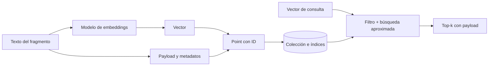

# Capítulo 8. Bases de datos vectoriales

## ¿Por qué importa?

Un embedding es útil cuando podemos guardarlo, encontrarlo y relacionarlo con su texto de origen. Una base vectorial organiza esos vectores y permite recuperar vecinos cercanos con una consulta. En una aplicación real también debe filtrar por tenant, estado, fecha o permisos; actualizar fragmentos; eliminar datos; sostener disponibilidad y permitir que el equipo los respalde. La elección afecta la calidad de recuperación, el rendimiento, el costo operativo y la seguridad.

Pensá en un archivo físico con miles de fichas. Si para cada consulta hubiera que leer una por una, el resultado sería correcto pero lento. Un índice crea caminos para llegar a candidatos sin revisar cada elemento. Las bases vectoriales hacen algo parecido en un espacio de muchas dimensiones. El índice puede acercarse a los vecinos más probables sin garantizar que siempre entregue el vecino matemáticamente más cercano; esa concesión entre tiempo y exactitud se debe medir.

Este capítulo se apoya en los vectores y la compatibilidad de modelos explicados en el [capítulo 7](book-es-cap7.md). No intenta enseñar otra vez la ingesta completa del [capítulo 3](book-es-cap3.md): se concentra en cómo organizar los datos, seleccionar un motor y proteger consultas. El ejemplo que acompaña el libro usa Qdrant por HTTP, pero no constituye una arquitectura lista para producción. El archivo `VALIDATION.md` advierte que el clúster Kubernetes suministrado no despliega Qdrant y que no se verificó una instalación integral.

## ¿Cómo funciona?

### Qué almacena una base vectorial

En Qdrant, la unidad básica se denomina *point*: un identificador, uno o varios vectores y un *payload* opcional con datos estructurados. La colección agrupa puntos con una configuración vectorial compartida. Otros sistemas usan palabras distintas, pero suelen ofrecer equivalentes: una tabla, namespace, índice o colección. El payload puede incluir texto del fragmento, identificador del documento, posición, idioma, fecha o etiquetas. No todo dato tiene que vivir junto al vector: guardar el original en un almacenamiento de objetos y mantener en el índice sólo la metadata necesaria puede reducir duplicación y mejorar la gobernanza.

El índice vectorial crea una estructura que facilita buscar candidatos. HNSW es una familia de grafos de navegación aproximada: cada elemento se conecta con vecinos y la búsqueda avanza por conexiones prometedoras. Ajustar parámetros puede aumentar la exploración y el recall, a costa de memoria o latencia. La búsqueda exacta, que compara la pregunta contra todos los vectores elegibles, es más sencilla y puede ser preferible en conjuntos pequeños o como referencia de evaluación. No hay un umbral universal de cantidad de puntos para cambiar a ANN: depende de dimensiones, hardware, concurrencia, filtros y objetivos de respuesta.

Además del vector, una consulta suele combinar una métrica de distancia, un límite de resultados y filtros. La métrica elegida debe ser compatible con la manera en que se generaron y normalizaron los vectores. Distancia coseno, Euclídea y producto interno no son nombres intercambiables. No conviene cambiar una métrica en producción sin revisar el contrato del proveedor de embeddings y comparar resultados con consultas conocidas.



La figura presenta una ruta conceptual. El código de ejemplo construye un payload con `name`, `text`, `position` y `documentId`, envía puntos a la colección `documents` y solicita los cuatro candidatos predeterminados. No implementa indexación de payload, filtros por tenant ni una capa de autorización.

### Índices aproximados y filtros

La búsqueda aproximada de vecinos cercanos, ANN, acelera la consulta al explorar una parte del espacio. La búsqueda exacta, a veces llamada KNN exacta, compara todos los registros que cumplen el alcance. El resultado ANN puede variar según parámetros, número de elementos y condiciones; por eso una configuración que parece rápida puede perder candidatos relevantes. Se evalúa midiendo recall contra un conjunto de verdad de referencia y latencia bajo carga realista.

Los filtros cambian el problema. Una pregunta como «¿qué dice la guía de gastos?» debe buscar sólo documentos autorizados para la persona, quizá además de limitarse a la versión vigente. Si filtramos después de traer resultados globales, podemos tanto filtrar mal como revelar datos en logs o memoria intermedia. Hay que aplicar el alcance de autorización dentro de la consulta cuando el motor lo permite y validar la identidad en el backend. El cliente nunca debe decidir su propio `tenantId` como prueba de permiso.

Los motores pueden indexar campos de metadata para que los filtros sean eficientes. Qdrant permite asociar índices de payload con campos y recomienda crearlos antes de cargar los datos usados en filtros. PostgreSQL permite combinar índices relacionales con búsqueda vectorial; con índices aproximados, el filtrado puede producir menos resultados de los esperados, según selectividad y configuración. Si el filtro por cliente reduce mucho el universo, es importante medir recall dentro de ese subconjunto y no sólo en el corpus entero.

Una colección compartida con un campo `tenantId` es fácil de administrar, pero requiere controles rigurosos en cada operación. Colecciones separadas pueden facilitar restauración o límites por cliente, pero aumentan el número de objetos y tareas administrativas. Particiones, bases separadas o despliegues separados tienen intercambios similares. La elección depende de aislamiento requerido, cantidad y tamaño de tenants, consultas, límites del servicio y costo de operación; un filtro no sustituye a una frontera de seguridad diseñada y probada.

### Familias de almacenamiento

Una base vectorial dedicada organiza índices y operaciones alrededor de la recuperación. Puede ofrecer filtros y mecanismos ANN listos para usar, y a menudo se despliega como servicio administrado o contenedor. La base relacional con extensión vectorial reutiliza SQL, transacciones, controles de acceso y herramientas que un equipo ya conoce. Un motor de búsqueda tradicional con capacidades vectoriales puede unir texto completo, filtros y vectores en un mismo producto. Bibliotecas como FAISS sirven para búsquedas dentro de una aplicación o proceso, pero el equipo debe construir persistencia, servicio, backup y coordinación alrededor de ellas.

| Opción | Puntos fuertes | Límites y trabajo operativo | Encaja cuando |
|---|---|---|---|
| Qdrant | Colecciones y puntos con payload; filtros y ANN; API HTTP/gRPC; opción local o administrada | Requiere operar almacenamiento, seguridad, respaldo y actualización si se aloja por cuenta propia | Se necesita una base dedicada con una ruta local reproducible |
| Pinecone | Servicio administrado orientado a búsqueda vectorial | Dependencia del servicio, precios y opciones cambian; revisar región, límites y recuperación de datos | El equipo prefiere delegar operación de la base y acepta el modelo comercial |
| Weaviate | Búsqueda vectorial y funciones de búsqueda híbrida; opciones de hosting | Configuración y capacidades varían entre despliegues y versiones | Se buscan capacidades integradas y el equipo puede mantener ese ecosistema |
| PostgreSQL + pgvector | SQL, joins, transacciones y datos vectoriales en un motor familiar | Competencia por recursos, ajuste de índices y filtros; probar carga y aislamiento | Ya existe PostgreSQL y los requisitos caben en su operación |
| Motor de búsqueda | Texto, filtros y funciones vectoriales en flujos de búsqueda existentes | Puede requerir más ajuste y recursos; validar el ranking híbrido | Ya se administra ese motor y la búsqueda textual es central |
| FAISS u otra biblioteca | Flexibilidad local y control sobre el algoritmo | No resuelve por sí sola API, persistencia durable, concurrencia ni recuperación operativa | Investigación, pruebas, dispositivo local o servicio pequeño especializado |

La tabla no es un ranking de velocidad, precio o calidad. Esas características dependen de versiones, región, tipo de instancia, tamaño del vector, carga y contrato. Para comparar servicios gestionados, calculá el costo completo con las páginas vigentes y el volumen propio; no extrapoles una cifra de otro equipo ni una tarifa archivada.

### Diseño del registro y ciclo de vida

Un punto útil permite responder de dónde vino, a qué versión corresponde y bajo qué política se puede leer. Un registro podría incluir `tenantId`, `documentId`, `chunkId`, `sourceVersion`, `embeddingConfigId`, `createdAt`, `text` y `status`. No es necesario poner todos los campos en el vector store. El ID debe ser estable e idempotente: reingerir la misma versión del documento debería actualizar o reemplazar sus puntos, no crear copias sin fin.

La actualización de un documento requiere una política explícita. Se puede eliminar todos sus puntos y cargar la versión nueva, o usar versiones y cambiar una marca de estado al terminar. El segundo enfoque evita que una carga parcial deje el documento vacío, aunque exige filtrar correctamente versiones obsoletas y limpiar datos antiguos. Las operaciones de lote deben tener tamaño controlado y registrar progreso para reanudarse después de un fallo.

La eliminación también es una operación de extremo a extremo. Eliminar un punto del índice no borra necesariamente el original en almacenamiento, un duplicado de caché, un backup o un registro de evaluación. La política de retención debe decir qué se elimina, en qué plazo y cómo se comprueba. Para datos sujetos a requisitos legales, consultar a los responsables correspondientes y no asumir que «delete» de una API equivale a eliminación inmediata en toda réplica y respaldo.

### Particionado, réplicas y consistencia

Cuando un índice no cabe razonablemente en una sola partición o necesita distribuir carga, puede dividirse en *shards*. El particionado horizontal reparte puntos entre fragmentos físicos; una consulta puede visitar uno o varios, y el resultado global reúne sus candidatos. Esto agrega capacidad, pero también coordinación, tráfico interno y más decisiones de distribución. Un aumento del número de shards no garantiza una consulta más rápida: una búsqueda que debe consultar a todos los shards puede aumentar el trabajo total.

Las réplicas son copias que ayudan a sostener lectura o disponibilidad, según el producto y su configuración. No son un reemplazo de backup y no siempre implican que una escritura ya sea visible desde cada réplica. El equipo necesita entender el nivel de consistencia, confirmaciones de escritura, elección de líder si existe, y comportamiento durante una partición de red. En una aplicación RAG, una demora de visibilidad puede causar que la consulta no encuentre un documento recién ingerido aunque la API haya confirmado alguna fase de la operación.

Almacenamiento en memoria, en disco o híbrido ofrece otro intercambio. Mantener más vectores y estructuras en RAM puede reducir accesos a disco, pero aumenta la presión de memoria y el costo de las máquinas; mover datos a disco reduce ese requisito, aunque puede afectar latencia. Cuantizar comprime vectores y puede disminuir consumo, con posibles cambios de precisión. Esas optimizaciones deben compararse contra una línea base de calidad y latencia, no habilitarse por intuición. La documentación de cada motor especifica qué parte de sus datos se mantiene residente y cómo ajustar cada función.

Una ruta de crecimiento prudente comienza por medir una instancia con la carga y el corpus previstos. Después se identifica el límite observado: CPU, memoria, lectura, filtro, escritura o concurrencia. Si la restricción es de memoria, un índice compacto o el almacenamiento en disco puede ayudar; si es escritura, lotes y colas pueden ser el punto de intervención; si es aislamiento de clientes, particionar por tenant puede tener más sentido que agregar hardware. Cada cambio requiere repetir las mismas consultas de evaluación y verificar la restauración.

## ¿Cómo se implementa?

### Inspeccionar el contrato presente en el repositorio

El proyecto usa Qdrant a través de HTTP para mantener baja la cantidad de dependencias del ejemplo. `ensureCollection` crea una colección con tamaño de vector y distancia coseno si todavía no existe; si ya existe, comprueba que la dimensión coincida. `indexText` crea fragmentos, calcula vectores y sube puntos con payload. `retrieve` vectoriza la pregunta y solicita candidatos. Esta ruta es adecuada para demostrar el contrato básico, pero no hace filtros de autorización, reintentos selectivos, batches configurables, indexación de metadata ni backup.

La siguiente petición reproduce el formato conceptual de búsqueda de Qdrant. El vector se sustituye por números ficticios, por lo que este bloque **no es ejecutable como búsqueda válida** y sólo ilustra dónde enviar un filtro. El campo `tenant_id` tendría que asignarse a partir de la sesión autenticada del servidor; el cliente no debería enviarlo como autoridad.

```http
POST /collections/documents/points/search
Content-Type: application/json

{
  "vector": [0.12, -0.08, 0.31],
  "limit": 5,
  "with_payload": true,
  "filter": {
    "must": [
      { "key": "tenant_id", "match": { "value": "tenant-from-session" } },
      { "key": "status", "match": { "value": "active" } }
    ]
  }
}
```

La respuesta esperada es una lista de puntos con puntajes y payload; no significa que el backend de muestra implemente este filtro. Antes de desplegar una consulta filtrada, crear los índices apropiados y ensayar tanto resultados como restricciones de acceso. Las versiones de API pueden cambiar; confirmar la ruta en la documentación de Qdrant correspondiente al despliegue utilizado.

### Un esquema relacional alternativo

Si la organización ya opera PostgreSQL, pgvector puede guardar embeddings y metadata en una tabla SQL. El siguiente SQL es **conceptual**: supone que la extensión está instalada, que la versión admite los operadores usados y que existe una política de tenant aplicada por el servidor o por Row-Level Security. La dimensión `1536` es ilustrativa; debe coincidir con el modelo y configuración reales.

```sql
CREATE EXTENSION IF NOT EXISTS vector;

CREATE TABLE rag_chunks (
  id text PRIMARY KEY,
  tenant_id text NOT NULL,
  document_id text NOT NULL,
  source_version text NOT NULL,
  content text NOT NULL,
  embedding vector(1536) NOT NULL,
  created_at timestamptz NOT NULL DEFAULT now()
);

CREATE INDEX rag_chunks_tenant_document_idx
  ON rag_chunks (tenant_id, document_id);

-- La consulta usa un placeholder del driver; no concatenar SQL con texto del usuario.
SELECT id, document_id, content,
       embedding <=> $1 AS cosine_distance
FROM rag_chunks
WHERE tenant_id = $2
ORDER BY embedding <=> $1
LIMIT 5;
```

La distancia de coseno se ordena de menor a mayor con el operador mostrado. Este ejemplo devuelve distancia, no un puntaje normalizado que se pueda comparar directamente con el de Qdrant. El ordenamiento puede usar una búsqueda exacta si no hay índice vectorial aplicable. Para corpus más grandes se evalúan índices HNSW o IVFFlat y se miden recall y latencia. Crear un índice aproximado no hace que cualquier consulta filtrada sea rápida ni completa; hay que observar el plan y el efecto del filtro.

PostgreSQL aporta joins y transacciones familiares. A cambio, el vector store comparte CPU, memoria, disco, backups y ventanas de mantenimiento con otras cargas. La decisión puede ser favorable cuando ya hay una plataforma PostgreSQL sólida y el volumen es compatible con sus objetivos. Si la recuperación domina la carga o exige una escala y funciones específicas, compararla con una base dedicada evita sobrecargar un servicio compartido.

### Evaluación, capacidad y continuidad

Antes de aumentar la escala, construir una prueba de carga que represente las consultas simultáneas, filtros, dimensiones, `topK` y payload real. Medir p50, p95 y p99, errores, consumo de memoria, tamaño del índice y recall frente a la búsqueda exacta o a un conjunto de relevancia anotada. La velocidad media no muestra colas largas ni el impacto de una consulta con un filtro muy selectivo. El capítulo 13 vuelve sobre formas de arquitectura para distintos volúmenes.

En una base administrada, revisar región, cifrado, autenticación, cuotas, retención, réplicas y mecanismo de exportación antes de confiarle información. En una base autogestionada, definir quién rota credenciales, actualiza versiones, monitorea disco, comprueba consistencia y prueba restauraciones. Una réplica no equivale a un backup: replica errores de borrado o corrupción lógica. El procedimiento debe incluir una copia recuperable y una prueba periódica de restauración. Ninguna de estas tareas está incluida en el Qdrant local de Compose.

Para migrar de un motor a otro, exportar texto, metadata e identificadores canónicos; volver a generar vectores si cambia el formato o modelo; cargar en destino; comparar conteos, filtros y resultados; y cambiar el tráfico gradualmente. Guardar sólo vectores puede impedir reconstruirlos si la nueva base o modelo necesita otra dimensión. Es preferible tratar el índice como derivado de fuentes y una configuración reproducible, y mantener una estrategia para volver a generarlo.

## Errores frecuentes y buenas prácticas

- **Tratar el almacén vectorial como única fuente de verdad.** El texto fuente y la política de retención deben tener un lugar y un ciclo de vida definidos.
- **Usar una colección común sin alcance de acceso.** Aplicar filtros derivados de identidad autenticada en todas las consultas, escrituras, lecturas y borrados.
- **Asumir que ANN siempre devuelve los mejores resultados.** Medir recall y latencia con filtros y datos reales.
- **Filtrar sólo en la aplicación después de una búsqueda global.** Consultar dentro del alcance autorizado y evitar exponer candidatos no autorizados en trazas.
- **Crear un índice para cada campo o ninguno.** Indexar metadata que se filtra con frecuencia, sin olvidar el costo de almacenamiento y actualización.
- **Cambiar dimensión, métrica o proveedor sin recrear el índice.** Verificar la ficha de versión y planear una reindexación.
- **Confundir réplica con backup.** Practicar una restauración desde copia independiente.
- **Suponer que el ejemplo es multi-tenant.** El prototipo no autentica usuarios ni aplica aislamiento entre clientes.
- **Escalar una base por intuición.** Primero medir corpus, tasa de escritura, concurrencia, filtros y tamaño de payload.

## Ejercicios prácticos

1. **Dibujá el registro.** Definí qué campos vivirían en el índice vectorial, cuáles en la base documental y cómo se enlazan mediante un ID estable.
2. **Compará exacto y aproximado.** Sobre un corpus pequeño, armá una lista de consultas y calcula qué resultados exactos faltan al usar el índice ANN elegido.
3. **Escribí un filtro seguro.** Describí cómo obtiene el backend el tenant desde una sesión y cómo prueba que una consulta de otro tenant no devuelve puntos.
4. **Elegí un motor.** Aplicá la tabla a un equipo hipotético que ya opera PostgreSQL, otro que no tiene infraestructura y otro que debe permanecer en una red aislada. Explicá los costos que quedan fuera de la tabla.
5. **Diseñá una restauración.** Documentá qué origen reconstruye la colección, cuánto tarda la reingesta y cómo se comprueba que una restauración está completa.

## Referencias y continuidad

- Qdrant, [visión general](https://qdrant.tech/documentation/overview/), [gestión de datos](https://qdrant.tech/documentation/manage-data/) y [filtrado](https://qdrant.tech/documentation/search/filtering/): colecciones, puntos, vectores, payload e índices.
- pgvector, [README oficial](https://github.com/pgvector/pgvector): operadores de distancia, índices HNSW/IVFFlat y comportamiento de filtros.
- Pinecone, [precios](https://www.pinecone.io/pricing/): revisar planes y condiciones actuales antes de estimar un despliegue.
- Repositorio de acompañamiento, `backend/src/core.js`, `docker-compose.dev.yml`, `k8s/app.yaml` y `VALIDATION.md`: integración implementada y límites declarados.
- Gao et al., [*Retrieval-Augmented Generation for Large Language Models: A Survey*](https://arxiv.org/abs/2312.10997): componentes y variantes de recuperación.

El [capítulo 7](book-es-cap7.md) explica el contrato de embeddings; el [capítulo 9](book-es-cap9.md) presenta cachés alrededor de consulta e ingesta; el [capítulo 11](book-es-cap11.md) aborda el almacenamiento de originales. Los ejemplos SQL y de filtro son ilustrativos: necesitan una configuración compatible, controles de acceso y pruebas en la versión elegida.
