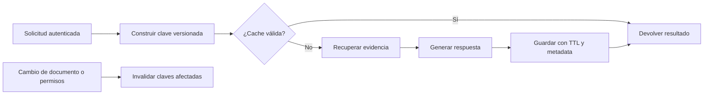

# Capítulo 9. Estrategias de caché

## ¿Por qué importa?

Un sistema RAG suele repetir trabajo. Una persona puede reformular la misma pregunta, varios usuarios pueden consultar una política común y una consulta puede necesitar más de una llamada costosa a un proveedor. Una caché guarda un resultado por un tiempo para responder más rápido o evitar repetir una operación. En un flujo RAG puede almacenar embeddings, resultados de recuperación, respuestas generadas o datos auxiliares. Cada capa evita trabajo diferente y tiene un riesgo distinto de servir algo obsoleto.

La analogía es la de un restaurante que guarda a mano una preparación muy pedida. Si el plato se conserva de forma segura, se sirve rápido; si cambia la receta o pasa el tiempo apropiado, vender la porción vieja puede causar una mala experiencia o un problema de salud. En RAG, un documento revocado, un permiso modificado o un modelo cambiado pueden volver incorrecta una respuesta guardada. La caché es una optimización con reglas de validez, no una fuente de verdad.

Importa porque la latencia y el costo pueden bajar, pero también porque introduce estado adicional que hay que invalidar, aislar y observar. Una clave incompleta puede mezclar datos de dos personas. Un tiempo de vida demasiado corto quizá no ahorre nada; uno muy largo puede conservar contenido fuera de vigencia. La decisión correcta comienza por identificar qué operación se repite y qué significa que su resultado siga siendo válido.

## ¿Cómo funciona?

### La ruta de lectura: acierto y fallo

Una aplicación calcula una clave a partir de todos los elementos que determinan un resultado, consulta la caché y devuelve el valor si existe y sigue vigente. Ese caso se denomina *hit* o acierto. Si no hay valor, ocurre un *miss* o fallo: la aplicación calcula el resultado, lo almacena y lo entrega. El tiempo de vida (TTL) marca cuándo un valor puede expirar automáticamente. No debe confundirse expiración con borrado inmediato de cada copia.

En un RAG, se pueden cachear etapas distintas:

1. **Embedding:** evita volver a vectorizar el mismo texto exacto con la misma configuración.
2. **Recuperación:** evita repetir una búsqueda si índice, filtros y parámetros no cambiaron.
3. **Respuesta generada:** evita otra llamada al generador para una consulta que produce el mismo resultado válido.
4. **Metadata de aplicación:** guarda configuraciones o permisos calculados, con límites de frescura propios.

El valor de cada capa depende de cuántas solicitudes se repiten y del costo de recalcular. Cachear embeddings de consultas diversas puede tener poca tasa de acierto; cachear respuestas repetidas sobre una política estable puede resultar útil. Medir antes de seleccionar una capa evita almacenar datos sin reducir la carga.



La figura muestra la ruta de una respuesta. En la práctica, la recuperación y la generación pueden cachearse separadamente para poder identificar cuál generó el ahorro y cuál ocasionó un resultado obsoleto.

### Qué debe formar parte de la clave

La clave identifica un resultado lógico. Para un embedding de texto, debería distinguir modelo, revisión, dimensión, normalización y contenido. Para una respuesta final, también importan la pregunta canonicalizada, su `locale`, la versión de la regla de canonicalización, el corpus o versión de los documentos, filtros de acceso, configuración del recuperador, versión del prompt, modelo generativo y parámetros de generación. La canonicalización debe ser determinista y aplicarse con la misma regla al escribir y consultar la caché. Sólo debe unificar diferencias de representación que no cambien la consulta: conservar acentos, negaciones, cifras, identificadores, distinciones del idioma y cualquier otra diferencia que pueda alterar la recuperación o la respuesta. Versionar la regla permite invalidar entradas cuando cambia esa semántica. Si cualquiera de esas entradas cambia, el resultado anterior puede no corresponder a la solicitud nueva.

El campo `locale` ya forma parte de las consultas de [`datos/evaluacion.jsonl`](../datos/evaluacion.jsonl); el set actual usa `es`. Reutilizá ese valor al evaluar y no infieras el idioma únicamente desde el texto: la misma cadena puede producir resultados distintos según el locale declarado.

El aislamiento de usuarios merece atención especial. Dos usuarios con permisos diferentes pueden formular la misma pregunta. Si la caché de respuesta se identifica sólo por el texto de esa pregunta, una persona puede recibir una respuesta construida con pasajes que sólo otra persona podía consultar. La clave debería incluir un identificador seguro de ámbito de autorización, o el diseño debería guardar únicamente resultados que sean verdaderamente públicos y aplicar el filtrado antes de servirlos. Incluir el `tenantId` provisto libremente por el navegador no demuestra que ese usuario pertenezca al tenant.

No es necesario concatenar información sensible en texto plano como clave. Para una respuesta, calculá `questionHash` sobre la pregunta canonicalizada; mantené `locale` y `canonicalizationVersion` como componentes explícitos de la clave. Un hash criptográfico reduce exposición accidental en herramientas de inspección, pero no transforma un dato de baja entropía en secreto: una pregunta común puede adivinarse probando hashes. También hay que limitar el tamaño de claves y valores y no almacenar tokens de autenticación.

Una clave conceptual para una respuesta podría componerse así:

```text
answer:v4:<scopeHash>:<indexVersion>:<retrieverConfig>:<promptVersion>:<chatModel>:<locale>:<canonicalizationVersion>:<questionHash>
```

La versión de clave `v4` funciona como un interruptor de invalidación global: si el formato o semántica de la clave cambian, se incrementa esa versión y las entradas anteriores dejan de consultarse. `canonicalizationVersion` es independiente: identifica la regla determinista usada para preparar la pregunta. `scopeHash` debe derivarse del ámbito de autorización resuelto por el servidor a partir de una identidad validada; no debe confiar en un `tenantId` libre enviado por el cliente. La caducidad posterior libera espacio. Si la clave no incorpora un dato de vigencia relevante, agregar una versión no corrige esa omisión.

### Frescura e invalidación

El TTL es sencillo: una respuesta desaparece después de un período máximo. Es adecuado para resultados que toleran una antigüedad conocida o que tienen un cambio poco frecuente. El TTL no sabe que un documento cambió a mitad de ese período. Si las modificaciones deben reflejarse rápido, se necesita invalidación dirigida, por ejemplo borrar las claves relacionadas a un documento o cambiar una versión global del corpus.

La invalidación dirigida puede ser difícil cuando un valor deriva de varios pasajes, filtros y documentos. Es útil conservar metadatos de dependencia junto con el resultado, como `indexVersion`, IDs de pasajes y alcance de acceso. Otra opción es emplear versionado: cada actualización de colección aumenta la versión del índice, y una clave nueva evita consultar respuestas calculadas con la versión anterior. El control de versiones debe actualizarse de manera atómica con la publicación del índice; de lo contrario una solicitud puede observar el número nuevo y contenido viejo, o a la inversa.

El borrado de seguridad o cumplimiento no debería depender de que una respuesta expire algún día si la política exige retirar el dato ahora. Hay que purgar o volver inalcanzables las entradas afectadas, los registros derivados y las copias que correspondan. Para determinar el alcance de eliminación, se necesita conocer qué claves podrían depender del documento o volver a calcular la caché desde fuentes vigentes. La respuesta cacheada sigue siendo contenido derivado y debe entrar en la política de retención.

| Estrategia | Qué garantiza | Ventaja | Límite |
|---|---|---|---|
| TTL fijo | La entrada no vive más que el plazo configurado | Simple y previsible | Un cambio puede tardar hasta el TTL en reflejarse |
| TTL corto + versión | Reduce antigüedad y permite invalidar por despliegue/corpus | Control global sencillo | Puede producir muchos misses tras subir la versión |
| Invalidación por dependencia | Elimina valores asociados a documentos o eventos | Actualización precisa | Hay que mantener relaciones confiables |
| Sin caché de respuestas | No sirve respuestas previamente generadas | Reduce riesgo de obsolescencia y mezcla | Se repite trabajo y costo |

La política debe escribirse por capa. Por ejemplo, conservar embeddings de documentos mientras el modelo y contenido no cambien puede ser válido durante meses; una respuesta sobre saldo o inventario quizá no debería cachearse, mientras que una respuesta a una política estable puede vivir algunos minutos con una versión del corpus. Los plazos son decisiones del producto, no valores universales.

### Dónde ubicar la caché

Una variable en memoria local es fácil de entender y puede servir para una demostración. Existe sólo en el proceso: reiniciar la aplicación la borra y cada réplica mantiene valores distintos. Tiene el riesgo de crecer sin límite si no se define una política de expulsión. Un `Map` sin TTL ni tamaño máximo es una tabla de ejemplo, no una caché de producción.

Redis y servicios compatibles ofrecen almacenamiento compartido con expiración y estructuras de datos. Permiten compartir entradas entre instancias, aunque la aplicación debe diseñar claves, límites, cifrado/red, autenticación, alta disponibilidad y comportamiento ante pérdida del caché. Un servicio gestionado como ElastiCache delega parte de la operación a AWS; un producto serverless puede variar la conexión, cuotas y forma de cobro. Revisar la documentación y las condiciones actuales del servicio específico.

Una caché distribuida agrega una dependencia de red. El sistema debe definir qué hacer si no responde: para una caché no crítica suele ser preferible continuar calculando desde las fuentes autorizadas, con límites para no saturar proveedores. Esto se denomina *fail open* respecto a la disponibilidad de la caché; no significa abrir permisos. En decisiones de autorización, la caché no puede convertir la ausencia de una respuesta en permiso. La política de seguridad debe fallar de forma segura y validar identidad en un componente confiable.

## ¿Cómo se implementa?

### Una función simple de lectura y escritura

El siguiente ejemplo usa sólo APIs estándar de JavaScript y puede ayudar a comprender el ciclo. Es **conceptual**: carece de límite de memoria, expulsión, persistencia, aislamiento de procesos y tratamiento de valores mutables; no debe copiarse como caché de producción. Su resultado esperado es reutilizar un cálculo durante el TTL en una sola instancia Node.js.

```js
// Ejemplo conceptual, acotado a una sola instancia y proceso.
const entries = new Map();

export async function remember(key, ttlMs, calculate) {
  const cached = entries.get(key);
  if (cached && cached.expiresAt > Date.now()) return cached.value;
  if (cached) entries.delete(key);

  const value = await calculate();
  entries.set(key, { value, expiresAt: Date.now() + ttlMs });
  return value;
}

const response = await remember('answer:v3:demo', 30_000, async () => {
  return { answer: 'La garantía dura dos años.', sources: ['manual:v2:chunk-3'] };
});
```

La operación encapsula el patrón «buscar, calcular, guardar». La primera llamada calcula y almacena; la siguiente, si llega antes de expirar, devuelve el valor guardado. Conviene en un ejercicio local para observar un `hit`, pero no entre varias réplicas ni para datos con permisos diferentes sin construir claves correctas.

### Compartir caché con Redis

En el caso distribuido, se puede usar un cliente Redis mantenido por el proyecto. El repositorio no declara la dependencia `redis` ni ofrece una integración de caché; el ejemplo siguiente es **ilustrativo y no validado**. En una implementación real hay que instalar una versión fijada, abrir y cerrar conexiones correctamente, configurar TLS/credenciales según el proveedor, poner timeout y gestionar la indisponibilidad.

```js
// Ilustrativo: requiere instalar y configurar el cliente `redis`.
import { createClient } from 'redis';

const client = createClient({ url: process.env.REDIS_URL });
await client.connect();

export async function getOrCompute(key, ttlSeconds, calculate) {
  const saved = await client.get(key);
  if (saved !== null) return JSON.parse(saved);

  const value = await calculate();
  await client.set(key, JSON.stringify(value), { EX: ttlSeconds });
  return value;
}
```

`EX` asigna un plazo de expiración en segundos. La codificación JSON facilita valores simples; objetos especiales, tamaños grandes y evolución de esquema requieren una estrategia explícita. Esta versión tiene una condición de carrera: varias solicitudes simultáneas con la misma clave pueden observar el mismo miss y calcular el valor a la vez. En operaciones caras puede implementarse *single-flight* por instancia o un mecanismo distribuido de coordinación con expiración y recuperación ante bloqueo huérfano. No conviene añadir un bloqueo distribuido automáticamente: su complejidad puede costar más que el cálculo que se evita.

La estrategia de error debe impedir que una caída del caché haga caer toda la consulta si el servicio de origen está disponible, pero también debe proteger a ese origen de una avalancha. Se usan límites de concurrencia, circuit breaker, degradación controlada y alertas. Para cachear respuestas, si Redis no está disponible, volver al RAG completo mantiene la funcionalidad pero aumenta la carga; si no hay capacidad, se puede rechazar temporalmente con un error explícito. La política depende de objetivos de servicio y cuotas.

### Diseñar una clave de respuesta segura

Una clave debe ser determinista: dos solicitudes equivalentes bajo exactamente el mismo contexto producen la misma clave. La siguiente función muestra un hash sobre un objeto ordenado de parámetros. Es **código conceptual**: hay que asegurar la serialización canónica, definir normalización de preguntas y obtener el ámbito de permisos desde autenticación del servidor. No incluye datos del usuario dentro de la clave como texto visible.

```js
import { createHash } from 'node:crypto';

function hash(value) {
  return createHash('sha256').update(value).digest('hex');
}

export function answerCacheKey(input) {
  const canonical = JSON.stringify({
    scope: input.authorizedScopeId,
    index: input.indexVersion,
    retriever: input.retrieverVersion,
    prompt: input.promptVersion,
    model: input.chatModel,
    question: input.normalizedQuestion
  });
  return `rag:answer:v3:${hash(canonical)}`;
}
```

El campo `authorizedScopeId` representa el alcance efectivo de documentos permitidos, no necesariamente una identidad individual. Si los permisos difieren por usuario, roles, grupo o documento, la clave debe distinguir esas combinaciones o la entrada sólo puede contener información común. Si ese alcance cambia, debe cambiar su versión o huella. Una clave demasiado amplia arriesga fuga; una demasiado estrecha reduce aciertos pero conserva separación. Ante duda, priorizar el aislamiento correcto y medir luego la tasa de reutilización.

La pregunta también puede contener datos personales. El hash limita la exposición literal de ese texto en herramientas que muestran claves, pero la caché almacena el valor de respuesta y sus fuentes, que pueden ser más sensibles. Aplicar controles de red, credenciales de mínimo privilegio, políticas de retención y protección de backups. No registrar valores cacheados completos en logs de depuración.

### Cachear embeddings y recuperación

El embedding de una consulta puede guardarse por hash de texto normalizado, modelo y dimensión. Un embedding de fragmento depende además del contenido exacto y preprocesamiento. Si se conserva en la base junto al punto, normalmente no hace falta otra caché para cada lectura del mismo vector. Un caché en frente del proveedor es más útil cuando la misma entrada vuelve a procesarse, o cuando se separa el vector store del servicio de embeddings.

Una recuperación cacheada debe incorporar versión del índice, métrica, filtros y parámetros como `topK`. Sin estos datos puede retornar resultados de una colección antigua o un conjunto con otro permiso. Si los documentos se actualizan con mucha frecuencia, almacenar candidatos durante un largo plazo puede ser peor que ejecutar una búsqueda rápida. La caché de recuperación no convierte los resultados en vigentes; sólo evita la búsqueda bajo condiciones equivalentes.

Para datos inmutables se puede usar un ID de contenido (hash) como referencia y conservar embeddings hasta que cambie modelo o preprocesamiento. Hay que recordar que un documento puede conservar el mismo texto y cambiar su autorización, fecha efectiva o estado de publicación. Un hash sólo del texto no representa metadata. Actualizaciones a metadata y filtros necesitan actualizar la entrada o su versión aunque el contenido textual sea idéntico.

### Evitar stampede y controlar tamaño

Un *cache stampede* ocurre cuando una entrada popular expira y muchas solicitudes vuelven a calcularla simultáneamente. Algunas medidas son refrescar la entrada un poco antes de expirar, agregar un margen aleatorio al TTL, limitar concurrencia por clave, permitir servir una versión antigua durante un plazo breve mientras se recalcula, o aplicar una coordinación de un solo cálculo. La estrategia de valor antiguo sólo es aceptable si la frescura lo permite y la respuesta sigue dentro del ámbito autorizado.

También hay que limitar tamaño de valores, número de claves y memoria. Una respuesta RAG puede incluir varios pasajes grandes y ocupar mucho más que un embedding o un ID. Se pueden guardar sólo la respuesta y referencias a fuentes, si éstas se pueden volver a cargar de forma segura; o comprimir cuando el costo de CPU y latencia lo justifica. Los límites deben ser visibles: expulsar por LRU o política de Redis ayuda al uso de memoria, pero no reemplaza decidir qué datos se pueden conservar.

## Medición y criterios de decisión

Antes de añadir una caché, registrar latencia y volumen de cada etapa: embedding, recuperación, generación, serialización y transferencia. Luego estimar tasa de acierto por tipo de clave, bytes ocupados, costo evitado, misses, expiraciones, errores y tiempo de invalidación. Una tasa de acierto global puede ocultar que sólo se reutilizan preguntas públicas mientras las solicitudes valiosas siguen fallando.

El ahorro neto compara el costo del cálculo evitado con el almacenamiento, transferencia, operación e impacto de misses coordinados. Una API de embeddings puede ser económica, pero la llamada a generación puede dominar la latencia; en otro sistema, una consulta lenta de base es la etapa crítica. No se deben introducir precios absolutos sin medir y revisar tarifas vigentes. El ejemplo fechado de costos en `REFERENCIAS_VERIFICADAS.md` usa supuestos explícitos y está asociado a modelos que pueden haber cambiado; recalcular antes de usarlo como presupuesto.

| Señal observada | Interpretación posible | Próxima comprobación |
|---|---|---|
| Pocas consultas repetidas y costo bajo | La caché quizá no aporte valor | Medir misses y costo de mantenimiento |
| Alta repetición y latencia de proveedor alta | Candidato para cachear embedding o resultado | Verificar clave, aislamiento y frescura |
| Muchos misses simultáneos en expiración | Stampede o TTL sincronizado | Mirar concurrencia y dispersar expiraciones |
| Respuestas diferentes con la misma pregunta | Contexto/índice/permisos no están en la clave o la generación es variable | Comparar fuentes, prompt y configuración |
| Entrada se sirve después de un cambio | Invalidación incompleta | Revisar versiones y dependencias del resultado |
| Aciertos sólo en una réplica | Caché en memoria local | Evaluar una caché compartida o aceptar el comportamiento |

No toda respuesta debe ser determinista. El muestreo de generación puede producir salidas ligeramente distintas aun con el mismo contexto. Cachear fija una realización concreta para el TTL. Eso puede ser útil para consistencia, pero puede no cumplir una expectativa de diversidad o personalización. Hay que acordar el comportamiento con el producto y preservar fuentes, sello de versión y fecha de cálculo cuando se ofrece una respuesta cacheada.

## Errores frecuentes y buenas prácticas

- **Usar sólo la pregunta como clave.** Añadir índice, modelo, prompt, filtros y ámbito de autorización que afectan el resultado.
- **Asumir que el TTL invalida inmediatamente.** TTL establece un máximo de vida; los cambios sensibles necesitan invalidación explícita.
- **Compartir respuestas entre usuarios sin revisar permisos.** Derivar el alcance del contexto autenticado y probar la separación entre tenants.
- **Guardar claves API o tokens en caché.** Sólo almacenar datos necesarios y controlar acceso al servicio.
- **Usar un `Map` ilimitado en un servidor real.** Definir límite, expiración, política de expulsión y comportamiento con varias réplicas.
- **Añadir Redis sin política de caída.** Definir timeout, límites de concurrencia y degradación cuando el caché no está disponible.
- **Ignorar cálculos concurrentes.** Medir stampede antes de incorporar bloqueos distribuidos.
- **Tratar respuestas cacheadas como evidencia actual.** Registrar IDs de fuentes y versiones para rastrear el origen.
- **Cachear un resultado sensible durante demasiado tiempo.** El plazo depende de dominio, cambios y exigencia de revocación.
- **Calcular ahorro desde precio de lista sin uso real.** Medir tasas, volumen, tokens y costo total con valores vigentes.

## Ejercicios prácticos

1. **Elegí una capa.** Sobre el flujo del capítulo 3, señalá qué etapa se repite y qué costo o latencia evitaría una caché.
2. **Diseñá tres claves.** Escribí claves conceptuales para embedding, recuperación y respuesta. Enumerá qué cambio debe producir un miss en cada una.
3. **Prueba de aislamiento.** Dos usuarios hacen la misma pregunta y tienen permisos diferentes. Describí un test que pruebe que el segundo no recibe fuentes ni respuesta derivadas del primero.
4. **Elegí TTL o versión.** Para una política laboral, precios de catálogo e inventario actual, proponé una estrategia distinta y explicá el tiempo de obsolescencia tolerable.
5. **Simulá una caída.** Documentá qué pasa si Redis no responde, si la generación supera el timeout y si cien solicitudes llegan a la vez luego de expirar una clave popular.
6. **Definí telemetría.** Proponé métricas de hit/miss, latencia, invalidación y errores que no requieran guardar preguntas privadas en claro.

## Referencias y continuidad

- Redis, [documentación de expiración de claves](https://redis.io/docs/latest/commands/expire/) y [guía de caché](https://redis.io/docs/latest/develop/use/patterns/): TTL y patrones de uso.
- Amazon Web Services, [Amazon ElastiCache](https://docs.aws.amazon.com/AmazonElastiCache/latest/dg/WhatIs.html): descripción y operación del servicio administrado.
- Repositorio de acompañamiento, `backend/src/core.js`, `backend/src/server.js` y `VALIDATION.md`: flujo actual y ausencia de integración de caché.
- Lewis et al., [*Retrieval-Augmented Generation for Knowledge-Intensive NLP Tasks*](https://arxiv.org/abs/2005.11401): arquitectura original que combina recuperación con generación.

El [capítulo 7](book-es-cap7.md) explica cómo versionar modelos de embeddings; el [capítulo 8](book-es-cap8.md) cubre filtros y ciclo de vida en el almacén vectorial; el [capítulo 10](book-es-cap10.md) continúa con modelos locales y remotos; los capítulos [12](book-es-cap12.md) y [18](book-es-cap18.md) tratan producción y observabilidad. Los ejemplos con Redis y las decisiones de TTL son conceptuales: este repositorio no trae cliente Redis ni lógica de invalidación y requieren integración, pruebas de carga y pruebas de acceso antes de usarse.
