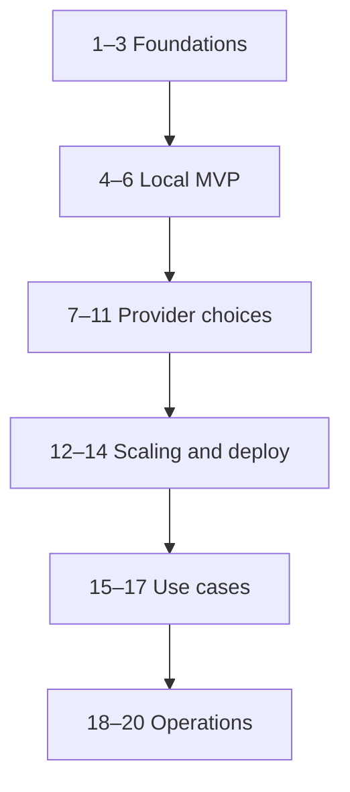

# Mapa maestro / Master reading map

## Español

1. **Primera hora:** capítulos 1–3, conceptos, vocabulario y arquitectura.
2. **Primer MVP:** capítulos 4–6, `sh scripts/setup-dev.sh`, ingesta y consultas.
3. **Elegir herramientas:** capítulos 7–11, comparar costos, recuperación y privacidad.
4. **Preparar producción:** capítulos 12–14, identificar autenticación, backup, infraestructura y límites.
5. **Casos y operación:** capítulos 15–20, evaluar rendimiento y troubleshooting.

## English

1. **First hour:** chapters 1–3, terminology and architecture.
2. **First MVP:** chapters 4–6, `sh scripts/setup-dev.sh`, ingestion and queries.
3. **Provider choices:** chapters 7–11, compare cost, retrieval and privacy.
4. **Production preparation:** chapters 12–14, authentication, backup, infrastructure and limits.
5. **Use cases and operations:** chapters 15–20, performance evaluation and troubleshooting.

